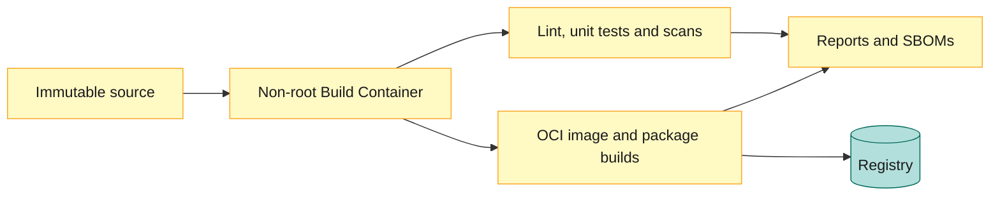

# Build Container

> Pinned disposable toolchain for GitHub Actions and Act. Owner: varunpathania86 · Status: active

## Overview

## Quick start

- `make lint`
- `make test-unit`
- `make scan`
- `make act-build MODE=worktree`

## Structure

| Path | Purpose |
|---|---|
| `Containerfile` | Pinned Ubuntu Build Container definition |
| `README.md` | Build boundary and operation overview |

## Configuration

Tool and base-image versions come from `.tool-versions`, `requirements-ci.txt` and `versions.yml`.
The image runs as a non-root user and preloads Trivy and pre-commit caches.

## Operations

The Workspace creates an immutable source snapshot. The container receives `/source` read-only, copies
it to disposable `/workspace`, and writes only to `/output`. Build Containers are destroyed after use.
Do not add application services, Kubernetes, deployment CLIs or runtime state to this image.

## Tests

`make lint test-unit scan` validates the Build Container contract. `make act-build` exercises the same
image through workflow jobs.

## Related

[CI LLD](../../docs/lld/ci.md) · [CI scripts](../../scripts/ci/README.md) · [Act orchestration](../../scripts/act/README.md)
