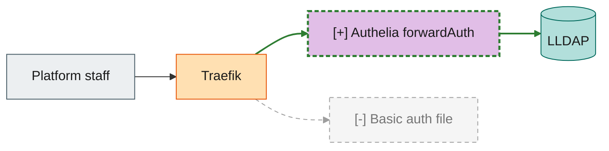

## Summary

<!-- What and why. Link the issue and the stage (master-plan.md §12) if any. -->

## Change diagram

<!-- Required for architecture, deployment or data-flow changes; optional otherwise. ≤ 10 nodes.
Replace the example. Added node: "[+]" label + its component class (`make fix-docs` adds the green
dashed border); untyped added step: :::new. Removed node: "[-]" label + :::removed. Links are counted
from 0: added links get the green linkStyle, removed links are -.-> with the grey linkStyle.
Write only `class` and `linkStyle` lines; `make fix-docs` adds the rest (master-plan.md §11.6). -->

## Changes

- **core:**
- **erp:**
- **edu:**
- **repo / CI / docs:**

## Tests

<!-- Commands run and new/updated tests; benchmark result links if resources changed. -->

- [ ] `make lint test-unit`
- [ ] `make scan` (images or dependencies changed)
- [ ] `make test-integration` (deployable behaviour changed)

## Docs & instructions updated

- LLD: <!-- docs/lld/<area>.md — required for features -->
- READMEs:
- `.github/instructions/*` / `AGENTS.md`:
- ADR proposed: <!-- only if master-plan.md §11.3 criteria apply; otherwise "No" -->

## Risk, rollback & data impact

<!-- Tenants affected, migrations, backup/restore notes, rollback steps. -->

## Checklist

- [ ] No secrets (except Vault-encrypted files) and no real personal or tenant data
- [ ] Upstream Gibbon/ERPNext code untouched (patches only)
- [ ] Trivy clean, or findings justified in `.trivyignore` with reason + expiry
- [ ] PR title is a plain sentence (≤ 72 characters, no `feat:` prefix)
