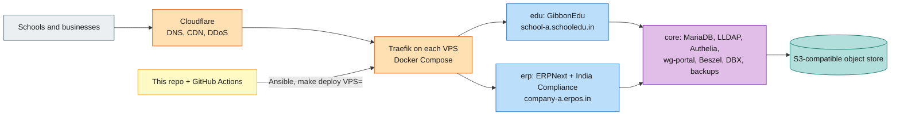

# nigu-lite

> Free, ad-supported ERPNext (India GST) and GibbonEdu hosting for many tenants on low-end VPSs.
> Owner: varunpathania86 · Status: experimental (Stage 2 — local environment)

## Overview



One YAML manifest per VPS (`deployments/<vps>.yml`) selects which tenants of which product run there.
The full design, decisions and stages are in [master-plan.md](master-plan.md).

## Quick start

Prerequisites: `git` and `make`; `make setup` installs everything else.

```bash
make setup      # install all developer tools and git hooks (idempotent)
make doctor     # check the machine without changing it
make lint       # pre-commit in an ephemeral Build Container
make test-unit  # unit tests in an ephemeral Build Container
make act-build  # execute the Build workflow through Act
make local-up local-deploy  # start and configure the local VPS simulator
make test-integration      # verify SSH, Docker, Traefik and Garage
make help       # all targets
```

## Structure

| Path | Purpose |
|---|---|
| [`AGENTS.md`](AGENTS.md), [`.github/instructions/`](.github/instructions/) | Rules for AI tools, indexed by task |
| [`docs/`](docs/) | ADRs, LLDs, SDD, developer docs and templates |
| [`core/`](core/), [`erp/`](erp/), [`edu/`](edu/) | Shared platform services and the two products |
| [`scripts/`](scripts/) | Scripts called by the Makefile and git hooks |
| [`tests/`](tests/) | Unit, local integration and future benchmark suites |
| [`deployments/`](deployments/) | Validated VPS manifests and future digest locks |
| [`local/`](local/) | Local VPS simulator and ephemeral Operations Container |
| [`policy/`](policy/) | Advisory rendered-IaC rules and accepted findings |
| [`versions.yml`](versions.yml), [`.tool-versions`](.tool-versions) | Image/artifact pins and CLI tool pins |

The delivery flow is Workspace snapshot → ephemeral Build Container → registry → Operations Container →
runtime. The Workspace Container does not build or deploy services. Stage 2 proves the Operations
Container and a local simulator; production deployment remains out of scope.

## Configuration

Secrets live only in Ansible Vault files. This repository is public: never commit plain secrets or
personal data.

## Operations

Production deployment remains out of scope. `make local-up local-deploy` starts the isolated simulator
and serves `https://test-school-a.localhost:8443`; `make local-status` checks the complete local path.

## Tests

`make test-unit` runs [`tests/unit/`](tests/unit/) inside a disposable Build Container.
`make test-integration` exercises SSH, inner Docker, Traefik and Garage through the local simulator.
`make act-build` exercises the GitHub workflow locally without pushing source.

## Related

- [Contributing and conventions](docs/developer/getting-started.md)
- [Baseline ADR](docs/adr/0001-platform-baseline.md)
- [CI LLD](docs/lld/ci.md) · [Manifest LLD](docs/lld/tenant-manifest.md) · [Local environment LLD](docs/lld/local-environment.md)
- [Security policy](SECURITY.md) · [Licence: AGPL-3.0](LICENSE)
