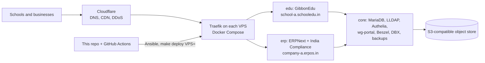

# nigu-lite

> Free, ad-supported ERPNext (India GST) and GibbonEdu hosting for many tenants on low-end VPSs.
> Owner: varunpathania86 · Status: experimental (Stage 0 — repository foundation)

## Overview



One YAML manifest per VPS (`deployments/<vps>.yml`) selects which tenants of which product run there.
The full design, decisions and stages are in [master-plan.md](master-plan.md).

## Quick start

Prerequisites: `git`, `make`, `docker`, [mise](https://mise.jdx.dev/).

```bash
make setup      # install pinned tools (.tool-versions) and git hooks
make lint       # pre-commit on all files
make test-unit  # unit tests
make help       # all targets
```

## Structure

| Path | Purpose |
|---|---|
| [`AGENTS.md`](AGENTS.md), [`.github/instructions/`](.github/instructions/) | Rules for AI tools, indexed by task |
| [`docs/`](docs/) | ADRs, LLDs, SDD, developer docs and templates |
| [`core/`](core/), [`erp/`](erp/), [`edu/`](edu/) | Shared platform services and the two products |
| [`scripts/`](scripts/) | Scripts called by the Makefile and git hooks |
| [`tests/`](tests/) | Unit tests now; integration tests and benchmarks from later stages |
| [`versions.yml`](versions.yml), [`.tool-versions`](.tool-versions) | Image/artifact pins and CLI tool pins |

Planned folders (`deployments/`, `local/`, `policy/`) are added by the stage that needs them (master-plan.md §12).

## Configuration

Secrets live only in Ansible Vault files. This repository is public: never commit plain secrets or
personal data.

## Operations

Not deployable yet. Progress follows the stages in master-plan.md §12.

## Tests

`make test-unit` runs the unit tests in [`tests/unit/`](tests/unit/). See [tests/README.md](tests/README.md).

## Related

- [Contributing and conventions](docs/developer/getting-started.md)
- [Baseline ADR](docs/adr/0001-platform-baseline.md)
- [Security policy](SECURITY.md) · [Licence: AGPL-3.0](LICENSE)
