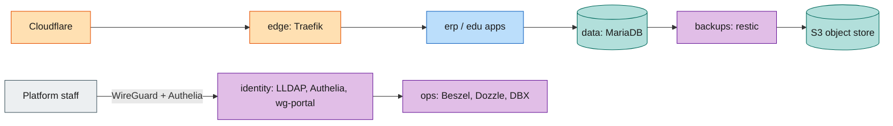

# core

> Shared platform services on every VPS. Owner: varunpathania86 · Status: experimental (planned for Stage 3)

## Overview

## Quick start

Not deployable yet. From Stage 3: `make local-deploy`, then `make deploy VPS=<vps>`.

## Structure

Planned: `ansible/` (roles `host`, `edge`, `data`, `identity`, `backups`, `metrics`, `cloudflare`) and `scripts/`.

## Configuration

Selected per VPS by `core_services` in `deployments/<vps>.yml`; variables in `group_vars`; secrets in Vault.

## Operations

See master-plan.md §4 (services), §3.4 (Cloudflare) and §13.1 (staff access matrix).

## Tests

Integration tests from Stage 3: health, per-tenant DB provisioning, backup → restore, access matrix.

## Related

[Baseline ADR](../docs/adr/0001-platform-baseline.md) · master-plan.md §3, §4, §13
