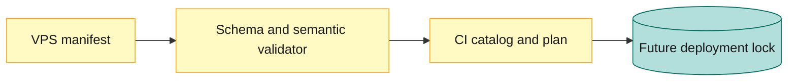

# deployments

> Validated VPS manifests and immutable deployment contracts. Owner: varunpathania86 · Status: active

## Overview

## Quick start

Run `make manifest-validate` to validate repository manifests and test tenants.

## Structure

| Path | Purpose |
|---|---|
| `schema.json` | JSON Schema for VPS manifests |
| `tenant.schema.json` | JSON Schema for tenant definitions |
| `local.yml` | Stage 2 local simulator manifest |
| `<vps>.yml` | One explicit service and tenant selection per VPS |
| `<vps>.lock.yml` | Generated immutable artifact locks in later stages |

## Configuration

Every key is explicit. There are no defaults. Production requires Cloudflare DNS and Let's Encrypt TLS.
The local manifest uses self-signed TLS, no DNS provider and synthetic test tenants only.

## Operations

CI validates manifests before planning. `make local-up local-deploy` uses `local.yml` to prove SSH and
Ansible delivery without starting production roles. Production deployment remains out of scope and must
later use a generated lock with verified signatures.

## Tests

`make test-unit` runs schema, semantic and rendering fixtures.

## Related

[Tenant manifest LLD](../docs/lld/tenant-manifest.md) · master-plan.md §7.1
