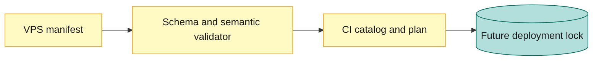

# deployments

> Validated VPS manifests and immutable deployment contracts. Owner: varunpathania86 · Status: active

## Overview

## Quick start

Run `make manifest-validate` to validate repository manifests and test tenants.

## Structure

| Path | Purpose |
|---|---|
| `schema.json` | JSON Schema for VPS manifests |
| `tenant.schema.json` | JSON Schema for tenant definitions |
| `<vps>.yml` | One explicit service and tenant selection per VPS |
| `<vps>.lock.yml` | Generated immutable artifact locks in later stages |

## Configuration

Every key is explicit. There are no defaults. Production requires Cloudflare DNS and Let's Encrypt TLS.
Exactly one production VPS hosts the control plane.

## Operations

Stage 1 validates manifests before CI planning. Deployment remains out of scope. Future deployments
must use the generated lock and verify signatures before remote work.

## Tests

`make test-unit` runs schema, semantic and rendering fixtures.

## Related

[Tenant manifest LLD](../docs/lld/tenant-manifest.md) · master-plan.md §7.1
