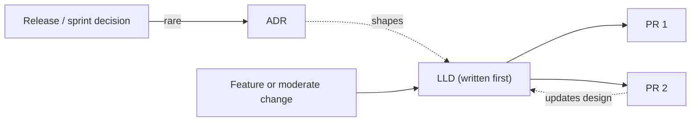

# Documentation

> Where each kind of document lives and when it is required (master-plan.md §11.3).

| Folder | Type | Required when |
|---|---|---|
| [`adr/`](adr/) | Architecture Decision Records | **Rare**: release- or sprint-level decisions; owner-approved, never created by AI unprompted |
| [`lld/`](lld/) | Low-Level Designs | **Before** implementing a feature or moderate change; one LLD spans several PRs |
| [`sdd/`](sdd/) | System Design Descriptions | System boundaries, products or trust zones change |
| [`developer/`](developer/) | Developer docs | Setup, workflows, runbooks, troubleshooting |
| [`templates/`](templates/) | Templates for all of the above, READMEs, tenants and VPS manifests | Always start from a template |

## Index

- ADR [0001 — Platform baseline](adr/0001-platform-baseline.md) (accepted)
- [Getting started](developer/getting-started.md)
