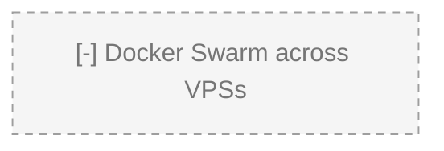
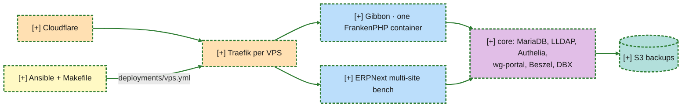

# 0001 — Build nigu-lite on Docker Compose, Ansible and shared multi-tenant runtimes

## Context and problem statement
ERPNext (India GST) and GibbonEdu are offered free of charge to many small tenants, funded later by
compliant advertising. Each low-end VPS (4 vCPU, 8 GB RAM, 300 GB SSD) must host up to 10 schools and
10 ERP companies, operated by one person with AI assistance. An earlier Docker Swarm design added cluster
complexity without benefit for independent VPSs. This record fixes the platform baseline before code exists.
Detail and evidence: [master-plan.md](../../master-plan.md) §1–§4.

## Decision drivers
- Low RAM per tenant on 8 GB VPSs; no cluster control plane.
- Reproducible infrastructure as code, one-person operations.
- Tenant isolation (databases, credentials, routing) without one stack per tenant.
- Free tooling (public repo, Cloudflare free plan, FOSS components).

## Existing solution
None (greenfield). A Docker Swarm design was considered on paper and rejected (option 2).

## Considered options
1. Docker Compose per independent VPS, provisioned by Ansible, shared multi-tenant runtimes (chosen)
2. Docker Swarm or k3s cluster across VPSs
3. One full stack per tenant

## Decision outcome
Chosen: **option 1**, because it meets the RAM target with the least operational complexity. The
individual decisions are listed below as they stood on the decision date; later changes to any of them
need a new ADR that supersedes the affected decision only (master-plan.md §11.3).

### Decisions (27 items, snapshot of master-plan.md §2)

| # | Decision | Alternatives rejected | Rationale |
|---|---|---|---|
| D1 | **Docker Compose v2 per VPS** | Docker Swarm, k3s | VPSs are independent with fixed roles; a scheduler/cluster adds control plane, quorum and overlay-network complexity for no benefit. |
| D2 | **Ansible** for provisioning and deployment | Terraform-only, shell scripts | Agentless, idempotent, Jinja2 templating fits the IaC rules. |
| D3 | **Shared DB engines, one database + user per tenant** | DB container per app | Saves 1–2 GB RAM; isolation per DB credentials. |
| D4 | **MariaDB for tenant apps; separate SQLite databases for LLDAP and Authelia** | MariaDB for identity too; PostgreSQL | ERPNext and Gibbon share MariaDB. Each identity service owns its SQLite file in a separate persistent volume, with no dependency on MariaDB availability and no extra database server. Measure resource use in S3; SQLite does not provide high availability. Adding PostgreSQL later (an app that needs it) is an ADR. |
| D5 | **LLDAP + Authelia** for LDAP + OIDC, **platform staff only** (`admin`, `ops`, `support`) | OpenLDAP + Keycloak | < 100 MB combined vs ~1 GB; YAML-configured (templatable). Tenant users keep native app accounts (D26). |
| D6 | **ERPNext multi-site, one bench** | Stack per company | Frappe's native multi-tenancy; per-tenant cost ≈ disk + DB. |
| D7 | **One FrankenPHP container serving all Gibbon schools** (one Caddy site block per school) | Container per school; Nginx + PHP-FPM pools | Lowest memory; one PHP/web runtime to patch. Isolation via DB credential separation, Caddy path rules and PHP hardening (§5). Fallback to per-school containers if the S4 spike fails security or compatibility checks. |
| D8 | **No public school website in the initial platform scope; school hostnames serve Gibbon only** | Adding a CMS or custom website service | Keeps the product focused on ERPNext and school management; avoids another tenant-facing application, runtime, backup surface and security boundary. Reconsider only as a separately scoped feature. |
| D9 | **Traefik v3 behind the Cloudflare proxy, Let's Encrypt certificates only**, per-manifest **`tls.mode`**: `selfsigned` (local/CI, template value), `letsencrypt-staging`, `letsencrypt`. ACME **DNS-01 via the Cloudflare API**, one wildcard certificate per VPS; Cloudflare SSL mode **Full (strict)**. FrankenPHP's own auto-HTTPS disabled | Cloudflare Origin CA certificates; Let's Encrypt HTTP-01 per host; Caddy as edge | Publicly trusted certificate works for proxied and DNS-only hosts alike; DNS-01 works behind the proxy and the origin lockdown; a wildcard means onboarding a tenant never requests a certificate (§5.1). |
| D10 | **Traefik file provider** for multi-host apps (Gibbon, ERPNext sites) | Docker labels | Adding a tenant reloads Traefik routes without recreating the shared app container. |
| D11 | **No ads on school services and no ad server initially**; evaluate ERP-facing ads only after legal and provider-policy review | School sponsor placements; Revive on VPS-1 | No public school website is in scope, and ads in school management screens are inappropriate. An ad server adds ops/security burden before demand and policy approval. |
| D12 | **Beszel now; Grafana stack later on a dedicated VPS + object store** | Prometheus + Grafana on VPS-1 | Saves ~600 MB+ now; clean upgrade path. |
| D13 | **Logical dumps + restic to off-site S3** | Volume snapshots only | Per-tenant restores; encrypted, deduplicated, versioned. |
| D14 | **Trivy** for vulnerability, misconfiguration, secret and licence scanning (local + CI) | Snyk (proprietary) | FOSS, one tool for images, filesystem, IaC and SBOM. |
| D15 | **pre-commit + .editorconfig** for new code only; upstream code excluded | Lint everything | Upstream Gibbon/ERPNext code is pulled at build time, never committed; our patches and config are linted. |
| D16 | **Task-scoped AI instructions** in `.github/instructions/*.instructions.md`, indexed by root `AGENTS.md` | One large instruction file | Small context for local models; Copilot auto-applies via `applyTo`; Roo Code reads `AGENTS.md` and follows the index. |
| D17 | **Local "VPS" = systemd + Docker inside a container** driven by the same Ansible playbooks | Separate docker-compose dev setup | Tests the real deployment path; VM option for full kernel fidelity. |
| D18 | **DBX Web workbench**, always running on the control-plane VPS, reachable only through the VPN; pinned by version + image digest | CloudBeaver, DbGate; starting it on demand | Already used and pinned in another project; one tool to learn; always available to ops (protection in D27, §4.2). |
| D19 | **Upgrades on Saturdays, one VPS + product at a time** (e.g. `vps-01` edu); old and new Gibbon side by side during the window | Upgrade all VPSs at once; per-school over weeks | Small blast radius, no school-day impact; canary school first, rollback per school = route back + restore snapshot (§5.5). |
| D20 | **Custom images and tenant packages published as signed OCI artifacts in GHCR** (+ `.tar.gz` on GitHub Releases) | Ansible copies tenant files from a checkout; zip in GitHub Packages | Immutable digests, signing, one registry; deploys use exactly what CI tested (§7.4). |
| D21 | **Plain-sentence commit messages and PR titles**, branch prefixes `feature/`, `bugfix/`, `patch/`, … | Conventional Commits | Commit message / PR title becomes the GitHub Actions run name; must read cleanly (§11.5). |
| D22 | **S3-compatible object stores only** (`object_store.type: s3`); MinIO locally, Contabo/B2/R2 in production | Custom adapter layer; provider-native APIs from day one | restic and rclone speak S3; between S3-compatible providers, switching = endpoint + keys. Non-S3 stores (e.g. Azure Blob, native GCS, Swift) need an ADR and a new `type` (§4.5). |
| D23 | **Public repo `nigu-lite` under AGPL-3.0**; public GHCR packages; keyless cosign signing (GitHub OIDC); `main` protected by a ruleset | Private repo on GitHub Free | Free Actions minutes, free public package storage (ERPNext image size no longer a cost), free rulesets and code scanning; AGPL keeps hosted forks open and is compatible with GPL-3.0 upstream code. Everything in the repo and its packages is public: no secrets except Vault-encrypted files, no personal data (§7.4, §13). |
| D24 | **Cloudflare free plan** for DNS, CDN and DDoS on `nigu.in`, `erpos.in`, `schooledu.in`; nigu-lite manages only its VPS, service and tenant records (DNS-only `A` per VPS node, proxied tenant `CNAME`s); public-site records are separate; managed by Ansible via API | Registrar DNS; wildcard records; Cloudflare Tunnel | Offloads static assets and attacks from 8 GB VPSs; tenant moves = one CNAME change, effective at the edge in seconds; no extra container (§3.4). |
| D25 | **wg-portal** (WireGuard + web UI with OIDC via Authelia) at `vpn.nigu.in`, on the control-plane VPS | Tailscale / NetBird, plain WireGuard configs | Self-hosted, one small container, standard WireGuard clients, self-service `.conf`/QR for `ops`/`admin` (§4.3). |
| D26 | **Group-based access for platform staff** (LLDAP `admin`/`ops`/`support` → Authelia rules + OIDC policies); **tenant routers never get Authelia forwardAuth**; all tenant users, including heads/admins, use native app accounts | Authelia in front of tenant portals; LLDAP accounts for tenant users | Tenant SSO is deferred, with no scheduled rollout or tenant OIDC clients. Keeps tenant users isolated from the staff directory (§4.3, §13.1). |
| D27 | **DBX behind VPN allow-list + Authelia + trusted-auth header**, password viewer disabled | DBX own logins; public DBX behind Authelia only | Two independent gates (network + identity) for the most sensitive tool (§4.2). |

### Proposed solution

### Consequences
- Good: one shared PHP runtime and database engine per VPS; per-tenant cost is mostly disk and a database.
- Good: the same Ansible playbooks drive the local simulator and production.
- Bad / accepted trade-off: shared Gibbon container relies on PHP and Caddy isolation controls;
  fallback to per-school containers if the S4 isolation spike fails (D7).
- Bad / accepted trade-off: public repository; everything except Vault-encrypted files is visible.
- Follow-up: LLDs per area (`ci.md`, `tenant-manifest.md`, `gibbon.md`, `erpnext.md`, `capacity.md`).

### Confirmation
Stage exit criteria in master-plan.md §12, the isolation suite (S4) and the §9.1 benchmarks.

## Pros and cons of the options
### Docker Swarm or k3s
- Good: built-in scheduling and service discovery.
- Bad: control plane, quorum and overlay networking for VPSs that never share workloads.

### One full stack per tenant
- Good: strongest isolation.
- Bad: 10 + 10 tenants would not fit in 8 GB RAM.

## More information
- [master-plan.md](../../master-plan.md) §2 (rationale), §5 (Gibbon isolation), §12 (stages)
