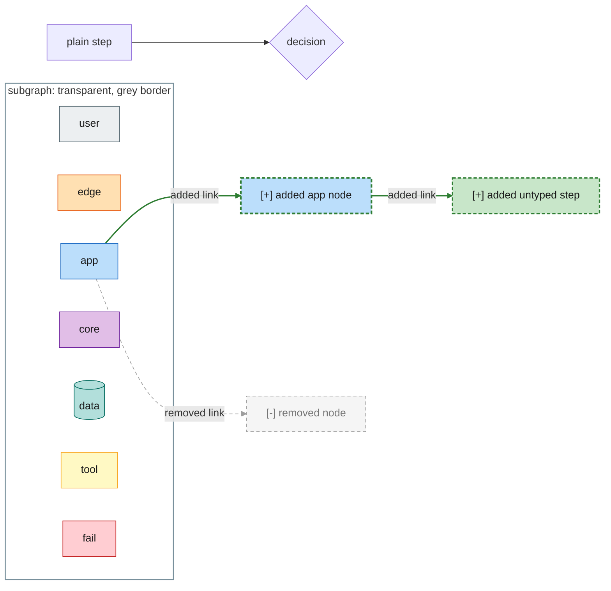

# Diagram style

> Single source of the mermaid colours and styles (rules: master-plan.md §11.6).

GitHub cannot import styles from another file, so every diagram carries its own copy of the lines it
uses. Do not copy them by hand: write `class <ids> <class>`, `[+]` / `[-]` labels and `subgraph <id>`,
then run `make fix-docs`. It adds, corrects and removes the `classDef` lines, the subgraph `style`
lines and the green border `style` of added component nodes from the block below; `make check-docs`
reports anything left. Only `linkStyle` lines are written by hand (they need the link index).

To change a colour, edit only this block and run `make fix-docs`; the change needs an LLD note and is
listed under "Docs & instructions updated" in the PR.

| Class | Use for |
|---|---|
| `user` | People and external clients |
| `edge` | Traffic entry and network access: Cloudflare, Traefik, wg-portal, DNS records |
| `app` | Tenant-facing applications: Gibbon, ERPNext, tenant packages |
| `core` | Shared platform services (the `core/` product): LLDAP, Authelia, Beszel, DBX, backups |
| `data` | Data stores and registries: MariaDB, SQLite volumes, object store, GHCR |
| `tool` | Repo, CI and operator tooling: GitHub Actions, Ansible, Make targets, manifests |
| `fail` | Runtime failure, deny and rollback outcomes |
| Added component (`[+]` + its class) | Change diagrams only: keeps its component fill, green dashed border added by `make fix-docs` |
| `new` | Change diagrams only: added node that is no component (a plain step); label starts with `[+]` |
| `removed` | Change diagrams only: removed node, fully greyed out; label starts with `[-]` |
| Added link | `linkStyle <index> stroke:#2e7d32,stroke-width:2px` on a solid arrow |
| Removed link | `-.->` plus `linkStyle <index> stroke:#9e9e9e,stroke-dasharray:5 4` |
