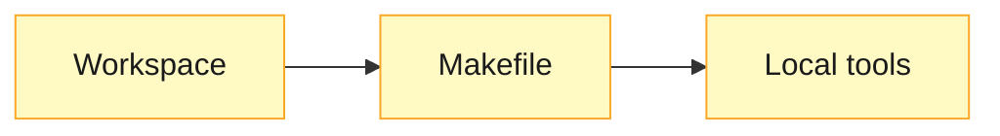
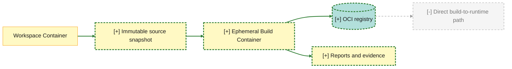
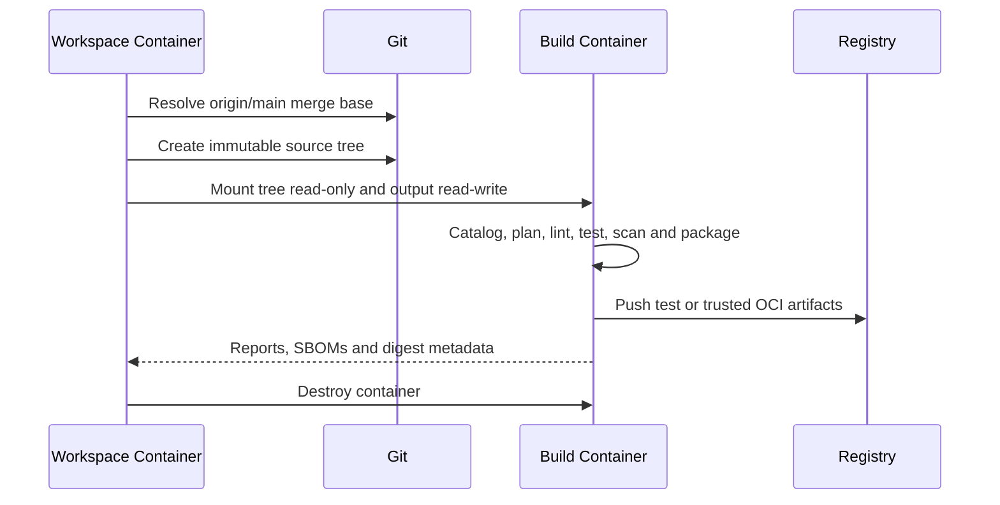

# CI, build and publishing — Low-Level Design

## 1. Summary

Stage 1 establishes a reproducible source-to-artifact chain. The Workspace Container creates an
immutable source snapshot and starts an ephemeral Build Container. Build Containers run the same Make
targets through GitHub Actions and Act. OCI outputs are signed and published to a registry before any
future deployment can consume them.

## 2. Scope

- In scope: CI catalog and planning, build images, Act snapshots, scans, reports, OCI publishing,
  signatures, locks, retention and the `main` ruleset.
- Out of scope: runtime services, local VPS simulation, Ansible deployment, Kubernetes, operations
  tooling and runtime clusters.

## 3. Requirements

| ID | Requirement | Type (functional / non-functional) | Verified by |
|---|---|---|---|
| R1 | GitHub Actions and Act use the same pinned build image and Make targets | reproducibility | Build and Act unit tests |
| R2 | Local commits, staged changes and worktree changes can be tested without a push | functional | snapshot integration tests |
| R3 | Build source is immutable and read-only inside the Build Container | security | snapshot tests |
| R4 | Every workflow writes `report.md` and self-contained `report.html` | functional | report tests |
| R5 | PRs build but never publish production artifacts | security | workflow and permission tests |
| R6 | Published OCI artifacts are scanned and signed before lock resolution | supply chain | publisher and lock tests |
| R7 | Docs-only changes build no modules | efficiency | planner tests |

## 4. Existing solution

None. Stage 0 provides Make targets, pre-commit, Git rules and tool pins, but no CI workflows or
Build Container contract.

## 5. Proposed design

### 5.1 Overview

### 5.2 Components and responsibilities

| Component | Change | Responsibility | Location |
|---|---|---|---|
| Snapshotter | New | Create a Git tree archive from commit, staged index or isolated worktree index | `scripts/ci/snapshot.py` |
| Catalog | New | Inventory images, tenants, VPS manifests and roles | `scripts/ci/catalog.py` |
| Planner | New | Map changed paths to modules and dependencies | `scripts/ci/plan.py` |
| Build image | New | Pin build-only tools in one disposable environment | `.github/build/` |
| Act wrapper | New | Transfer snapshots, run containers and collect outputs | `scripts/act/` |
| Report writer | New | Merge job fragments into Markdown, HTML and JSON | `scripts/ci/report.py` |
| Publisher | New | Package, sign and push OCI artifacts | `scripts/ci/` |

### 5.3 Flows

On failure, the report job still collects completed fragments, marks failed and skipped legs, and
returns a non-zero final status for blocking workflows.

### 5.4 Data and configuration

Catalog entries are validated JSON objects with `id`, `type`, `path`, `inputs` and `dependencies`.
Plans contain a complete module list, affected modules, matrix legs and skip reasons. Every report
fragment follows a versioned JSON schema. No Vault password, signing key or production credential is
accepted by CI.

The source snapshot has modes:

| Mode | Source | Reproducibility |
|---|---|---|
| `commit` | current feature-branch `HEAD` | reproducible from commit |
| `staged` | isolated index tree | not a production commit |
| `worktree` | temporary index with unstaged and untracked files | not reproducible from commit |
| `all` | selected snapshot with all modules forced | snapshot dependent |

### 5.5 Interfaces

- `make ci-catalog`, `make ci-plan BASE=`, `make ci-module ID= TYPE=`
- `make ci-quality`, `make ci-report WORKFLOW=`
- `make act-build MODE=commit`, `MODE=staged`, `MODE=worktree`
- `make registry-up`, `make registry-status`, `make registry-down`
- `build.yml`, `iac-security.yml`, `publish.yml`, `retention.yml`

Every workflow job calls Make targets. GitHub values enter shell commands through environment
variables, not direct expression interpolation.

## 6. Decisions

| # | Decision | Alternatives | Reason | PR |
|---|---|---|---|---|
| L1 | Immutable Git-tree transfer, not a live Workspace bind mount | Act checkout of current directory | Prevents mixed or changing input and Workspace writes | S1 |
| L2 | One pinned CI image used by Actions and Act | Per-job tool installation | Reproducible and faster builds | S1 |
| L3 | Merge base with `origin/main` for PR planning | Head remote or previous commit | Matches PR contents | S1 |
| L4 | Local registry uses non-production test tags | No local publish; direct load into runtime | Proves the registry path without runtime coupling | S1 |
| L5 | Worktree and staged outputs cannot publish production artifacts | Treat all local builds equally | Preserves trusted GitHub OIDC boundary | S1 |
| L6 | Reviewdog consumes the existing Trivy SARIF for PR comments | Duplicate a Trivy scan in another action | More intuitive changed-file reviews without changing the blocking gate | S1 |

## 7. Security, isolation and privacy

PR and local snapshot jobs have read-only source. Registry write permission is granted only to publish
jobs in a trusted `main` or `v*` GitHub context. Fork and Act runs receive no production secrets.
Actions are pinned by SHA. Trivy gates fixed CRITICAL/HIGH vulnerabilities. OCI signatures use keyless
Cosign identity on GitHub. Local registry tags are test-only and must not satisfy deployment checks.

## 8. Resources and performance

Build Containers are parallel and disposable. Caches are optional and external to the container.
Catalog and plan jobs avoid empty matrix work. Runtime capacity is unaffected, so no benchmark is
required for S1.

## 9. Test plan

| Level | Cases | Location |
|---|---|---|
| Unit | snapshot, catalog, planner, reports, package allow-list, locks | `tests/unit/ci/` |
| Workflow | Act pull request, docs-only, invalid manifest and local publish | `tests/act/` |
| Security | fork permissions, scanner findings, source read-only, signature identity | `tests/unit/ci/` |
| Benchmark | N/A: no runtime resources change | N/A |

## 10. Rollout, upgrade and rollback

Implement behind Make targets, then enable each workflow independently. Keep the `main` ruleset
disabled until the required Build report check has passed on a PR. Rollback consists of removing the
ruleset requirement or reverting the workflow PR; no runtime state is affected.

## 11. Observability and operations

Every run has a merged report and retained raw evidence. Scheduled and manual runs have readable run
names. A failed report-generation job is itself blocking. Retention runs report candidates and
deletions in dry-run or execution mode.

## 12. Risks and open points

| Risk / question | Impact | Mitigation / owner |
|---|---|---|
| Act image bootstrap is circular | initial local build unavailable | bootstrap from pinned tools, then pin resulting digest |
| `origin/main` is stale | plan misses newer upstream paths | document `git fetch`; allow explicit `BASE` |
| Local registry is shared on the host | test artifacts persist | isolated project prefix and non-production tags |
| KICS overlaps existing scanners | maintenance cost | retain only after measured S1 evaluation |

## 13. Implementation plan

| Step | PR | Status |
|---|---|---|
| 1 | S1 design | implemented by this stage |
| 2 | Build Container and Act snapshot | planned |
| 3 | Catalog, planner and reports | planned |
| 4 | Workflows, scans and publishing | planned |
| 5 | Ruleset verification | planned |

## 14. Changelog

| Date | PR | Change to this design |
|---|---|---|
| 2026-11-21 | S1 | Defined Workspace, Build Container, registry and snapshot boundaries |
