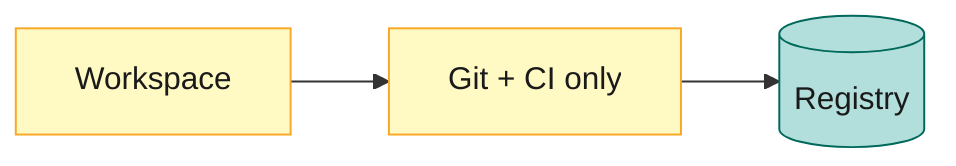
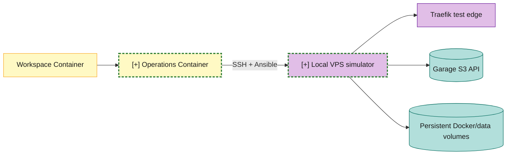
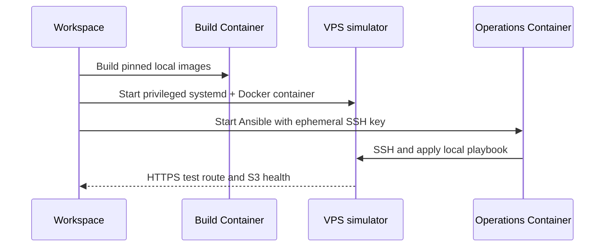

# Local VPS simulator — Low-Level Design

## 1. Summary

Stage 2 creates one disposable VPS simulator so the same SSH and Ansible delivery shape can be
exercised before platform roles exist. The Workspace orchestrates container lifecycle only. A separate
ephemeral Operations Container runs Ansible over SSH into the simulator. A pinned Traefik test route
and Garage S3-compatible service prove the edge, TLS and object-store boundaries.

## 2. Scope

- In scope: systemd + Docker simulator, SSH bootstrap, persistent Docker/data volumes, Ansible
  Operations Container, `deployments/local.yml`, self-signed Traefik route, Garage S3-compatible
  service, Make targets and local integration checks.
- Out of scope: production roles, MariaDB, LLDAP, Authelia, ERPNext, Gibbon, Cloudflare, WireGuard,
  backups and application deployment.

## 3. Requirements

| ID | Requirement | Type | Verified by |
|---|---|---|---|
| R1 | Ansible connects over SSH to a real systemd + Docker container | functional | local integration |
| R2 | The Workspace does not run Ansible or build source images | architecture | command/path tests |
| R3 | `make local-up local-deploy` produces one HTTPS test route | functional | integration smoke test |
| R4 | The local S3 endpoint is compatible with the future backup contract | functional | Garage health and S3 API test |
| R5 | `local-down` preserves data and `local-reset` deletes only local state | data lifecycle | idempotency tests |
| R6 | No runtime secrets or production tenant data enter Git | security | Trivy + fixture scan |

## 4. Existing solution

None. Stage 1 provides CI, validation and Build Containers but no runtime simulator.

## 5. Proposed design

### 5.1 Overview

### 5.2 Components and responsibilities

| Component | Change | Responsibility | Location |
|---|---|---|---|
| Simulator image | New | Ubuntu, systemd, sshd and Docker-in-Docker | `local/Containerfile` |
| Operations image | New | Pinned Ansible and SSH client; no runtime state | `local/operations/Containerfile` |
| Ansible playbook | New | Render and deploy the Stage 2 local stack | `local/ansible/` |
| Lifecycle scripts | New | Start, stop, reset and deploy through Make | `local/scripts/` |
| Local manifest | New | Select test tenants and local-only services | `deployments/local.yml` |

### 5.3 Flows

### 5.4 Data and configuration

All Ansible values live in `local/ansible/group_vars/local.yml`. `deployments/local.yml` is structural
VPS selection. Local S3 credentials are explicit, synthetic and documented as non-secret test values.
SSH keys and Docker volumes live under `.cache/local/` and named Docker volumes; none are committed.

### 5.5 Interfaces

- `make local-up`
- `make local-deploy`
- `make local-status`
- `make local-down`
- `make local-reset`
- `make test-integration`

## 6. Decisions

| # | Decision | Alternatives | Reason | PR |
|---|---|---|---|---|
| L1 | Separate Operations Container | Install Ansible in Workspace | Preserves development/execution separation | S2 |
| L2 | Build simulator images through Build Container | Direct Workspace image build | Same source-to-registry discipline | S2 |
| L3 | Garage for local S3 | unavailable MinIO image | S3-compatible, pinned, single-node test endpoint | S2 |
| L4 | Traefik file provider with generated default certificate | separate local HTTPS proxy | Matches future edge routing shape | S2 |
| L5 | Docker `vfs` storage inside the simulator | nested `overlayfs` | Reliable Docker-in-Docker on an arbitrary host filesystem | S2 |
| L6 | Runtime override to root for systemd PID 1 | sudo-wrapped systemd | `systemd` must own PID 1; the image still declares non-root USER for scanning | S2 |

## 7. Security, isolation and privacy

Only loopback SSH and HTTPS ports are published. The simulator is privileged because Docker-in-Docker
requires it; Sysbox remains the preferred future replacement. It runs as root only at container runtime
so systemd owns PID 1, while the image declares UID 1000 and Trivy scans it accordingly. The local
`ops` account has passwordless sudo for the disposable simulator so the Operations Container can run
real Ansible tasks. Test credentials cannot access any external service. The `.cache/local/` key and
generated state are gitignored.

## 8. Resources and performance

The local simulator is intended for a 16 GB development machine and capped by its Docker stack. Stage 2
adds no acceptance benchmark; its purpose is deployment fidelity, not capacity. S3+ adds resource
benchmarks.

## 9. Test plan

| Level | Cases | Location |
|---|---|---|
| Unit | local manifest, variable/template contract, lifecycle helper behavior | `tests/unit/local/` |
| Integration | SSH, Docker, HTTPS route, Traefik and Garage health, reset | `tests/integration/` |
| Benchmark | N/A | N/A |

## 10. Rollout, upgrade and rollback

Stage 2 is opt-in and uses dedicated `nigu-local-*` names. `local-down` removes only the simulator
container and retains its data. `local-reset` removes the dedicated container, network and volumes.
Rollback is re-run after `make local-reset`; no production state exists.

## 11. Observability and operations

`make local-status` reports container state, Docker state, SSH, Traefik and Garage health. Scripts stop
with explicit errors and never silently continue after a failed health check.

## 12. Risks and open points

| Risk / question | Impact | Mitigation / owner |
|---|---|---|
| Privileged local container | broad local daemon access | loopback-only ports, dedicated instance and reset command |
| Docker storage differs from host VPS | lower kernel fidelity | tagged limitations; VM path remains future optional |
| Garage differs from MinIO | provider-specific edge cases | tests use the S3 API only; replace image without changing contract |

## 13. Implementation plan

| Step | PR | Status |
|---|---|---|
| 1 | LLD and simulator images | approved |
| 2 | Ansible local stack | implemented |
| 3 | Lifecycle and integration tests | implemented |

## 14. Changelog

| Date | PR | Change to this design |
|---|---|---|
| 2026-11-23 | S2 | Added local simulator, Operations Container and S3-compatible test stack |
| 2026-11-23 | S2 | Implemented runtime host keys, vfs nested storage and passing end-to-end checks |
