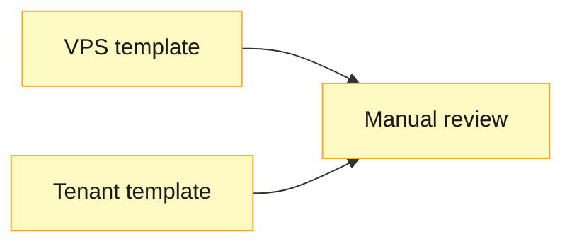
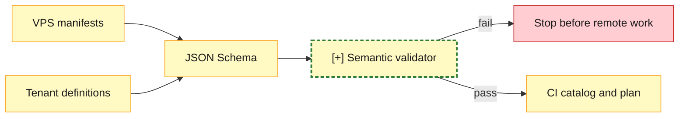
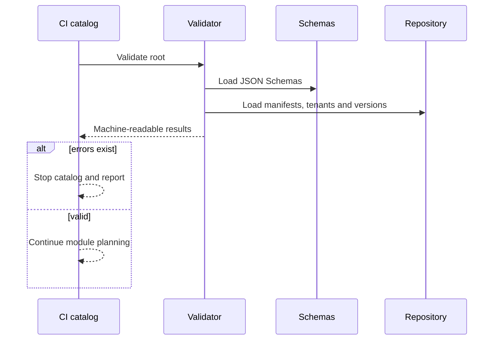

# Tenant and VPS manifests — Low-Level Design

## 1. Summary

This design adds explicit schemas and a semantic validator for VPS and tenant manifests. CI validates
the full repository relationship graph before planning modules. The same validator is the future
deployment preflight gate and always fails before any remote task.

## 2. Scope

- In scope: VPS schema, tenant schema, tenant package structure, repository-wide validation,
  deterministic rendering fixtures and test tenants.
- Out of scope: tenant onboarding, Ansible deployment, DNS changes and application runtimes.

## 3. Requirements

| ID | Requirement | Type | Verified by |
|---|---|---|---|
| R1 | Every required value is explicit | configuration | schema fixtures |
| R2 | Tenant placement is unique across manifests | semantic | validator tests |
| R3 | Capacity and control-plane rules are enforced | semantic | boundary tests |
| R4 | Product and Gibbon version references are valid | semantic | version fixture tests |
| R5 | Plaintext Vault data and secrets fail validation | security | encryption/package tests |
| R6 | `VPS=` is required by deploy entry points | safety | Make guard tests |
| R7 | Synthetic test tenants use the same schema as production tenants | parity | shared validator tests |

## 4. Existing solution

Stage 0 has manifest and tenant templates but no `deployments/` directory, schema or executable
validator.

## 5. Proposed design

### 5.1 Overview

### 5.2 Components and responsibilities

| Component | Change | Responsibility | Location |
|---|---|---|---|
| VPS schema | New | Structural validation of deployment documents | `deployments/schema.json` |
| Tenant schema | New | Structural validation of tenant definitions | `deployments/tenant.schema.json` |
| Validator | New | Cross-file semantic checks and stable error codes | `scripts/manifests/validator.py` |
| Render fixtures | New | Safe dummy-secret inputs for future templates | `tests/fixtures/` |
| Test tenants | New | Two synthetic tenants per product | `tests/tenants/` |

### 5.3 Flows

### 5.4 Data and configuration

VPS manifests require `schema_version`, `host`, `environment`, `public_ip`, `node_record`,
`control_plane`, DNS, TLS, WireGuard, upgrade day, core services and product selections. Tenant
definitions require schema version, display name, product, domains, apps and explicit product
configuration. No code field has a default.

Semantic rules include reserved IDs, unique tenant placement, at most ten tenants per product,
exactly one Gibbon canary, explicit Gibbon versions and production-only DNS/TLS combinations.

### 5.5 Interfaces

- `make ci-catalog`
- `make manifest-validate ROOT=`
- future `make deploy VPS=`
- validator JSON output for CI reports

## 6. Decisions

| # | Decision | Alternatives | Reason | PR |
|---|---|---|---|---|
| L1 | JSON Schema plus Python semantic validation | schema only or Python only | Separates structural and relational checks | S1 |
| L2 | Validator scans the repository without network access | remote/deployment inspection | Keeps unit tests deterministic | S1 |
| L3 | Stable error codes and paths in JSON output | human text only | Enables CI mapping and reports | S1 |
| L4 | Test tenants reuse production schema | separate test schema | Prevents test-only drift | S1 |

## 7. Security, isolation and privacy

Validation rejects plaintext `vault.yml`, secret-like keys in package allow-lists and real-data
patterns in synthetic fixtures. Validator messages must not print Vault contents. Tenant packages
remain public, so the allow-list excludes secrets even when a repository scan is otherwise clean.

## 8. Resources and performance

Validation reads a small set of YAML and JSON files and is offline. The complete catalog must complete
within CI's short validation job. No runtime benchmark is needed.

## 9. Test plan

| Level | Cases | Location |
|---|---|---|
| Unit | valid input, each schema rejection, cross-file conflicts and boundaries | `tests/unit/manifests/` |
| Rendering | dummy secrets, deterministic output, no production values | `tests/unit/manifests/` |
| Integration | N/A in S1 | N/A |
| Benchmark | N/A | N/A |

## 10. Rollout, upgrade and rollback

Introduce the validator before workflows depend on the catalog. Schema versions are explicit. A
future schema migration adds a new schema and validator branch with fixtures; it does not silently
change an existing version.

## 11. Observability and operations

Validation errors include code, file, JSON path and message. CI reports group errors by file and
code. No host task runs after any validation error.

## 12. Risks and open points

| Risk / question | Impact | Mitigation / owner |
|---|---|---|
| Current tenant template may lack product-specific fields | schema expansion later | keep version 1 narrow and test fixtures explicit |
| Production manifests do not exist | control-plane rule can be vacuous | apply rule when production manifests exist |

## 13. Implementation plan

| Step | PR | Status |
|---|---|---|
| 1 | Schemas and validator | planned |
| 2 | Test tenants and render fixtures | planned |
| 3 | CI catalog integration | planned |
| 4 | Future deploy preflight integration | later stage |

## 14. Changelog

| Date | PR | Change to this design |
|---|---|---|
| 2026-11-21 | S1 | Added schema and semantic validation design |
