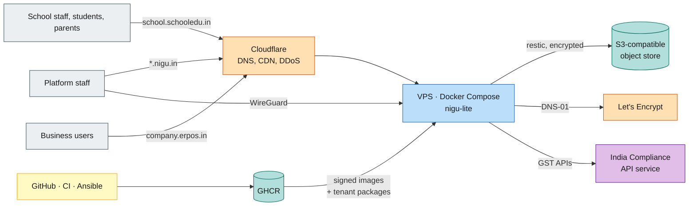
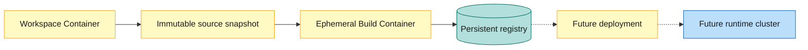
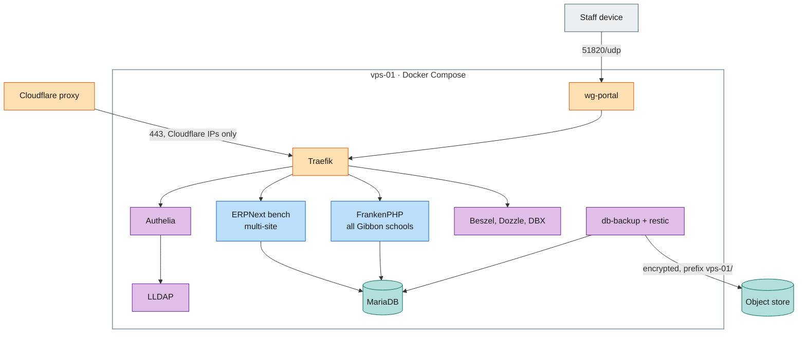
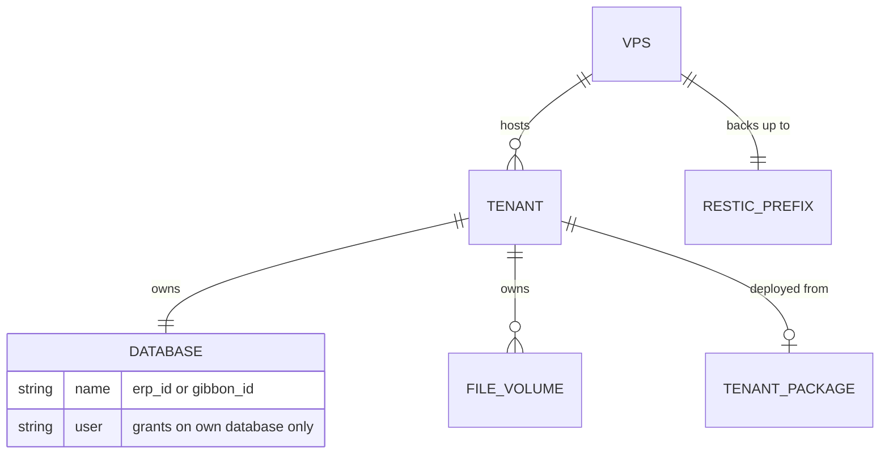

# Software Design Document (SDD)
**Project Name:** nigu-lite — free ERP & school platform  
**Document Version:** 0.1  
**Status:** Draft  
**Date:** 2026-11-20  
**Author(s):** varunpathania86 (owner, platform architect)  
**Compliance Standard(s):** IEEE 1016 / Digital Personal Data Protection Act 2023 (India), GST rules via India Compliance  

<!-- High-level, system-wide SDD. Detailed module design lives in LLDs (docs/lld/); decisions in ADRs (docs/adr/).
Add a separate docs/sdd/<system>.md only if a later product needs its own SDD; list it in the index at the end. -->

---

## Document Revision History

| Version | Date | Author | Description of Changes |
| :--- | :--- | :--- | :--- |
| 0.1 | 2026-11-20 | varunpathania86 | Initial draft from master-plan.md (Stage 0) |
| 1.0 | [YYYY-MM-DD] | [Name] | Approved baseline for implementation (after the S4 spike settles D7) |

---

## 1. Introduction
### 1.1 Purpose
This document describes the system-level design of nigu-lite: what runs where, how tenants are isolated, how data is
protected and how requirements trace to design and tests. It is for contributors (developers, operators, reviewers),
AI coding agents and future compliance auditors. Day-to-day detail belongs in LLDs; this document stays high level.

### 1.2 Scope
**In scope:**
* Hosting ERPNext v15 with India Compliance for companies at `<company>.erpos.in` (one multi-site bench).
* Hosting GibbonEdu for schools at `<school>.schooledu.in` (one FrankenPHP container for all schools).
* The shared platform per VPS: edge (Cloudflare, Traefik), MariaDB, staff identity (LLDAP, Authelia), VPN (wg-portal),
  monitoring (Beszel, Dozzle), database workbench (DBX) and encrypted off-site backups (restic → S3).
* The delivery chain: monorepo, CI, signed images and tenant packages in GHCR, Ansible deployment from manifests.
* A local VPS simulator for tests.

**Out of scope:**
* Public school websites or a CMS (D8), and ads on school services (D11).
* The public provider website at `nigu.in`/`www.nigu.in`; it may run on a separately managed host with its own DNS routing and TLS.
* Tenant single sign-on; tenant users keep native app accounts (D26).
* Container orchestration (Swarm, Kubernetes) (D1); high availability of a single VPS.
* ERP advertising until the S7 legal and policy review approves it (master-plan.md §10).

### 1.3 System Overview
The platform, branded nigu.in, offers ERPNext and GibbonEdu free of cost to many small tenants, funded later by
reviewed, compliant advertising on ERP surfaces only. Its public brand website may be hosted separately and is not
deployed or routed by nigu-lite. Each low-end VPS (4 vCPU, 8 GB RAM, 300 GB SSD) runs Docker Compose and hosts up to
10 schools and 10 ERP companies. VPSs are independent; later they split by role (`core-01`, `erp-01`, `edu-01`,
`mon-01`) and talk over WireGuard. One operator runs everything, assisted by automation and AI tools, so the design
favours few components, low RAM and reproducible infrastructure as code.

### 1.4 Definitions, Acronyms, and Abbreviations

| Term / Acronym | Definition |
| :--- | :--- |
| SDD | Software Design Document |
| SRS | Software Requirements Specification; here the goals and constraints in master-plan.md §1 |
| ADR / LLD | Architecture Decision Record / Low-Level Design (master-plan.md §11.3) |
| Tenant | One school (edu) or one company (erp) |
| Manifest | `deployments/<vps>.yml`: which services and tenants run on one VPS |
| Tenant package | Signed OCI artifact with a tenant's assets and migrations, built from `<product>/tenants/<id>/` |
| Control plane | Staff-facing services on subdomains of `nigu.in` (`auth`, `vpn`, `dbx`, `beszel`, `logs`) |
| Staff groups | LLDAP groups `admin`, `ops`, `support` (platform staff only) |
| DPDP Act | Digital Personal Data Protection Act 2023 (India) |
| RPO / RTO | Recovery point / recovery time objective |

### 1.5 References
* SRS: [master-plan.md](../../master-plan.md) §1 (goals G1–G11) and §14 (decisions from open questions)
* Architecture baseline: [ADR 0001 — Platform baseline](../adr/0001-platform-baseline.md) (D1–D27)
* LLDs: none yet; planned `gibbon.md`, `erpnext.md`, `backup.md`, `identity.md`, `capacity.md` ([docs/lld/](../lld/README.md))
* Diagram style: [diagram-style.md](../diagram-style.md)
* IEEE 1016-2009, Software Design Descriptions
* Digital Personal Data Protection Act 2023 (India)

---

## 2. System Architecture & Design Viewpoints
### 2.1 Architectural Design (Context & Composition Viewpoints)
A small set of independent, single-host deployments (one Docker Compose project per VPS), configured entirely by
Ansible from one YAML manifest per VPS. Inside a VPS it is a layered design: edge → tenant applications → shared
platform services → data stores. There is no cluster, scheduler or service mesh.

External actors and integrations: tenant users and platform staff (browsers, WireGuard clients); Cloudflare (DNS,
proxy, edge TLS); Let's Encrypt (origin certificates); an S3-compatible object store (backups); GitHub and GHCR
(source, CI, artifacts); the India Compliance API (GST e-invoice, e-waybill); UptimeRobot (external checks).

### 2.2 Decomposition Description
* **Edge (`core/`):** Traefik terminates origin TLS, routes by hostname from file-provider routes, trusts only
  Cloudflare IP ranges; CrowdSec bouncer; nigu-lite service and tenant DNS records managed by Ansible. The separate
  provider-site records are outside this deployment.
* **Access (`core/`):** wg-portal provides the staff WireGuard network (`10.10.0.0/24`) with OIDC login.
* **Identity (`core/`):** LLDAP (staff directory) and Authelia (forwardAuth, OIDC, MFA) for platform staff only.
* **Data (`core/`):** one MariaDB server; one database and one user per tenant.
* **Operations (`core/`):** db-backup + restic, Beszel, Dozzle, DBX (VPN-only database workbench).
* **ERP product (`erp/`):** ERPNext v15 + India Compliance as one multi-site bench (one site per company).
* **Edu product (`edu/`):** GibbonEdu in one FrankenPHP container with one Caddy site block per school.
* **Workspace (`scripts/`, `.github/`, `deployments/`):** Git, documentation and source snapshots initiated through the
  Makefile; no application services, Kubernetes workloads or deployment.
* **Build (`.github/build/`, `scripts/ci/`):** ephemeral CI/Act containers for lint, tests, scans, packaging,
  signing and reports. They receive immutable source snapshots and are destroyed after each run.
* **Delivery (`deployments/`, GHCR):** validated manifests, signed OCI images and tenant packages. Deployment from
  the registry to runtime remains a later-stage concern.
* **Local environment (`local/`):** a systemd + Docker container that acts as a VPS for the same playbooks.

S1 delivery preserves this strict sequence:

### 2.3 Design Rationale & Trade-Offs
The baseline decisions D1–D27 are recorded in [ADR 0001](../adr/0001-platform-baseline.md); the main trade-offs:

| Driver | Choice | Trade-off accepted |
| :--- | :--- | :--- |
| Low RAM, one operator | Docker Compose per VPS (D1), Ansible (D2) | No automatic failover; a VPS is a failure domain |
| Cost per tenant | Shared MariaDB (D3), ERPNext multi-site (D6), one Gibbon container (D7) | Isolation relies on credentials and PHP hardening; D7 falls back to per-school containers if the S4 spike fails |
| Small identity footprint | LLDAP + Authelia for staff only (D5, D26) | No tenant SSO |
| Protection without paid services | Cloudflare free (D24), Let's Encrypt DNS-01 wildcard (D9) | Cloudflare sees tenant traffic (named sub-processor) |
| Reproducibility and trust | Signed OCI artifacts (D20), public AGPL repo (D23) | Everything public: secrets only as Vault ciphertext |

### 2.4 Deployment & Infrastructure Viewpoint
Each VPS (Contabo today) runs one Docker Compose project, rendered by Ansible from `deployments/<vps>.yml`. Public
ports 443/80 accept only Cloudflare ranges; `51820/udp` is open for WireGuard; SSH and staff-only tools are reachable
through the VPN. Tenant hostnames use proxied Cloudflare `CNAME`s to a VPS node record; nigu-lite service hostnames
follow their individual DNS and access rules. The provider website at `nigu.in`/`www.nigu.in` may use a separate host
and deployment; its records and TLS are not managed by these manifests or Traefik. Moving a tenant is a manifest
change, a data restore and one `CNAME` update (master-plan.md §3.3, §3.4).

Capacity: ≤ 10 schools + ≤ 10 ERP companies per VPS, estimated at ~5.1–6.0 GB RAM (master-plan.md §6), verified by
the `capacity-10x10` benchmark before a VPS is filled. Scale-out splits roles across VPSs (master-plan.md §3.2).

---

## 3. Data Design & Governance
### 3.1 Data Architecture & Storage

| Store | Technology | Holds | Location |
| :--- | :--- | :--- | :--- |
| Tenant databases | MariaDB (`erp_<id>`, `gibbon_<id>`) | All tenant application data | VPS volume |
| Tenant files | Docker volumes | ERPNext site files, Gibbon `uploads/` per school | VPS volume |
| Staff directory | LLDAP, SQLite | Staff accounts and groups | Own volume |
| Staff sessions, MFA | Authelia, SQLite | Sessions, TOTP/WebAuthn registrations | Own volume |
| Certificates | Traefik `acme.json` | Let's Encrypt keys and certificates | VPS volume, backed up |
| Backups | restic repository | Dumps, SQLite snapshots, files | S3 bucket, prefix per VPS |
| Artifacts | GHCR | Images, tenant packages (public, no personal data) | GitHub |
| Configuration | Git + Ansible Vault | Manifests, templates, encrypted secrets | Repository |

### 3.2 Data Dictionary
Application schemas belong to the upstream products (ERPNext DocTypes, Gibbon tables) and are not redesigned here.
The platform's own data:

| Table / Collection | Field Name | Data Type | Constraints | Sensitivity / PII Classification |
| :--- | :--- | :--- | :--- | :--- |
| `deployments/<vps>.yml` | `tenants.<product>.<id>` | YAML map | Unique ID, `^[a-z0-9-]+$`, not reserved, ≤ 10 per product | Internal |
| `<product>/tenants/<id>/tenant.yml` | name, branding, version pin | YAML | Validated by schema | Public (repo is public) |
| `<product>/tenants/<id>/vault.yml` | DB and admin credentials | Ansible Vault | AES-256 encrypted | Secret |
| `<product>/tenants/<id>/migrations/` | Bootstrap and reference data | SQL / JSON | Forward-only, checksummed | Public; no personal data |
| MariaDB tenant databases | Students, guardians, staff, invoices, customers | Upstream schemas | One DB + user per tenant | Confidential (PII, incl. children's data) |
| LLDAP | Staff user, email, groups | SQLite | Staff only | Confidential (PII) |
| Authelia | Sessions, second factors | SQLite | Staff only | Secret |

### 3.3 Data Retention, Backup, and Lifecycle
* **Backups:** per-database MariaDB dumps, per-site `bench backup --with-files`, consistent SQLite snapshots and Gibbon
  uploads go to a local staging volume; restic uploads them encrypted to S3 with retention 7 daily / 4 weekly /
  6 monthly. Each VPS has its own key and restic password, limited to its prefix (master-plan.md §4.5).
* **Restore:** per tenant (`make tenant-restore`); a restore drill runs each release and monthly; `make restore-test`
  proves the path locally against Garage.
* **RPO / RTO:** to be fixed in `docs/lld/backup.md` (S3) and confirmed by the S6 restore drill.
* **Upgrades:** a `pre-<version>` snapshot of every tenant before a product upgrade; rollback = route back + restore.
* **Lifecycle:** tenants are added and moved only through manifests; the tenant-retire playbook deletes the tenant's
  database, files and DNS record after its rollback window. Deleting the tenant's data from backups follows the
  retention schedule; the exact offboarding and erasure steps are defined in the backup LLD.
* **Personal data:** never in the repository, packages, test fixtures or benchmark data (synthetic only).

---

## 4. Component & Interface Design
### 4.1 Component Specifications

| Component | Inputs → outputs | Key logic | Error handling |
| :--- | :--- | :--- | :--- |
| Manifest validator | `deployments/<vps>.yml`, tenant files → pass/fail | Schema, reserved IDs, tenant limits, `tls.mode` for production, ≤ 2 Gibbon versions | Fails before any remote task |
| Traefik | HTTPS from Cloudflare → app services | One `Host()` router per tenant from rendered files; forwardAuth only on staff hosts | Per-tenant health check → maintenance page for that tenant only |
| Gibbon (FrankenPHP) | HTTP from Traefik → pages, uploads | Per-school site block, `tenant-guard.php` narrows `open_basedir` and sessions (master-plan.md §5.2) | `/_health` per school; container health independent of schools |
| ERPNext bench | HTTP from Traefik → sites | Frappe multi-site by hostname; India Compliance app | Per-site backup, migrate, restore |
| Backups | Databases, files → restic snapshots | Stage locally, then one uploader (restic) | Alerts on failure; `make s3-check` |
| Deploy (Ansible) | Manifest + signed artifacts → running VPS | Verify cosign signatures, render templates, apply migrations | `/_health` gate per tenant fails the deploy |

Details per component are in their LLDs as they are written.

### 4.2 External & Internal Interfaces (APIs)

| Interface | Protocol | Authentication |
| :--- | :--- | :--- |
| Tenant web apps | HTTPS via Cloudflare (TLS 1.2+, Full strict) | Native app accounts |
| Staff tools on `*.nigu.in` | HTTPS; `dbx`/`logs` only via WireGuard | Authelia forwardAuth + MFA; DBX adds `X-DBX-Auth` |
| wg-portal | OIDC (Authelia issuer `auth.nigu.in`) | Groups `admin`, `ops` |
| Cloudflare API | REST | Three least-privilege tokens in Vault |
| Object store | S3 API (restic, rclone) | Per-VPS access key |
| ERP tenant migrations | Frappe REST API + `Nigu Migration` DocType | Per-site API key from Vault |
| GHCR | OCI distribution | Anonymous pull; CI pushes with GitHub OIDC, keyless cosign |

---

## 5. Security, Privacy & Compliance Controls
*Note: Essential for future regulatory audits.*

### 5.1 Authentication & Authorization
Platform staff exist only in LLDAP (groups `admin`, `ops`, `support`); Authelia enforces group rules with MFA on every
staff host and is the OIDC provider for wg-portal. Tenant users have native ERPNext or Gibbon accounts managed by their
tenant; tenant routers never use Authelia, and staff have no implicit rights inside tenant apps. The full matrix is in
master-plan.md §13.1 and is enforced by `tests/integration/access/`.

### 5.2 Data Protection & Cryptography
* **Data in Transit:** browser → Cloudflare edge certificate; Cloudflare → origin Let's Encrypt wildcard (DNS-01),
  Full (strict), TLS ≥ 1.2; staff tools over WireGuard; internal Docker networks only between containers.
* **Data at Rest:** restic encrypts backups (AES-256) with a per-VPS password; secrets in Ansible Vault (AES-256) with a
  long random password; VPS disks rely on provider controls. Cloudflare API tokens are rotated yearly.
* **Isolation:** one database + user per tenant; Frappe site isolation; Gibbon PHP and path controls (master-plan.md
  §5.2); SSH key-only and only via WireGuard.

### 5.3 Audit Logging & Monitoring
Beszel collects host and container metrics with alerts; Dozzle shows live container logs (VPN only); UptimeRobot checks
each tenant hostname and the origin certificate. Traefik and CrowdSec log real client IPs taken from trusted Cloudflare
ranges. Log retention and a central log store (Loki on `mon-01`) arrive with S8; until then logs stay on the VPS.

### 5.4 Compliance Notes
* **DPDP Act 2023:** each school or company is the data fiduciary for its users; the platform acts as processor.
  Schools hold children's data, so consent and parental-consent duties stay with the school; the platform provides
  isolation, backups, deletion on offboarding and no tracking or ads on school services (D11).
* **Sub-processors:** Cloudflare, the object-store provider, the VPS provider and India Compliance (ERP only) are named
  in tenant terms.
* **GST:** handled by India Compliance inside ERPNext; the platform pins versions supported by it.
* **Supply chain:** pinned versions and digests, Trivy scans and SBOMs, cosign signatures verified at deploy.

---

## 6. Human Interface Design
### 6.1 Overview of User Interface
The user interfaces are the upstream ERPNext and Gibbon UIs, unmodified apart from per-tenant branding (logo, colours)
from tenant packages. Staff tools use their own UIs. Accessibility follows the upstream products. No ads appear in
any school interface.

### 6.2 Screen Flows & Wireframes
n/a: no custom screens. Key workflows: tenant login on its hostname; staff login via Authelia (MFA), then VPN for
`dbx`/`logs`; onboarding a tenant = manifest change + `make deploy VPS=` (master-plan.md §7).

---

## 7. Requirements Traceability Matrix (RTM)

| Requirement ID | Requirement Summary | Design Section / Module | Compliance Control (If Applicable) | Verification Method |
| :--- | :--- | :--- | :--- | :--- |
| G1 | ERPNext (GST) and Gibbon free for many tenants | §2.2 ERP and Edu products | GST via India Compliance | S5 GSTR report on synthetic data; S4 pilot |
| G3 | ≤ 10 schools + 10 companies on 4 vCPU / 8 GB | §2.4, master-plan.md §6 | — | `capacity-10x10`, `stress-10x10` benchmarks |
| G4 | Independent VPSs, no cluster | §2.1, §2.4 | — | S8 moves rehearsed locally |
| G5 | Reproducible IaC | §2.2 Delivery | — | Jinja2 render tests; deploy from clean VPS (S6) |
| G5-CI | Build, scan and publish outside the Workspace | §2.2 Build and registry | SEC-4 | Snapshot and Build Container tests (S1) |
| G8 | Tenants per VPS from one manifest | §4.1 Manifest validator | — | Validator unit tests (S1) |
| SEC-1 | Tenant data isolation | §5.2 Isolation | DPDP Act (security safeguards) | S4 isolation suite; per-tenant DB grants test |
| SEC-2 | Staff access by group with MFA | §5.1 | DPDP Act (security safeguards) | `make access-check`, `tests/integration/access/` |
| SEC-3 | Encrypted, restorable off-site backups | §3.3 | DPDP Act (security safeguards) | `make restore-test`, `make s3-check`, restore drill |
| SEC-4 | No secrets or personal data in the public repo | §3.2 | — | Trivy secret scan, push protection |
| PRIV-1 | No ads or tracking on school services | §1.2, §6.1 | DPDP Act (children's data) | Review; no ad code in `edu/` |

---

## 8. Appendices
* **Appendix A:** OpenAPI / Swagger Specifications — n/a: the platform exposes no own API; upstream APIs only.
* **Appendix B:** Infrastructure-as-Code (IaC) & Network Diagrams — master-plan.md §3 and §7; Ansible roles under
  `core/`, `erp/`, `edu/`.
* **Appendix C:** Third-Party Vendor & Sub-processor List — Contabo (VPS, object storage), Cloudflare (DNS, CDN,
  proxy), Backblaze B2 or Cloudflare R2 (alternative object storage), GitHub (code, CI, GHCR), Let's Encrypt
  (certificates), India Compliance (GST APIs, ERP only), UptimeRobot (external checks).
