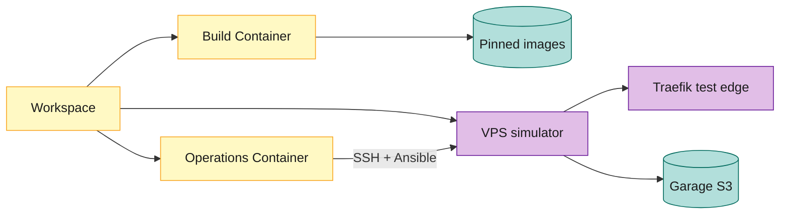

# Software Design Document (SDD)
**Project Name:** nigu-lite local delivery
**Document Version:** 1.0
**Status:** Approved
**Date:** 2026-11-23
**Author(s):** varunpathania86
**Compliance Standard(s):** IEEE 1016

---

## Document Revision History

| Version | Date | Author | Description of Changes |
| :--- | :--- | :--- | :--- |
| 1.0 | 2026-11-23 | varunpathania86 | Defined the Stage 2 local delivery boundary |

---

## 1. Introduction

### 1.1 Purpose

This document defines the Stage 2 development-to-operations boundary for local integration.

### 1.2 Scope

Included are Build Containers, the local VPS simulator, the Operations Container and synthetic test
services. Production workloads, public deployment and runtime platform clusters are excluded.

### 1.3 System Overview

The Workspace orchestrates Make targets. Build Containers create pinned local images. A disposable
Operations Container runs Ansible over SSH into one persistent simulator. The simulator exposes only
loopback SSH and HTTPS and hosts the Stage 2 Traefik, Nginx and Garage checks.

### 1.4 Definitions, Acronyms, and Abbreviations

| Term / Acronym | Definition |
| :--- | :--- |
| SDD | Software Design Document |
| S3 | S3-compatible object-storage interface |
| Operations Container | Ephemeral pinned Ansible environment |
| Simulator | Local systemd, SSH and Docker container representing a VPS |

### 1.5 References

- [Baseline ADR](../adr/0001-platform-baseline.md)
- [Local environment LLD](../lld/local-environment.md)
- [Master plan, local environment](../../master-plan.md#8-local-environment-vps-simulator)

---

## 2. System Architecture & Design Viewpoints

### 2.1 Architectural Design

### 2.2 Decomposition Description

- **Workspace:** edits source and invokes Make targets only.
- **Build Container:** builds and scans disposable local images.
- **Operations Container:** runs pinned Ansible over SSH and retains no state.
- **VPS simulator:** owns systemd, SSH, Docker, the test edge and persistent local volumes.

### 2.3 Design Rationale & Trade-Offs

The split enforces the future Workspace → Build Container → registry → deployment → runtime flow.
The privileged simulator and `vfs` Docker storage favour portability over kernel fidelity. A VM remains
the future option for kernel, firewall and WireGuard validation.

### 2.4 Deployment & Infrastructure Viewpoint

The simulator publishes only `127.0.0.1:2222` and `127.0.0.1:8443`. Traefik and Garage run inside nested
Docker. Garage is reachable only on an internal network; no S3 port is published on the host.

---

## 3. Data Design & Governance

### 3.1 Data Architecture & Storage

SSH keys live under `.cache/local/ssh/`. Simulator Docker and application state use named
`nigu-local-*` volumes. Garage stores synthetic test objects. No tenant or personal data is loaded.

### 3.2 Data Dictionary

n/a — Stage 2 introduces no application data model.

### 3.3 Data Retention, Backup, and Lifecycle

`make local-down` retains local volumes. `make local-reset` removes only the dedicated simulator,
network, keys and volumes. Production backup and retention controls begin in later stages.

---

## 4. Component & Interface Design

### 4.1 Component Specifications

Component details and error behaviour are specified in the
[local environment LLD](../lld/local-environment.md). Lifecycle scripts fail explicitly when Docker,
SSH or route health does not become ready.

### 4.2 External & Internal Interfaces

- Make targets: local simulator lifecycle and integration testing.
- SSH: Operations Container to simulator, key authentication only.
- HTTPS: host loopback to Traefik test route.
- S3: internal Garage API; tests and future backups use the S3 contract.

---

## 5. Security, Privacy & Compliance Controls

### 5.1 Authentication & Authorization

SSH permits key authentication and disables root and password login. The simulator's `ops` account
has passwordless sudo because it is disposable and loopback-only.

### 5.2 Data Protection & Cryptography

SSH host keys are generated at runtime and excluded from images. TLS uses a generated self-signed
Traefik certificate. Local S3 credentials are explicit synthetic test values, not production secrets.

### 5.3 Audit Logging & Monitoring

`make local-status` verifies SSH, Docker, Traefik, the route and Garage. Integration results are the
Stage 2 acceptance evidence; production audit controls are out of scope.

---

## 6. Human Interface Design

### 6.1 Overview of User Interface

n/a — no product UI is deployed.

### 6.2 Screen Flows & Wireframes

n/a — operator interaction is through Make targets.

---

## 7. Requirements Traceability Matrix (RTM)

| Requirement ID | Requirement Summary | Design Section / Module | Compliance Control | Verification Method |
| :--- | :--- | :--- | :--- | :--- |
| S2-R1 | Separate build and operations work | 2.1–2.2 | Least privilege by role | Unit and command tests |
| S2-R2 | SSH delivery into systemd VPS | 2.1, 4.2 | Key-only SSH | Integration test |
| S2-R3 | Loopback test edge | 2.4, 4.2 | No public port | HTTPS route test |
| S2-R4 | S3-compatible local store | 3.1, 4.2 | Synthetic data only | Garage health test |

---

## 8. Appendices

* **Appendix A:** n/a — no OpenAPI surface in Stage 2.
* **Appendix B:** See the architecture diagram in §2.1 and the local environment LLD.
* **Appendix C:** Garage is the Stage 2 S3-compatible local service.
