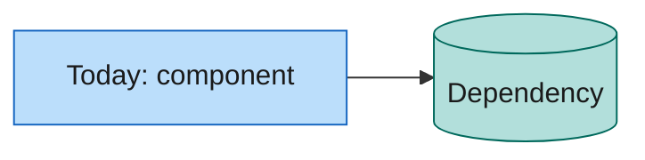
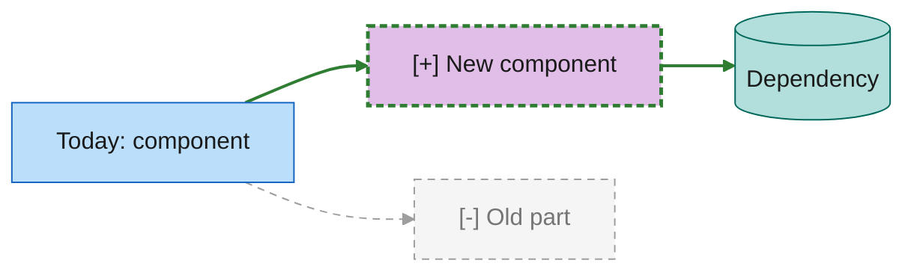

# NNNN — <Short decision title as a statement, e.g. "Run each school in its own Gibbon container">

## Context and problem statement
<!-- 2–5 sentences: the situation, the forces, why decide now. Link the evidence (benchmark, incident, LLD). -->

## Decision drivers
- <driver, e.g. RAM per tenant ≤ 50 MB>
- <driver, e.g. no cross-school file access>

## Existing solution
<!-- How it works today. Required unless greenfield; then write "None". -->

## Considered options
1. <Option 1 — chosen>
2. <Option 2>
3. <Do nothing>

## Decision outcome
Chosen: **<option>**, because <one-sentence justification tied to the drivers>.

### Proposed solution

### Consequences
- Good: <…>
- Bad / accepted trade-off: <…>
- Follow-up: <LLDs to create/update, migration, tenants affected>

### Confirmation
<!-- How we will know it is implemented and working: tests, benchmark, review, metric. -->

## Pros and cons of the options
### <Option 2>
- Good: <…>
- Bad: <…>

## More information
<!-- Links: LLDs, PRs, upstream docs, related ADRs. -->
