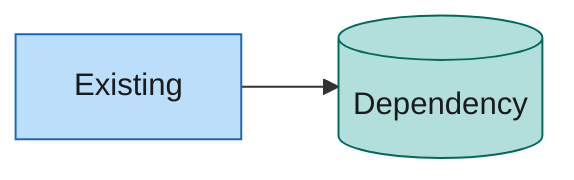
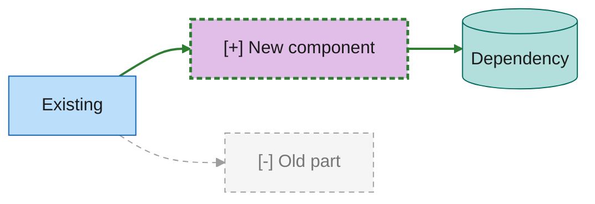
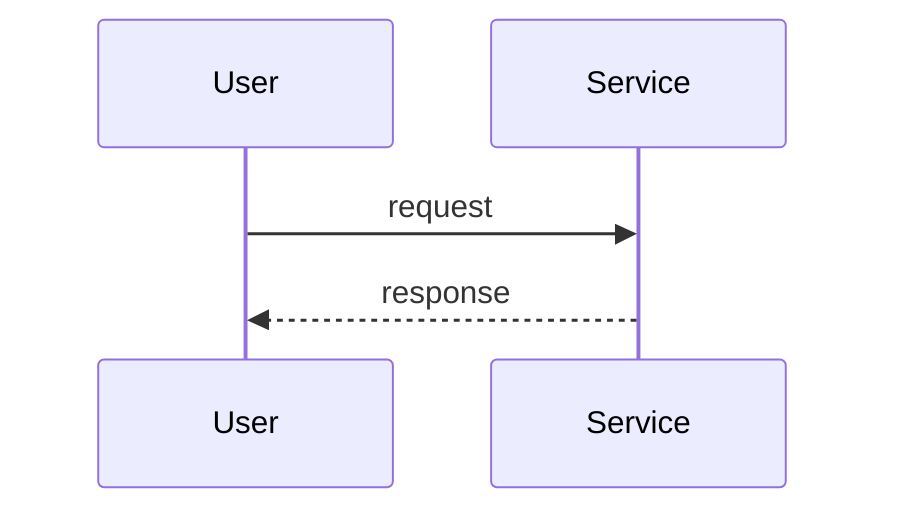

# <Area / feature> — Low-Level Design

## 1. Summary
<!-- 3–5 sentences: what, why, outcome for tenants/operators. -->

## 2. Scope
- In scope: <…>
- Out of scope / non-goals: <…>

## 3. Requirements
| ID | Requirement | Type (functional / non-functional) | Verified by |
|---|---|---|---|
| R1 | <…> | <…> | <test / benchmark> |

## 4. Existing solution
<!-- Current behaviour and its problem. "None (new)" if greenfield. -->

## 5. Proposed design
### 5.1 Overview

### 5.2 Components and responsibilities
| Component | Change | Responsibility | Location (path) |
|---|---|---|---|

### 5.3 Flows
<!-- Sequence diagram for the main path and the main failure path. -->

### 5.4 Data and configuration
<!-- Schemas, DB tables/grants, manifest and tenant.yml keys (no defaults), versions.yml pins, secrets in Vault. -->

### 5.5 Interfaces
<!-- Make targets, CLI, HTTP endpoints, CI jobs, Ansible role variables. -->

## 6. Decisions
| # | Decision | Alternatives | Reason | PR |
|---|---|---|---|---|
| L1 | <moderate decision recorded here, not as an ADR> | <…> | <…> | #<n> |

## 7. Security, isolation and privacy
<!-- Tenant isolation, exposed ports, secrets, personal data, ads rules. -->

## 8. Resources and performance
<!-- RAM/CPU/disk estimate, impact on §9.1 targets, benchmark scenario. -->

## 9. Test plan
| Level | Cases | Location |
|---|---|---|
| Unit | <…> | `tests/unit/…` |
| Integration | <…> (test tenants) | `tests/integration/…` |
| Benchmark | <scenario or N/A> | `tests/benchmarks/…` |

## 10. Rollout, upgrade and rollback
<!-- Order of VPSs/tenants, data migration, feature flags in tenant.yml, rollback steps. -->

## 11. Observability and operations
<!-- Health checks, metrics, alerts, logs, runbook links. -->

## 12. Risks and open points
| Risk / question | Impact | Mitigation / owner |
|---|---|---|

## 13. Implementation plan
| Step | PR | Status |
|---|---|---|
| 1 | <branch / PR> | planned |

## 14. Changelog
| Date | PR | Change to this design |
|---|---|---|
