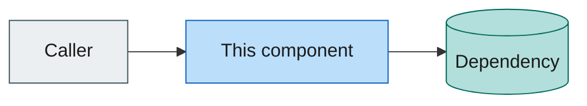

# <Name>
> One-line purpose. Owner: <name> · Status: <active|experimental|deprecated>

## Overview
<!-- One high-level mermaid diagram, ≤ 10 nodes: inputs, this component, dependencies, outputs -->

## Quick start
<!-- Only `make` targets -->

## Structure
<!-- Key folders/files and their purpose -->

## Configuration
<!-- Variables/manifest keys, where they live, which are secret -->

## Operations
<!-- Deploy, backup/restore, common tasks, troubleshooting links -->

## Tests
<!-- Unit/integration/benchmark coverage and how to run -->

## Related
<!-- ADRs, LLDs, upstream docs -->
