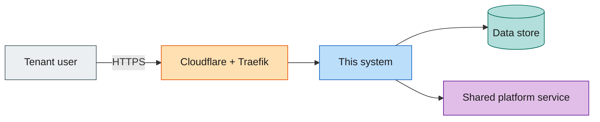
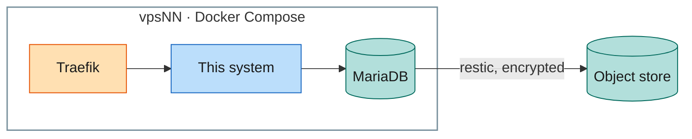
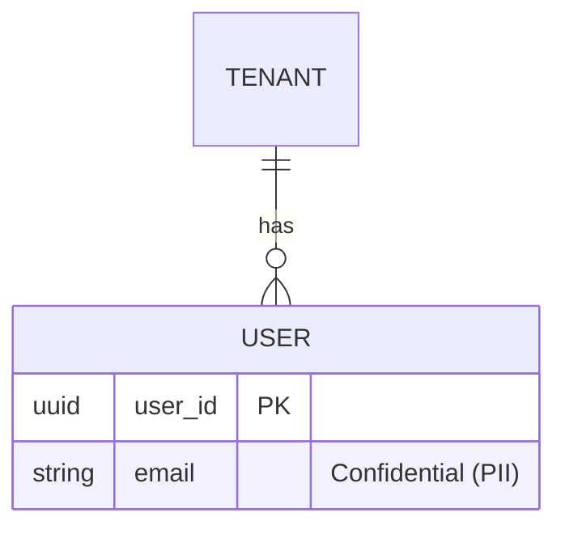

# Software Design Document (SDD)
**Project Name:** [Insert Project Name]  
**Document Version:** 1.0  
**Status:** [Draft | Approved | Superseded by <SDD>]  
**Date:** [YYYY-MM-DD]  
**Author(s):** [Name(s) / Role(s)]  
**Compliance Standard(s):** IEEE 1016 / [Insert Applicable Compliance: e.g., DPDP Act 2023 (India), GDPR, ISO 27001, SOC 2]  

<!-- Copy to docs/sdd/<system>.md. Keep every section; write "n/a" with a reason rather than deleting one.
Link master-plan.md sections, ADRs and LLDs instead of copying them. No secrets or real personal data. -->

---

## Document Revision History

| Version | Date | Author | Description of Changes |
| :--- | :--- | :--- | :--- |
| 0.1 | [YYYY-MM-DD] | [Name] | Initial draft |
| 1.0 | [YYYY-MM-DD] | [Name] | Approved baseline for implementation |

---

## 1. Introduction
### 1.1 Purpose
Define the purpose of this Software Design Document and identify its intended audience (e.g., software architects, developers, QA engineers, compliance auditors).

### 1.2 Scope
Provide a high-level overview of the software system being designed. Explicitly state what is inside and outside the boundaries of this design.

### 1.3 System Overview
Summarize the software's business context, primary functions, and operational environment.

### 1.4 Definitions, Acronyms, and Abbreviations

| Term / Acronym | Definition |
| :--- | :--- |
| SDD | Software Design Document |
| SRS | Software Requirements Specification |
| [Insert Term] | [Insert Definition] |

### 1.5 References
List all referenced documents, including the Software Requirements Specification (SRS), regulatory frameworks, and architectural standards.
* [SRS Document Link / ID]
* [Compliance Standard Reference]

<!-- nigu-lite: requirements come from master-plan.md sections and issues; also link related ADRs and LLDs here. -->

---

## 2. System Architecture & Design Viewpoints
### 2.1 Architectural Design (Context & Composition Viewpoints)
Describe the high-level architecture (e.g., microservices, layered monolith, event-driven). Include or reference a system context diagram showing external actors and third-party integrations.

<!-- Colours: docs/diagram-style.md. Write only `class` lines, then run `make fix-docs`.
For a change to an existing system, add "Existing" and "Proposed" diagrams: added nodes "[+]" with their class, removed "[-]" :::removed,
green/grey linkStyle on added/removed links (master-plan.md §11.6). -->

### 2.2 Decomposition Description
Break the system down into major subsystems, modules, or services. Define the single responsibility of each component.
* **Module A:** [Responsibility]
* **Module B:** [Responsibility]

### 2.3 Design Rationale & Trade-Offs
Document key architectural decisions, alternative approaches considered, and why the selected patterns/technologies were chosen (especially regarding scalability, maintainability, and compliance).

<!-- nigu-lite: summarise and link the ADRs (baseline D1–D27 in docs/adr/0001-platform-baseline.md); do not restate them. -->

### 2.4 Deployment & Infrastructure Viewpoint
Describe the target hosting environment (cloud provider, regions, containerization, network topology, VPCs, and load balancing).

<!-- nigu-lite: VPS placement (deployments/<vps>.yml), Docker Compose networks, Cloudflare records, WireGuard. -->

---

## 3. Data Design & Governance
### 3.1 Data Architecture & Storage
Describe the database technologies used (relational, NoSQL, object storage, caching) and data flow across the system. Include or reference an Entity-Relationship Diagram (ERD).

### 3.2 Data Dictionary

| Table / Collection | Field Name | Data Type | Constraints | Sensitivity / PII Classification |
| :--- | :--- | :--- | :--- | :--- |
| `users` | `user_id` | UUID | Primary Key, Not Null | Internal |
| `users` | `email` | VARCHAR(255) | Unique, Encrypted | Confidential (PII) |

### 3.3 Data Retention, Backup, and Lifecycle
Detail backup frequencies, disaster recovery (RTO/RPO targets), archival policies, and automated data purging mechanisms required for compliance.

<!-- nigu-lite: restic schedule and restore drill (master-plan.md §4.5); tenant offboarding and data deletion. -->

---

## 4. Component & Interface Design
### 4.1 Component Specifications
For each module identified in Section 2.2, detail:
* **Inputs & Outputs:** Data expected and returned.
* **Processing Logic / Algorithms:** Step-by-step logic, state transitions, or business rules.
* **Error Handling:** Exception handling, retry policies, and fallback behaviors.

<!-- Detailed module design belongs in the LLD (docs/lld/<area>.md); link it and keep only the summary here. -->

### 4.2 External & Internal Interfaces (APIs)
Define communication protocols (REST, gRPC, GraphQL, message brokers).
* **Endpoint / Topic:** `[Method] /api/v1/[resource]`
* **Authentication:** [e.g., OAuth 2.0, mTLS, API Key]
* **Payload Schema:** [Reference OpenAPI/Swagger or JSON schema]

---

## 5. Security, Privacy & Compliance Controls
*Note: Essential for future regulatory audits.*

### 5.1 Authentication & Authorization
Detail identity management (IdP), session handling, and access control models (RBAC, ABAC, least privilege).

<!-- nigu-lite: staff via LLDAP groups + Authelia; tenant users via native app accounts (D26). -->

### 5.2 Data Protection & Cryptography
* **Data in Transit:** TLS versions, cipher suites, certificate management.
* **Data at Rest:** Encryption algorithms (e.g., AES-256), key management service (KMS), and key rotation policies.

### 5.3 Audit Logging & Monitoring
Specify what security and user events are logged, log immutability, retention duration, and alerting thresholds.

---

## 6. Human Interface Design
### 6.1 Overview of User Interface
Describe the frontend architecture, supported platforms/browsers, and accessibility standards (e.g., WCAG 2.1 AA).

<!-- nigu-lite: upstream UIs (Gibbon, ERPNext) are not modified; describe only theming, ad slots or "n/a". -->

### 6.2 Screen Flows & Wireframes
Link to UI/UX design files (e.g., Figma) and describe key user workflows.

---

## 7. Requirements Traceability Matrix (RTM)
Map every requirement from the SRS to its corresponding design component and verification method to demonstrate compliance coverage.

| Requirement ID | Requirement Summary | Design Section / Module | Compliance Control (If Applicable) | Verification Method |
| :--- | :--- | :--- | :--- | :--- |
| REQ-001 | [Summary] | Section 4.1 - Auth Module | [e.g., ISO 27001 A.9] | Automated Integration Test |
| REQ-002 | [Summary] | Section 3.2 - User Table | [e.g., GDPR Art. 32] | Security Audit / Code Review |

---

## 8. Appendices
* **Appendix A:** OpenAPI / Swagger Specifications
* **Appendix B:** Infrastructure-as-Code (IaC) & Network Diagrams
* **Appendix C:** Third-Party Vendor & Sub-processor List
