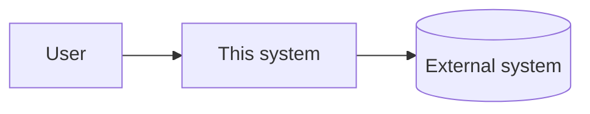
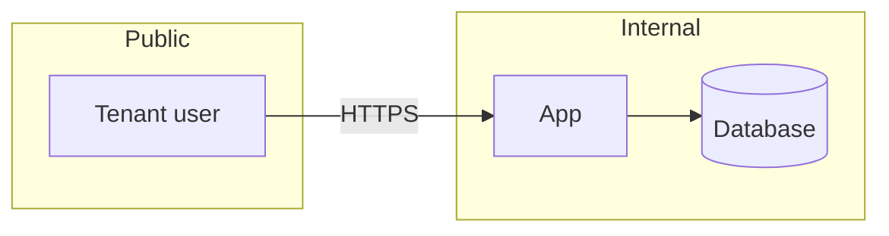

# <System or product name> — System Design Description

## 1. Purpose and scope
<!-- What the system does, for whom, and what is out of scope. -->

## 2. Context
<!-- Users, external systems and the trust boundary (C4 level 1). -->

## 3. Containers and responsibilities
<!-- Deployable units (C4 level 2): containers, data stores, VPS placement. -->
| Container | Technology | Responsibility | Runs on |
|---|---|---|---|

## 4. Trust zones and data flows
<!-- Public, staff (VPN/Authelia), tenant, internal. Which data crosses which boundary. -->

## 5. Data
<!-- Data stores, personal data categories, retention, backups and restore. -->

## 6. Quality attributes
<!-- Isolation, availability, performance targets (master-plan.md §9.1), security controls. -->

## 7. Constraints and assumptions

## 8. Related documents
<!-- ADRs, LLDs per area, runbooks. -->
