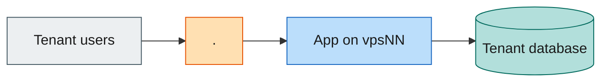

# <Tenant display name> (`<tenant-id>`)
> Product: <erp|edu> · Apps: <gibbon|erpnext> · Status: <onboarding|active|retiring>

<!-- PUBLIC REPO: no personal names, phone numbers or e-mail addresses. Role-based contacts only;
     personal contact details live in vault.yml or outside the repository. -->

## Overview

## Domains
| Hostname | App | Notes |
|---|---|---|
| `<tenant-id>.<domain>` | <app> | Cloudflare proxied CNAME → `vpsNN.nigu.in` |

## Contacts
| Role | Channel |
|---|---|
| <School office / Accounts team> | <ticket queue or shared role mailbox reference> |

## Placement and versions
<!-- Which deployments/<vps>.yml selects this tenant; pinned app version; canary or not. -->

## Assets and migrations
<!-- assets/: logo, header, CSS overrides. migrations/: NNNN-
.sql|json, starting with 0001-bootstrap. -->

## Special notes
<!-- Agreed exceptions, custom domains (paid), data retention requests. -->
