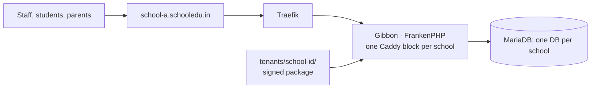

# edu

> GibbonEdu for many schools in one FrankenPHP container, one database per school.
> Owner: varunpathania86 · Status: experimental (planned for Stage 4)

## Overview

## Quick start

Not deployable yet. From Stage 4: `make image-build PRODUCT=edu APP=gibbon`, `make tenant-new PRODUCT=edu ID=<id>`.

## Structure

Planned: `ansible/`, `images/gibbon/`, `scripts/`, `tenants/<school-id>/` (README, `tenant.yml`, `vault.yml`,
`assets/`, `migrations/`).

## Configuration

Schools are defined in `tenants/<id>/tenant.yml` and selected per VPS in `deployments/<vps>.yml`, each with
an explicit `gibbon_version`. School services are ad-free.

## Operations

See master-plan.md §5 (routing, isolation, health checks, Saturday upgrades and rollback).

## Tests

From Stage 4: isolation suite (cross-school file, DB and session access must fail), host routing, upgrade
and rollback drill, `edu-*` benchmarks.

## Related

[Baseline ADR](../docs/adr/0001-platform-baseline.md) (D7, D8) · master-plan.md §5, §7, §9.1
