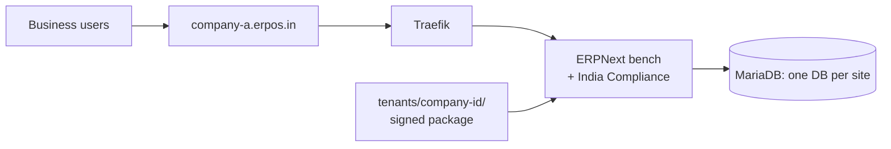

# erp

> ERPNext with India Compliance (GST) as one multi-site bench for many companies.
> Owner: varunpathania86 · Status: experimental (planned for Stage 5)

## Overview

## Quick start

Not deployable yet. From Stage 5: `make image-build PRODUCT=erp APP=erpnext`, `make tenant-new PRODUCT=erp ID=<id>`.

## Structure

Planned: `ansible/`, `images/erpnext/`, `scripts/`, `tenants/<company-id>/` (README, `tenant.yml`, `vault.yml`,
`assets/`, `migrations/`).

## Configuration

Companies are defined in `tenants/<id>/tenant.yml` and selected per VPS in `deployments/<vps>.yml`.

## Operations

See master-plan.md §4.4 (applications), §7.2 (tenant migrations) and §10 (advertising, deferred).

## Tests

From Stage 5: two test companies, GSTR report on synthetic data, per-site restore, `erp-*` benchmarks.

## Related

[Baseline ADR](../docs/adr/0001-platform-baseline.md) (D6) · master-plan.md §4.4, §7, §9.1
