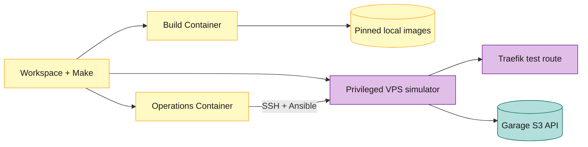

# Local environment

> Systemd + Docker VPS simulator for SSH and Ansible delivery. Owner: varunpathania86 · Status: active (Stage 2)

## Overview

## Quick start

- `make local-up`
- `make local-deploy`
- `make local-status`
- `make test-integration`
- `make local-down`
- `make local-reset`

## Structure

| Path | Purpose |
|---|---|
| `Containerfile` | Ubuntu systemd, sshd and Docker simulator image |
| `operations/` | Ephemeral Operations Container with pinned Ansible |
| `ansible/` | Inventory, group variables, playbook and Jinja templates |
| `scripts/` | Lifecycle orchestration called only by Make |

## Configuration

`deployments/local.yml` selects synthetic test tenants. Local non-secret test credentials and image
pins live in `local/ansible/group_vars/local.yml`. SSH keys and state live under `.cache/local/` and
named Docker volumes; they are not committed.

## Operations

`make local-up` builds through the Build Container and starts one loopback-only simulator.
`make local-deploy` runs a disposable Operations Container against SSH port 2222.
`make local-down` retains data. `make local-reset` removes only `nigu-local-*` containers, network and
volumes. The route is `https://test-school-a.localhost:8443`.

## Tests

`make test-integration` verifies SSH, inner Docker, Traefik, the self-signed route and Garage health.
Unit tests validate the manifest and rendered Stage 2 templates without requiring Docker.

## Related

[S2 LLD](../docs/lld/local-environment.md) · [Local delivery SDD](../docs/sdd/local-delivery.md) · master-plan.md §8
