# Master Plan — Free ERP & School Platform (ad-supported)

> Status: **Revision 1** (first push to `nigu-lite`, Stage 0) · Date: 2026-11-20 · Owner: varunpathania86
> Scope: **greenfield** **public** (AGPL-3.0) monorepo **`nigu-lite`** ("lite" = the free, ad-funded tier). The existing `infra` and `infra-core` repos are prior art only — ideas may be reused, nothing is migrated.

---

## 0. Overview at a Glance

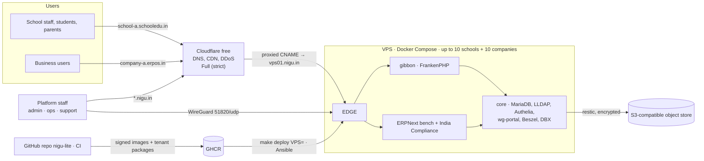

| If you want to know… | Read |
|---|---|
| Why each tool was chosen | §2 decisions, §4 tools |
| How one VPS is laid out and how it scales out | §3, §6 |
| How many schools share one PHP container safely | §5 |
| Which hostname goes where (DNS, Cloudflare, TLS) | §3.3, §3.4 |
| Who may access which admin tool (VPN, RBAC) | §4.3, §13.1 |
| Which tenants go on which VPS | §7.1 |
| How code becomes a deployment | §7.4 |
| How to run everything locally | §8 |
| What "fast enough" means | §9.1 benchmark targets |
| Whether advertising is viable | §10 |
| How AI tools are instructed | §11 |
| What to build first | §12 |

---

## 1. Goals & Constraints

| # | Goal / Constraint | Implication |
|---|---|---|
| G1 | Offer **ERPNext (India GST compliant)** and **GibbonEDU** free of cost to many tenants | Multi-tenancy must be cheap: shared DB engines, shared identity, shared edge, shared PHP runtime for schools |
| G2 | Explore compliant advertising as a revenue source | No school public website or school-app ads; assess ERP-facing advertising only after legal and provider-policy review (§10) |
| G3 | Run on **low-end VPS** (4 vCPU / 8 GB / 300 GB SSD per VPS) | Low-RAM components; no Kubernetes, no Swarm. Capacity target: **≤ 10 schools + ≤ 10 ERP companies per VPS**; object store may be shared by multiple VPSs |
| G4 | Grow to **a few independent VPSs** later (core, erp, edu, monitoring) | Docker Compose per VPS; VPSs talk over WireGuard (managed by wg-portal), not a cluster |
| G5 | Fully reproducible **IaC** via Ansible + Makefile | Jinja2 templates for all config, no ad-hoc shell in roles, secrets in Vault |
| G6 | One-person operations, assisted by AI (incl. local models via Roo Code) | Small, task-scoped AI instructions; strong automation (pre-commit, CI, tests) |
| G7 | **Single repo now**, split later (ERPNext image repo, per-school Gibbon repos) | Folder boundaries = future repo boundaries; only `core` contracts cross folders |
| G8 | Per-VPS tenant selection from one YAML manifest across product types | `deployments/<vps>.yml` selects services + tenants for `erp`, `edu`, future products |
| G9 | Tenant resources travel with the tenant | Gibbon branding assets and ordered data migrations (incl. bootstrap) in `tenants/<id>/` |
| G10 | Local environment that mimics a VPS | Same playbooks run against a local Docker-based "VPS" with test tenants and MinIO as object store |
| G11 | Domains | Three Cloudflare zones. **`erpos.in`**: ERPNext (`<company>.erpos.in`). **`schooledu.in`**: one hostname per school, serving Gibbon at `https://<school>.schooledu.in/`. **`nigu.in`**: platform home and control plane (`auth`, `vpn`, `dbx`, `beszel`, VPS node records). Custom school domains later as a **paid** add-on |

---

## 2. Key Decisions (baseline ADR)

These decisions (D1–D27) form one baseline record, `docs/adr/0001-platform-baseline.md`, written in S0. Later ADRs are rare (§11.3).

| # | Decision | Alternatives rejected | Rationale |
|---|---|---|---|
| D1 | **Docker Compose v2 per VPS** | Docker Swarm, k3s | VPSs are independent with fixed roles; a scheduler/cluster adds control plane, quorum and overlay-network complexity for no benefit. |
| D2 | **Ansible** for provisioning and deployment | Terraform-only, shell scripts | Agentless, idempotent, Jinja2 templating fits the IaC rules. |
| D3 | **Shared DB engines, one database + user per tenant** | DB container per app | Saves 1–2 GB RAM; isolation per DB credentials. |
| D4 | **MariaDB for tenant apps; separate SQLite databases for LLDAP and Authelia** | MariaDB for identity too; PostgreSQL | ERPNext and Gibbon share MariaDB. Each identity service owns its SQLite file in a separate persistent volume, with no dependency on MariaDB availability and no extra database server. Measure resource use in S3; SQLite does not provide high availability. Adding PostgreSQL later (an app that needs it) is an ADR. |
| D5 | **LLDAP + Authelia** for LDAP + OIDC, **platform staff only** (`admin`, `ops`, `support`) | OpenLDAP + Keycloak | < 100 MB combined vs ~1 GB; YAML-configured (templatable). Tenant users keep native app accounts (D26). |
| D6 | **ERPNext multi-site, one bench** | Stack per company | Frappe's native multi-tenancy; per-tenant cost ≈ disk + DB. |
| D7 | **One FrankenPHP container serving all Gibbon schools** (one Caddy site block per school) | Container per school; Nginx + PHP-FPM pools | Lowest memory; one PHP/web runtime to patch. Isolation via DB credential separation, Caddy path rules and PHP hardening (§5). Fallback to per-school containers if the S4 spike fails security or compatibility checks. |
| D8 | **No public school website in the initial platform scope; school hostnames serve Gibbon only** | Adding a CMS or custom website service | Keeps the product focused on ERPNext and school management; avoids another tenant-facing application, runtime, backup surface and security boundary. Reconsider only as a separately scoped feature. |
| D9 | **Traefik v3 behind the Cloudflare proxy, Let's Encrypt certificates only**, per-manifest **`tls.mode`**: `selfsigned` (local/CI, template value), `letsencrypt-staging`, `letsencrypt`. ACME **DNS-01 via the Cloudflare API**, one wildcard certificate per VPS; Cloudflare SSL mode **Full (strict)**. FrankenPHP's own auto-HTTPS disabled | Cloudflare Origin CA certificates; Let's Encrypt HTTP-01 per host; Caddy as edge | Publicly trusted certificate works for proxied and DNS-only hosts alike; DNS-01 works behind the proxy and the origin lockdown; a wildcard means onboarding a tenant never requests a certificate (§5.1). |
| D10 | **Traefik file provider** for multi-host apps (Gibbon, ERPNext sites) | Docker labels | Adding a tenant reloads Traefik routes without recreating the shared app container. |
| D11 | **No ads on school services and no ad server initially**; evaluate ERP-facing ads only after legal and provider-policy review | School sponsor placements; Revive on VPS-1 | No public school website is in scope, and ads in school management screens are inappropriate. An ad server adds ops/security burden before demand and policy approval. |
| D12 | **Beszel now; Grafana stack later on a dedicated VPS + object store** | Prometheus + Grafana on VPS-1 | Saves ~600 MB+ now; clean upgrade path. |
| D13 | **Logical dumps + restic to off-site S3** | Volume snapshots only | Per-tenant restores; encrypted, deduplicated, versioned. |
| D14 | **Trivy** for vulnerability, misconfiguration, secret and licence scanning (local + CI) | Snyk (proprietary) | FOSS, one tool for images, filesystem, IaC and SBOM. |
| D15 | **pre-commit + .editorconfig** for new code only; upstream code excluded | Lint everything | Upstream Gibbon/ERPNext code is pulled at build time, never committed; our patches and config are linted. |
| D16 | **Task-scoped AI instructions** in `.github/instructions/*.instructions.md`, indexed by root `AGENTS.md` | One large instruction file | Small context for local models; Copilot auto-applies via `applyTo`; Roo Code reads `AGENTS.md` and follows the index. |
| D17 | **Local "VPS" = systemd + Docker inside a container** driven by the same Ansible playbooks | Separate docker-compose dev setup | Tests the real deployment path; VM option for full kernel fidelity. |
| D18 | **DBX Web workbench**, always running on the control-plane VPS, reachable only through the VPN; pinned by version + image digest | CloudBeaver, DbGate; starting it on demand | Already used and pinned in another project; one tool to learn; always available to ops (protection in D27, §4.2). |
| D19 | **Upgrades on Saturdays, one VPS + product at a time** (e.g. `vps-01` edu); old and new Gibbon side by side during the window | Upgrade all VPSs at once; per-school over weeks | Small blast radius, no school-day impact; canary school first, rollback per school = route back + restore snapshot (§5.5). |
| D20 | **Custom images and tenant packages published as signed OCI artifacts in GHCR** (+ `.tar.gz` on GitHub Releases) | Ansible copies tenant files from a checkout; zip in GitHub Packages | Immutable digests, signing, one registry; deploys use exactly what CI tested (§7.4). |
| D21 | **Plain-sentence commit messages and PR titles**, branch prefixes `feature/`, `bugfix/`, `patch/`, … | Conventional Commits | Commit message / PR title becomes the GitHub Actions run name; must read cleanly (§11.5). |
| D22 | **S3-compatible object stores only** (`object_store.type: s3`); MinIO locally, Contabo/B2/R2 in production | Custom adapter layer; provider-native APIs from day one | restic and rclone speak S3; between S3-compatible providers, switching = endpoint + keys. Non-S3 stores (e.g. Azure Blob, native GCS, Swift) need an ADR and a new `type` (§4.5). |
| D23 | **Public repo `nigu-lite` under AGPL-3.0**; public GHCR packages; keyless cosign signing (GitHub OIDC); `main` protected by a ruleset | Private repo on GitHub Free | Free Actions minutes, free public package storage (ERPNext image size no longer a cost), free rulesets and code scanning; AGPL keeps hosted forks open and is compatible with GPL-3.0 upstream code. Everything in the repo and its packages is public: no secrets except Vault-encrypted files, no personal data (§7.4, §13). |
| D24 | **Cloudflare free plan** for DNS, CDN and DDoS on `nigu.in`, `erpos.in`, `schooledu.in`; two-tier records (DNS-only `A` per VPS node, proxied tenant `CNAME`s); managed by Ansible via API | Registrar DNS; wildcard records; Cloudflare Tunnel | Offloads static assets and attacks from 8 GB VPSs; tenant moves = one CNAME change, effective at the edge in seconds; no extra container (§3.4). |
| D25 | **wg-portal** (WireGuard + web UI with OIDC via Authelia) at `vpn.nigu.in`, on the control-plane VPS | Tailscale / NetBird, plain WireGuard configs | Self-hosted, one small container, standard WireGuard clients, self-service `.conf`/QR for `ops`/`admin` (§4.3). |
| D26 | **Group-based access for platform staff** (LLDAP `admin`/`ops`/`support` → Authelia rules + OIDC policies); **tenant routers never get Authelia forwardAuth**; all tenant users, including heads/admins, use native app accounts | Authelia in front of tenant portals; LLDAP accounts for tenant users | Tenant SSO is deferred, with no scheduled rollout or tenant OIDC clients. Keeps tenant users isolated from the staff directory (§4.3, §13.1). |
| D27 | **DBX behind VPN allow-list + Authelia + trusted-auth header**, password viewer disabled | DBX own logins; public DBX behind Authelia only | Two independent gates (network + identity) for the most sensitive tool (§4.2). |

---

## 3. Target Architecture

### 3.1 Single VPS (start)

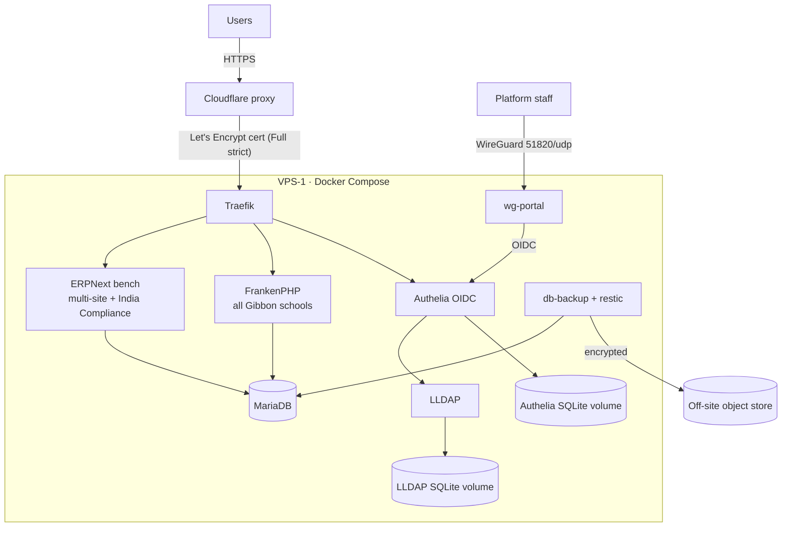

| Layer | Components |
|---|---|
| core/edge | Traefik (+ CrowdSec bouncer); Cloudflare in front (no container) |
| core/access | wg-portal (WireGuard `wg0`, `10.10.0.0/24`) |
| core/identity | LLDAP, Authelia; one private SQLite volume each |
| core/data | MariaDB (`erp_*`, `gibbon_*`) |
| core/ops | db-backup → restic → S3, Beszel (`beszel.nigu.in`), Dozzle (VPN only), DBX (always on, VPN only) |
| erp | ERPNext bench: backend, frontend, websocket, queue-short, queue-long, scheduler, redis-cache, redis-queue |
| edu | `gibbon-<version>` (FrankenPHP, all schools; a second version only during upgrades) |

### 3.2 Later — independent VPSs

| VPS | Role | Notes |
|---|---|---|
| `core-01` | Data, identity, backups, control plane (`auth`/`vpn`/`dbx`/`beszel.nigu.in`) | DB ports bound only to the WireGuard IP |
| `erp-01` | ERPNext | DB on `core-01` via WireGuard |
| `edu-01` | Gibbon | DB on `core-01` via WireGuard |
| `mon-01` | Grafana + VictoriaMetrics/Loki on object store | Also monitors the others from outside |

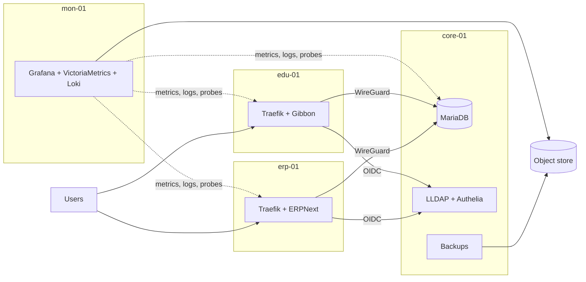

Moving a tenant or product = edit `deployments/<vps>.yml`, validate, deploy, restore data, repoint its Cloudflare CNAME (§3.4).

Inter-VPS traffic: other VPSs join `core-01`'s WireGuard network as static peers (Ansible-managed, separate subnet from staff devices, e.g. `10.10.1.0/24`); wg-portal stays the single place where staff devices are managed.

### 3.3 Domain & routing map

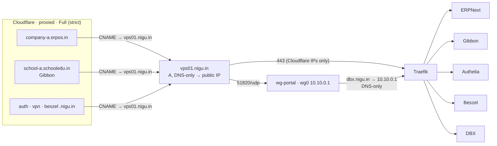

| Hostname | Cloudflare record | Target | Certificate at Traefik | Access |
|---|---|---|---|---|
| `vps01.nigu.in` (one per VPS) | `A`, **DNS-only** | VPS public IP | — | WireGuard endpoint (`51820/udp`); CNAME target. Replacing a VPS = change this one record |
| `nigu.in`, `www.nigu.in` | proxied | control-plane VPS | LE wildcard `*.nigu.in` | Public platform home |
| `auth.nigu.in` | `CNAME`, proxied | control-plane VPS | LE wildcard `*.nigu.in` | Public: Authelia portal + OIDC issuer for all three domains |
| `vpn.nigu.in` | `CNAME`, proxied | control-plane VPS | LE wildcard `*.nigu.in` | wg-portal web UI; OIDC login, groups `admin`, `ops`. The tunnel itself uses `vps01.nigu.in:51820` (Cloudflare does not proxy UDP on the free plan) |
| `beszel.nigu.in` | `CNAME`, proxied | control-plane VPS | LE wildcard `*.nigu.in` | No VPN needed; Authelia `admin`, `ops`, `support` |
| `dbx.nigu.in` | `A`, **DNS-only** | `10.10.0.1` (WireGuard IP) | LE wildcard `*.nigu.in` | VPN subnet **and** Authelia `admin`, `ops` (§4.2) |
| `logs.nigu.in` (Dozzle) | `A`, DNS-only | `10.10.0.1` | LE wildcard `*.nigu.in` | Same chain as DBX |
| `<company>.erpos.in` | `CNAME`, proxied | `vpsNN.nigu.in` | LE wildcard `*.erpos.in` | ERPNext native login; **no Authelia** |
| `<school>.schooledu.in` | One `CNAME`, proxied | `vpsNN.nigu.in` | LE wildcard `*.schooledu.in` | Gibbon native login at `/`; **no Authelia** |

- **Why the WireGuard IP for DBX:** if `dbx.nigu.in` were proxied, a VPN user's browser would reach it through Cloudflare from their public IP, and an `ipAllowList` on `10.10.0.0/24` would always fail (trusting `X-Forwarded-For` would not help: it carries the public IP). Pointing a DNS-only record at `10.10.0.1` sends the traffic through the tunnel; the private IP in public DNS reveals nothing reachable.
- **One certificate mechanism:** Let's Encrypt certificates are publicly trusted, so the same wildcard serves Cloudflare → origin (proxied hosts, Full strict) and browser → origin (DNS-only `dbx`/`logs`). For proxied hosts, visitors see Cloudflare's edge certificate, not ours (§5.1).
- All tenant hostnames are one level deep, so Cloudflare's free Universal SSL edge certificate covers them.
- Reserved tenant IDs (validator): `www`, `auth`, `vpn`, `dbx`, `beszel`, `logs`, `status`, `admin`, `ldap`, `grafana`, `mon`, any `vps*`.

### 3.4 Cloudflare DNS, edge caching & Ansible automation

| Item | Design |
|---|---|
| Plan | Free: up to 200 DNS records per zone (zones created since 2024), 10 Cache Rules, WebSockets, 100 MB request body, 100 s origin timeout. Pro (3,500 records) when a zone nears ~150 records; each school uses one CNAME for Gibbon |
| Zone settings (Ansible) | SSL/TLS **Full (strict)**, Always Use HTTPS, minimum TLS 1.2, HSTS after S6 stabilises; optional **Authenticated Origin Pulls** (mTLS from Cloudflare, verified by Traefik) |
| Certificates | Let's Encrypt via Traefik ACME **DNS-01** (Cloudflare provider), one certificate per VPS (§5.1); `acme.json` on a persistent, backed-up volume |
| Caching | **Allow-list**: cache only ERPNext `/assets/*`. **Bypass** everything else, explicitly ERPNext `/private/*`, `/api/*`, `/app*`, and **all traffic on school hostnames**. Gibbon responses use `Cache-Control: private, no-store`; no shared origin or CDN cache. Defined as Cache Rules templates per zone |
| Real client IP | Traefik `forwardedHeaders.trustedIPs` = Cloudflare IP ranges (refreshed by Ansible); CrowdSec and logs use the real visitor IP |
| Origin lockdown | Public 443/80 accepted only from Cloudflare ranges. Docker-published ports bypass UFW, so the rule lives in the **`DOCKER-USER`** iptables chain (Ansible template). `51820/udp` open to all; SSH only on `wg0` after S6 |

**API tokens** (Ansible Vault, least privilege, one purpose each):

| Token | Permissions | Used by |
|---|---|---|
| `cf_dns_token` | Zone · DNS · Edit on the three zones | `community.general.cloudflare_dns` (records) |
| `cf_zone_token` | Zone Settings · Edit, Cache Rules · Edit, Cache Purge · Purge on the three zones | `ansible.builtin.uri` → Cloudflare API (settings, cache rules, purge); no module exists for these |
| `cf_acme_token` | Zone · DNS · Edit on the three zones, **client IP filter = the VPS public IPs** | Traefik DNS-01 on each VPS (only token that lives on a VPS; a leaked copy is useless elsewhere). Later option: delegate `_acme-challenge` to a separate validation zone to drop DNS edit rights on the main zones |

Exact permission names are verified when the tokens are created (S6).

**Ansible automation** (role `core/ansible/roles/cloudflare`, driven by the manifests; no shell):
- `make dns-sync VPS=`: node `A` record from `public_ip` + `node_record`; one proxied `CNAME` per tenant hostname of that VPS. Records of tenants no longer in any manifest are **reported**, and only deleted by the tenant-retire playbook (no silent pruning).
- Tenant onboarding (`make deploy`) calls the same tasks, so a new tenant is reachable as soon as its health gate passes.
- `make cdn-purge VPS= [ID=]`: purge by hostname for the affected tenants after an image or tenant-package change (part of the deploy when the lock diff changes static assets). Purge by hostname is available on all plans since 2025; verify rate limits in S6, fall back to purging the changed asset URLs.
- `make tenant-move ID= FROM= TO=`:

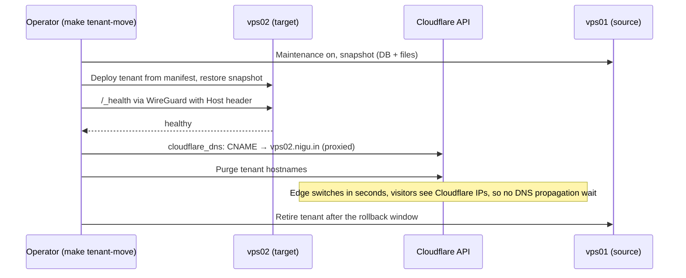

**Limits to design around:** requests over 100 s get Cloudflare 524, so long ERPNext reports run as prepared/background reports; uploads > 100 MB are not possible through the proxy (Gibbon/ERPNext upload limits stay below); TLS terminates at Cloudflare, so Cloudflare processes tenant traffic (named as a sub-processor in school/ERP terms, §13). Locally (`dns.provider: none`) the Cloudflare role is not run; it is tested by rendering and `--check` in unit tests and first applied in S6.

---

## 4. Tools & Services (with rationale)

### 4.1 Host & Platform

| Layer | Tool / Service | Rationale | Alternatives |
|---|---|---|---|
| VPS | **Contabo** | Best RAM/€ for a free service | Hetzner, OVH |
| OS | **Ubuntu 24.04 LTS** | Long support | Debian 12 |
| Runtime | **Docker Engine + Compose v2** | Simple, Ansible-native (`community.docker.docker_compose_v2`) | Swarm, k3s, Podman |
| Provisioning | **Ansible** (`community.docker`, `community.general`) | Idempotent, Jinja2 IaC | Terraform later for DNS/VPS only |
| Tool pinning | **mise** + **`.tool-versions`** | Same versions of python, ansible-core, linters, trivy on laptop and CI | asdf, devcontainer |
| Entry point | Root **Makefile** → `scripts/` or `<product>/scripts/` | Single entry point; complex logic in scripts | — |
| Host selection | **`deployments/<vps>.yml`** manifests | Cross-product tenant placement in one file per VPS | Per-product inventories |
| Secrets | **Ansible Vault** | Encrypted in git, no extra infra | SOPS + age |
| Edge / TLS | **Traefik v3** behind Cloudflare; **Let's Encrypt** wildcard per VPS via DNS-01 (`tls.mode: letsencrypt`) | Host routers via file provider; `selfsigned` locally; `letsencrypt-staging` for the first deploy of a VPS | Caddy, Cloudflare Origin CA |
| Firewall | **UFW** + `DOCKER-USER` rules + **CrowdSec** | 443/80 from Cloudflare ranges only, `51820/udp` open, SSH on `wg0` only; brute-force protection ~50 MB | fail2ban |
| Admin network | **wg-portal** (WireGuard, `wg0` `10.10.0.0/24`, web UI `vpn.nigu.in`, OIDC via Authelia) | SSH, DBX, logs; later inter-VPS DB traffic (static peers) | Tailscale, NetBird |
| DNS + CDN | **Cloudflare free** for `nigu.in`, `erpos.in`, `schooledu.in`; DNS-only `A` per VPS node, proxied `CNAME` per tenant; managed by Ansible (`community.general.cloudflare_dns` + Cloudflare API) | Static asset caching, DDoS protection, instant tenant moves; `.in` supported (§3.3, §3.4) | Registrar DNS |
| Swap | 4 GB swapfile, `vm.swappiness=10` | Safety net during ERPNext migrations | — |

### 4.2 Data & Database Access (`core/`)

| Function | Tool | Approx. RAM | Rationale |
|---|---|---|---|
| MySQL-compatible DB | **MariaDB 10.11 LTS** (verify ERPNext + India Compliance support before pinning) | 1.2–2 GB | Required by Frappe; also Gibbon. LLDAP and Authelia use separate SQLite stores (D4). |
| Cache/queue | **Redis 7 / Valkey** inside `erp/` | 100–250 MB | Tightly coupled to Frappe. |
| DB access (GUI) | **DBX Web workbench** at `dbx.nigu.in` — always running on the control-plane VPS; image pinned by digest; Web release and its internal connection API contract pinned to the same version; VPN allow-list + Authelia + trusted-auth header (below) | ≤ 300 MB budget, measure in S3 | Web workbench for MariaDB (local and other VPSs over WireGuard), the S3 object store (if verified) and LLDAP (LDAP Studio plugin). No Kafka/Trino agents or JRE (decided: not needed). `mem_limit` set. |
| DB access (CLI) | `make db-shell VPS= DB=` → `mariadb` via SSH over WireGuard | 0 | Fastest, no extra service. |
| Object store access | **rclone** (CLI, `make s3-ls`, `make s3-sync`) + provider web console | 0 | restic handles backups; rclone handles ad-hoc listing/copy. Use DBX for buckets only if its object-store support is verified in S3. |

#### DBX protection (`dbx.nigu.in`)

Three gates in a fixed middleware order: **network** (WireGuard subnet), **identity** (Authelia, groups `admin`/`ops`), **application** (DBX trusts only requests carrying the secret header that Traefik adds after Authelia succeeded).

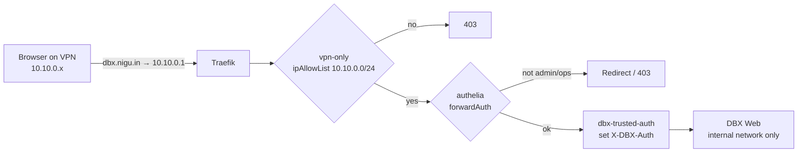

```yaml
# core/ansible/roles/edge/templates/dynamic/dbx.yml.j2 (rendered file is 0600, secret from Vault)
http:
  routers:
    dbx:
      rule: Host(`dbx.nigu.in`)
      entryPoints: [websecure]
      middlewares: [vpn-only, authelia, dbx-trusted-auth, secure-headers]   # order matters
      service: dbx
      tls: {}                     # served from the VPS wildcard certificate (§5.1)
  middlewares:
    vpn-only:
      ipAllowList:
        sourceRange: ["{{ wireguard_subnet }}"]   # no ipStrategy → checks the TCP peer, ignores X-Forwarded-For
    authelia:
      forwardAuth:
        address: http://authelia:9091/api/authz/forward-auth
        trustForwardHeader: true                  # entrypoint already drops X-Forwarded-* from non-Cloudflare peers
        authResponseHeaders: [Remote-User, Remote-Groups, Remote-Email, Remote-Name]
    dbx-trusted-auth:
      headers:
        customRequestHeaders:
          X-DBX-Auth: "{{ vault_dbx_trusted_auth_secret }}"   # overwrites any client-supplied value
```

| DBX setting | Value | Why |
|---|---|---|
| `DBX_WEB_TRUSTED_AUTH_ENABLED` | `true` | Login delegated to Authelia; DBX accepts requests only with the trusted header |
| Trusted-auth secret | Vault value, same as `X-DBX-Auth` above (variable name per DBX docs, confirm in S3) | A request that bypasses Traefik cannot authenticate |
| `DBX_DISABLE_PASSWORD_VIEWER` | `true` | Stored database credentials cannot be revealed in the UI |
| Network | DBX attached only to the internal `edge` network, **no published port** | Traefik is the only way in |
| User identity | From `Remote-User`/`Remote-Groups` if DBX supports it (confirm in S3) | Audit trail per staff member |

- **Prerequisite (integration test in S3):** Traefik must see the WireGuard client IP (`10.10.0.x`), not a Docker gateway address. If Docker's port publishing rewrites the source, bind a dedicated `vpn` entrypoint to `10.10.0.1:443` instead of relying on `ipAllowList` alone.
- **LDAP Studio plugin (`io.dbx.ldap`, official):** installed at image build or by Ansible from a pinned version + checksum in `versions.yml` (never ad hoc from the UI). Connection to `ldap://lldap:3890` with a read-only bind account in LLDAP's `lldap_strict_readonly` group for browsing; changes are made with the operator's own `admin` credentials. Lets ops see LLDAP entries next to the MariaDB (ERPNext, Gibbon) and S3/MinIO connections. Identity SQLite volumes are not mounted into DBX; directory changes go through LDAP, not direct SQL. Flink and Kafka connectors are not configured (no such services here).

**Version pins.** mise/asdf treat every `.tool-versions` line as an installable tool, so keys such as `dbx-image-digest` or `dbx-jre-sha256-amd64` fail or warn unless you have plugins for them. Keep CLI tools in `.tool-versions`; keep image/artifact pins in `versions.yml` (read by Ansible and the Makefile, bumped by Renovate):

```yaml
# versions.yml (excerpt)
dbx:
  # Keep the internal connection API adapter coupled to this release.
  web: 0.6.67
  api_contract: 0.6.67
  image_digest: sha256:0fdaf801248c7155431d6d1d412f9f7cc9b79b955dc956571d8e9c03993c0020
  plugins:
    io.dbx.ldap: {version: "<pin>", sha256: "<checksum>"}   # LDAP Studio
gibbon:
  releases:            # at most two during an upgrade (§5.5)
    "<old>": {sha256: "<checksum>"}
    "<new>": {sha256: "<checksum>"}
```

### 4.3 Identity (`core/`)

| Function | Tool | Approx. RAM | Integration |
|---|---|---|---|
| LDAP directory | **LLDAP** | ~20 MB | Platform staff only; groups `admin`, `ops`, `support`; Authelia backend; browsed via DBX LDAP Studio |
| OIDC + SSO + MFA | **Authelia** at `auth.nigu.in` | ~40 MB | forwardAuth for `beszel`, `dbx`, `logs` `.nigu.in`; OIDC provider for wg-portal (and later Grafana) |
| VPN | **wg-portal** | ~30 MB | OIDC login via Authelia; self-service `.conf` / QR for `admin`, `ops` |
| Tenant users | Native ERPNext / Gibbon accounts per tenant | — | Not in LLDAP; tenant routers have no Authelia middleware (D26) |
| Upgrade path | Zitadel / Keycloak | 0.3–1 GB | Only if per-tenant self-service orgs or SAML are needed |

**Identity storage:** LLDAP and Authelia each use their supported SQLite backend on a separate local persistent volume, mounted only into the owning service (apart from controlled backup/restore access). Paths, ownership and permissions are explicitly configured through `group_vars`. Neither service depends on MariaDB. Keep one instance of each service; do not share SQLite files across VPSs or replicas. Include consistent backups and identity restore tests (§4.5).

All tenant users (company users, school heads/admins, school staff, students, parents) keep **native app accounts** managed by their tenant. LLDAP and Authelia hold only platform staff, so a tenant account can never gain an internal group and an internal account is never needed on a tenant portal. Platform staff who must work inside a tenant app use a per-tenant support account created by the tenant (documented in the tenant README).

**Tenant SSO is deferred for everyone**, including principals, school admins and company owners. No tenant OIDC clients, `sso.heads` flag or delegated directory-management UI are planned. Any future proposal needs an explicit scope decision and design covering tenant isolation, user lifecycle, delegation and privacy before implementation; it is not an automatic post-S6 task.

**Groups and rules** (summary; full matrix in §13.1):

| LLDAP group | Gets |
|---|---|
| `admin` | Everything on `*.nigu.in` (incl. `vpn`, `dbx`, `logs`, `beszel`), wg-portal admin role |
| `ops` | `vpn.nigu.in`, `dbx.nigu.in`, `logs.nigu.in`, `beszel.nigu.in` (+ future Grafana); tenant `/_health` and SSH over the VPN |
| `support` | `beszel.nigu.in` (+ future Grafana support dashboards) only; explicitly denied `vpn` and `dbx` |

```yaml
# core/ansible/roles/identity/templates/authelia/configuration.yml.j2 (excerpt)
session:
  cookies:
    - domain: nigu.in
      authelia_url: https://auth.nigu.in
access_control:
  default_policy: deny
  networks:
    - {name: vpn, networks: ["{{ wireguard_subnet }}"]}
  rules:
    - domain: [dbx.nigu.in, logs.nigu.in]
      networks: [vpn]
      subject: [group:admin, group:ops]
      policy: two_factor
    - domain: [dbx.nigu.in, logs.nigu.in]
      policy: deny                       # support and everyone else
    - domain: beszel.nigu.in
      subject: [group:admin, group:ops, group:support]
      policy: two_factor
    - domain: "*.nigu.in"
      subject: [group:admin]
      policy: two_factor
identity_providers:
  oidc:
    authorization_policies:
      vpn_admin_ops:
        default_policy: deny
        rules: [{policy: two_factor, subject: [group:admin, group:ops]}]
    clients:
      - client_id: wg-portal
        authorization_policy: vpn_admin_ops   # support cannot log in to vpn.nigu.in
        redirect_uris: [https://vpn.nigu.in/api/v0/auth/login/authelia/callback]   # confirm path for the pinned wg-portal version
```

**Cross-domain SSO:** an Authelia session cookie belongs to one registrable domain, and each cookie domain needs its own portal URL on that domain (`auth.<domain>`); there is no single cookie for `nigu.in` and `schooledu.in`. This design does not need one: forwardAuth is used only on `nigu.in` hosts, and OIDC works across domains with the issuer `auth.nigu.in`. If a staff-only host is ever added on `erpos.in` or `schooledu.in`, add a cookie entry with `auth.erpos.in` / `auth.schooledu.in` (staff log in once per domain).

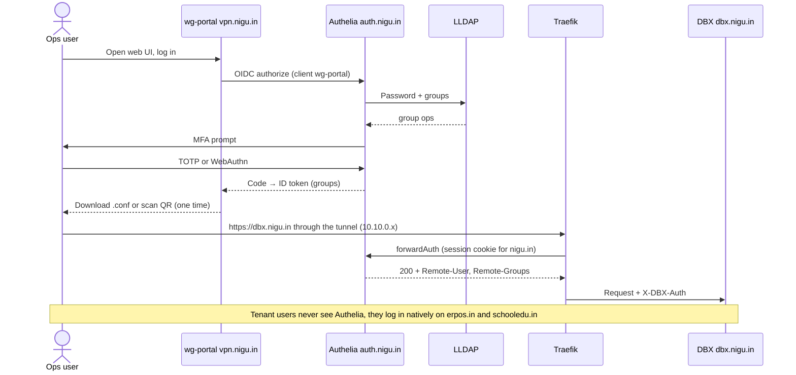

### 4.4 Applications

| Product | App | Deployment model | Rationale |
|---|---|---|---|
| erp | **ERPNext v15** (+ Frappe HRMS optional) at `<company>.erpos.in` (native login) | One bench, multi-site, custom image `erp/images/erpnext` | Mature open-source ERP. Upgrade only when India Compliance supports the target version. |
| erp | **India Compliance** | Baked in via frappe_docker `apps.json` | GST invoices, GSTR-1/3B, e-Invoice/e-Waybill. API features need India Compliance credits: platform-funded from ERP ad revenue if §10.4 is approved, otherwise tenant brings own; per-tenant usage tracked and capped. |
| edu | **GibbonEDU** at `<school>.schooledu.in/` (native login) | One **FrankenPHP** container, one Caddy site block per school, pinned Gibbon release downloaded at image build | §5 |
| all | **GitHub Actions → GHCR** | Build, scan, sign and publish custom images and tenant packages (§7.4) | Free registry, no long-lived Docker Hub token |

### 4.5 Backup & DR

| Function | Tool | Rationale |
|---|---|---|
| DB dumps | **`tiredofit/db-backup`** | Per-database MariaDB dumps |
| Identity SQLite backups | Consistent SQLite snapshots via the SQLite backup API/`.backup`, then restic | Snapshot LLDAP and Authelia separately; never copy live database files directly (including WAL-mode databases). Restore to the owning volume with correct permissions; retain required encryption/signing secrets securely in Vault and test staff login/MFA and wg-portal OIDC after restore. |
| ERPNext site backup | `bench backup --with-files` job | Native per-site restore |
| Off-site | **restic** → S3-compatible store: **Contabo Object Storage**, **Backblaze B2** or **Cloudflare R2**; **MinIO** in the local env | Encrypted, deduplicated, retention 7d/4w/6m. Prefer a provider other than the VPS provider for at least one copy. |
| Shared bucket | One bucket for all VPSs, prefix per VPS (`<vps>/restic`, `<vps>/dumps`); separate access key + restic password per VPS, restricted to its prefix where the provider supports it | A compromised VPS cannot read or delete other VPSs' backups |
| Restore drill | `make restore-test` on the local env (backs up to and restores from MinIO) | Untested backups are not backups |

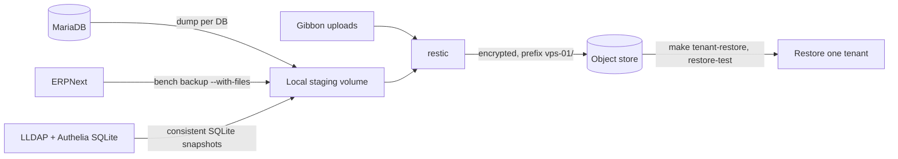

**Object-store adapter.** Only **S3-compatible** stores are supported; for those, the S3 API is the adapter and no custom code is needed. Not every provider's object store speaks S3, and "S3-compatible" stores differ in details (addressing style, regions, Object Lock, multipart limits, key scoping).

| Backend | Status | Notes |
|---|---|---|
| MinIO (local env) | Supported | Integration tests; Garage/SeaweedFS as drop-in local alternatives |
| Contabo Object Storage | Supported (target) | S3-compatible; path-style |
| Backblaze B2 (S3-compatible endpoint) | Supported | Use the S3 endpoint, not B2's native API |
| Cloudflare R2 | Supported | `region: auto` |
| Other S3-compatible (Wasabi, Hetzner, …) | Allowed after `make s3-check` passes | |
| Non-S3 APIs (Azure Blob, native GCS, OpenStack Swift without S3 layer, provider-proprietary) | **Not supported** | Needs an ADR (new backend type is a release-level decision) + new `type` + tests |

How it stays portable:
- Only **restic** and **rclone** talk to the object store. `db-backup` and `bench backup` write to a local volume; restic uploads. So one tool's backend support decides compatibility, not every tool's.
- `object_store.type` is required; the manifest validator rejects anything except `s3` today.
- Adding a non-S3 store = ADR, then map the new `type` to restic's native backend for that service (or its `rclone:` backend, which covers many providers), plus `make s3-check`-style smoke test and a restore drill. No in-house adapter code unless both tools lack the backend.
- `make s3-check VPS=` (S6 gate, and before switching provider): write/list/read/delete, multipart upload, key scoped to its prefix, `restic check`, restore of one tenant.

All tools read one config block, so local and production differ only in values:

```yaml
# group_vars (per environment)
object_store:
  type: s3                                   # only supported value (D22)
  endpoint: https://eu2.contabostorage.com   # local: http://minio:9000
  region: default
  bucket: nigu-backups
  prefix: vps-01
  path_style: true                           # required by MinIO and Contabo
```

MinIO's licensing and distribution changed in 2025 (community console reduced, official community binaries/images no longer published). Pin a known image by digest for local use, or use **Garage** or **SeaweedFS** (also S3-compatible) if that becomes a problem; `tests/integration` only uses the S3 API, so that swap is config-only. Passing tests against MinIO does not prove a production provider works; `make s3-check` against the real provider does.

### 4.6 Observability

| Phase | Tool | Rationale |
|---|---|---|
| Now | **Beszel** hub + agent at `beszel.nigu.in` (Authelia: `admin`, `ops`, `support`; no VPN) | Host/container metrics + alerts, ~50 MB; agents on other VPSs connect over WireGuard |
| Now | **UptimeRobot** (external) | Alerts when the VPS itself is down |
| Now | **Dozzle** at `logs.nigu.in` (VPN + Authelia `admin`, `ops`) | Live container logs |
| Now | **Telegram bot / ntfy** | Alert channel |
| Later | **Grafana + VictoriaMetrics + Loki** on `mon-01` with object store, **Alloy** agents | Long retention cheaply; Grafana logs in via Authelia OIDC, `support` gets read-only dashboards |
| Later | **Gatus** on `mon-01` | Per-tenant HTTP checks generated from the VPS manifests (YAML config, templatable) |

### 4.7 Quality, Security & Developer Tooling

| Concern | Tool | Where it runs | Notes |
|---|---|---|---|
| Formatting consistency | **.editorconfig** + `editorconfig-checker` | Editor, pre-commit, CI | Indentation/EOL/charset for YAML, Jinja2, Shell, PHP, Python, Markdown, Makefile (tabs) |
| Commit-time checks | **pre-commit** | Local (`make setup` installs hooks), CI (`pre-commit run --all-files`) | Only our code: upstream code is never committed; `exclude:` for `**/vendor/`, `**/upstream/`, generated files |
| YAML / Ansible | **yamllint**, **ansible-lint** | pre-commit, CI | |
| Shell | **shellcheck**, **shfmt** | pre-commit, CI | |
| Dockerfiles | **hadolint** | pre-commit, CI | |
| Markdown | **markdownlint-cli2** | pre-commit, CI | Mermaid blocks allowed |
| Python (validators/tests) | **ruff** (lint + format) | pre-commit, CI | |
| PHP (our patches/plugins only) | **PHP-CS-Fixer**, **PHPStan** | pre-commit (on changed files), CI | |
| Secrets | **Trivy secret** scan (+ optional **gitleaks** pre-commit hook) | pre-commit, CI | Blocks committed tokens |
| Commit / branch rules | `commit-msg` hook (small script in `scripts/`) + CI check of PR title and branch name | pre-commit, CI | Enforces §11.5 |
| Signing / publishing | **cosign** (keyless via GitHub OIDC, public Rekor log), **ORAS** | CI (`publish.yml`) | Signed images and tenant packages (§7.4) |
| IaC policy (advisory) | **KICS** (Compose, Ansible, Dockerfile) + **conftest** (our Rego rules in `policy/iac/`) on **rendered** per-tenant / per-VPS config | CI (`iac-security.yml`), `make iac-scan` | Trivy's Compose/Ansible coverage is limited; scanning rendered output catches what templates produce. Evaluate KICS in S1; drop it if conftest + Trivy cover enough |
| Workflow security | **actionlint**, **zizmor** | pre-commit, CI (`build.yml`) | Catches broken expressions, script injection, over-broad permissions, unpinned actions |
| CI reports | `scripts/ci/report.py` (Markdown + self-contained HTML) | Every workflow's `report` job | Uploaded as Actions artifacts and shown in the job summary (§7.5) |
| Vulnerabilities | **Trivy image** + **Trivy fs** | `make scan`, CI on PR + nightly | Fail on CRITICAL/HIGH with fix available; `.trivyignore` with expiry comments |
| Misconfiguration (IaC) | **Trivy config** | `make scan`, CI (`build.yml` blocking on Dockerfiles; `iac-security.yml` advisory on rendered config) | Dockerfiles, Compose, and Ansible coverage where supported |
| SBOM + licences | **Trivy** `image --format cyclonedx` (SBOM) and `--scanners license` | CI on image build | SBOM attached to GHCR image; licence findings reviewed, not auto-failed |
| Dependency updates | **Renovate** | GitHub | Pins images, actions (by SHA), galaxy collections, `.tool-versions` |
| HTTP load tests | **k6** | `make bench` | Results stored in `tests/benchmarks/results/` |
| Integration tests | **pytest** + **httpx**, optional **Playwright** for UI smoke | `make test-integration` | Runs against the local env and test tenants |

Pin all GitHub Actions (including Trivy's) by commit SHA. CI tooling is part of the supply chain.

---

## 5. Gibbon on a Single FrankenPHP Container

### 5.1 Routing

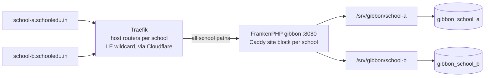

- School URLs: `https://<school>.schooledu.in/` serves Gibbon directly. Configure Gibbon's canonical URL as the school hostname and install it at `/srv/gibbon/<school>`; there is no public website path or subfolder rewrite. ERP remains `<company>.erpos.in`. Paid custom domains later use the same Gibbon-only routing model (`tenant.yml` → `custom_domains`), designed in an LLD.
- Traefik's file provider generates one explicit `Host(<school hostname>)` route per school to that school's versioned Gibbon service. Exclude `/_health` and `/_health/*` from public routing; those paths are internal health endpoints only. Do not configure a fallback website or route unknown school hosts to a default tenant.
- All paths on a school hostname belong to Gibbon. A school move updates its one CNAME and its Gibbon data; maintenance or an upgrade affects that school's application only.
- TLS (`tls.mode` in the VPS manifest, required, no default in code):
  - `selfsigned`: Traefik default certificate from a platform CA; local, CI and rehearsals. Pre-filled by the manifest template.
  - `letsencrypt-staging`: real ACME flow with untrusted certificates and much higher limits; first deploy of a new VPS. Cloudflare must be set to **Full** (not strict) for that VPS's hosts meanwhile, or use DNS-only test hostnames.
  - `letsencrypt`: production. Traefik ACME **DNS-01** with the Cloudflare provider (`cf_acme_token`). **One certificate per VPS** with SANs = the wildcards of the zones it serves + its node name, e.g. `*.erpos.in`, `*.schooledu.in`, `vps01.nigu.in` (+ `*.nigu.in` on the control plane). Wildcards make tenant onboarding certificate-free; the node name makes each VPS's identifier set unique, so Let's Encrypt's "5 identical certificates per week" limit applies per VPS, not shared.
  - `acme.json` is on a persistent volume and backed up; redeploys reuse it. Rehearsals use `selfsigned`.
  - The validator rejects `environment: production` without `letsencrypt`.

**Let's Encrypt behind Cloudflare: what changes**

| Topic | Effect | Handling |
|---|---|---|
| Which certificate visitors see | For proxied hosts, browsers see **Cloudflare's edge certificate** (Universal SSL; Cloudflare picks the CA). Our Let's Encrypt cert secures only Cloudflare → origin | Accepted. Showing our own cert to visitors needs DNS-only (no CDN/DDoS, origin IP exposed) or Cloudflare Advanced Certificate Manager (paid). DNS-only hosts (`dbx`, `logs`) do show our cert |
| Why DNS-01, not HTTP-01 | **Wildcard certificates require DNS-01** (Let's Encrypt does not issue wildcards via HTTP-01). HTTP-01 would mean one certificate per tenant hostname: a new issuance on every onboarding, and all VPSs sharing the "50 certificates per registered domain per week" limit for `erpos.in`/`schooledu.in`. It also cannot validate the DNS-only internal hosts (`dbx`, `logs` resolve to `10.10.0.1`, unreachable from Let's Encrypt). HTTP-01 itself does work for proxied hosts: the validator's request reaches the origin through Cloudflare, so the Cloudflare-only origin lockdown does not block it. Edge settings (Always Use HTTPS, redirect rules, WAF/bot rules) must leave `/.well-known/acme-challenge/` reachable on port 80, which is extra configuration to keep correct | Not used; DNS-01 only |
| API token on the VPS | DNS-01 needs a DNS edit token where Traefik runs | `cf_acme_token` IP-filtered to the VPS IPs; Vault; rotate yearly |
| Renewal failure | Expired origin cert → Cloudflare 526 for **every tenant on that VPS** | Traefik renews 30 days before expiry; alert when < 21 days (UptimeRobot SSL check on `vpsNN.nigu.in`, later Gatus); `make cert-status VPS=` |
| Shorter lifetimes | Let's Encrypt is moving towards ~45-day certificates | Fully automated; no impact beyond the alert above |
| Edge certificate coverage | Free Universal SSL covers apex + one level | All hostnames are one level deep (§3.3) |
- FrankenPHP: `auto_https off`, listens on plain HTTP `:8080` on the internal Docker network only. Trusts `X-Forwarded-*` from Traefik only (`trusted_proxies`).
- One Caddyfile site block per school (Jinja2 template → `/etc/frankenphp/Caddyfile.d/<school>.caddyfile`), e.g.:

```caddyfile
http://school-a.schooledu.in:8080 {
	root * /srv/gibbon/school-a
	header Cache-Control "private, no-store"
	@blocked path /config.php /.git* /installer /installer/*
	respond @blocked 404
	@uploadPhp path_regexp (?i)^/uploads/.*\.ph(p[0-9]?|tml|ar)$
	respond @uploadPhp 404
	php_server {
		env GIBBON_TENANT school-a
		env GIBBON_ROOT /srv/gibbon/school-a
	}
}
```

This routing excerpt omits the separate internal `/_health` handler (§5.4). The public document root is exactly that school's Gibbon installation.

### 5.2 Isolation controls

| Control | Implementation | Limit |
|---|---|---|
| **DB credential separation** | One MariaDB database + user per school, grants only on its own DB; credentials in that school's `config.php` (rendered from Vault) | Credentials are readable by the shared PHP process, so the PHP controls below protect them |
| **Caddy path rules** | Per-site `root`; deny `config.php`, PHP execution in `uploads/`, dotfiles, installer after setup; static uploads served without PHP | Only covers HTTP paths, not file access from inside PHP |
| **PHP hardening (global `php_ini`)** | `open_basedir=/srv/gibbon:/tmp/php`, `disable_functions=exec,shell_exec,system,passthru,proc_open,popen,pcntl_exec`, `allow_url_include=Off`, `expose_php=Off`, `memory_limit=128M`, `max_execution_time=30`, `upload_max_filesize`/`post_max_size` bounded | FrankenPHP's `php_ini` option is **global only**; there is no per-site `php_ini` |
| **Per-school narrowing** | Global `auto_prepend_file=/etc/gibbon/tenant-guard.php` reads `GIBBON_ROOT` (set per `php_server` via `env`) and calls `ini_set('open_basedir', "$root:/tmp/php/$tenant")` and a per-school `session.save_path`. `open_basedir` can only be tightened at runtime, never widened. | Verify in the S4 spike: Gibbon compatibility, `ini_set` effect per request in FrankenPHP threads, no leakage between requests |
| **Read-only code** | Gibbon code mounted read-only; only `uploads/` and session dirs writable, per school | Gibbon module/theme installs happen through image builds, not the admin UI |
| **Resource fairness** | `max_threads`, `max_wait_time`, `max_requests` (thread recycling); container `mem_limit`/`cpus` | All schools share one thread pool, so one school's spike can slow others. Watch it with benchmarks. |
| **Single runtime** | One PHP + Gibbon version per container | Upgrades move schools one at a time to a second container (§5.5) |

**Exit rule (S4):** if the spike shows `open_basedir` narrowing is unreliable, Gibbon is incompatible with FrankenPHP, or isolation tests fail, fall back to per-school containers using the same image (D7 fallback).

### 5.3 Upstream code handling

The Gibbon release is downloaded at image build (pinned version + checksum) into `edu/images/gibbon/`. Our changes live as `patches/*.patch` plus config templates. Upstream code is never committed, so linters and pre-commit only see our code. The same applies to ERPNext/India Compliance (`apps.json` + pinned refs).

### 5.4 Health checks (many schools, one container)

Docker's healthcheck is per container. It must not depend on any single school, otherwise one school's broken database would restart every school.

| Level | Check | On failure |
|---|---|---|
| Container | Docker `healthcheck` → internal-only Caddy site `:8081` that returns 200 without PHP or DB | Docker restarts the container (runtime failure only) |
| Per school | `/_health` in each school's site block → `health.php` baked into the image (not Gibbon code): runs `tenant-guard`, `SELECT 1` with **that school's** DB credentials, checks `uploads/` and session dir are writable, returns JSON `{school, gibbon_version, db, storage}`. Caddy allows it only from the Docker network (`remote_ip`); no public router matches it. | One Traefik service per school (all pointing to the same container) with `healthCheck.path=/_health` and `hostname=<school domain>` → only that school gets a maintenance page; alert |
| Deploy gate | Ansible polls `/_health` for every school in the manifest after each deploy or upgrade | Deploy fails and lists the failing schools |
| External | UptimeRobot now, Gatus later: each school's public login page | Telegram/ntfy alert |

### 5.5 Upgrade & rollback (Gibbon)

The manifest pins every school to a Gibbon version. Deploy runs one container per version in use (normally one, at most two) and Traefik routes each school to its version. Gibbon database updates are one-way, so rollback means routing back **and** restoring the pre-upgrade snapshot.

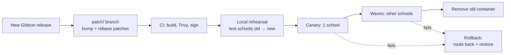

| Step | Where | What | Gate |
|---|---|---|---|
| 1. Prepare | `patch/gibbon-<new>` | Bump `versions.yml` (version + checksum); rebase `patches/`; read upstream changelog for DB/PHP changes; record behaviour changes in the upgrade report and update `docs/lld/gibbon.md` | CI green, image signed |
| 2. Rehearse | Local env: `make upgrade-test PRODUCT=edu APP=gibbon FROM=<old> TO=<new>` | Deploy `test-school-a/b` on `<old>` with seed data → snapshot → move to `<new>` → Gibbon DB update → integration, isolation and health tests → benchmark → rollback drill back to `<old>` | All pass; upgrade report + benchmark in the PR |
| 3. Canary (Saturday) | One VPS + product, e.g. `make upgrade VPS=vps-01 PRODUCT=edu` | Maintenance on for all schools of that VPS; `tenant-snapshot` of each (restic tag `pre-<new>`); move the canary school (marked `canary: true` in the manifest) to `<new>` (starts `gibbon-<new>` next to `gibbon-<old>`); DB update; `/_health` + smoke test | Canary healthy for 30–60 min |
| 4. Rest (same Saturday) | Same VPS + product | Move the other schools; DB update each; `/_health` gate; maintenance off | All schools healthy |
| 5. Finish (next deploy after the rollback window) | Same VPS | Old container removed when no school references `<old>` | Validator: ≤ 2 Gibbon versions per VPS |
| 6. Next VPS | Following Saturday | Repeat for the next VPS (or the next product on the same VPS) | Previous VPS stable for a week |

**Rollback (per school, within the canary/wave window):**
1. Maintenance on for that school.
2. Set it back to `<old>` in the manifest and deploy; this only switches the route, because the old container is still running until the rollback window closes.
3. `make tenant-restore VPS= ID= SNAPSHOT=pre-<new>` (DB + uploads).
4. Pass the `/_health` gate, then turn maintenance off; open a `bugfix/` issue.

Data written after the snapshot is lost on rollback. That is why schools are in maintenance during the DB update. Rollback window: **Saturday upgrade → Sunday 18:00 IST** (before the school week). After that, fix forward with a `hotfix/` branch.

Runtime-only updates (PHP/FrankenPHP, no Gibbon change) use the same flow. ERPNext cannot cheaply run two benches (~2 GB each): upgrade the bench in a maintenance window with per-site `bench backup`, `bench migrate`, and roll back with the previous image + per-site restore; upgrade only when India Compliance supports the target version.

---

## 6. Resource Budget — one VPS (8 GB, 10 schools + 10 ERP companies)

| Component | Est. RAM |
|---|---|
| OS + Docker | 500 MB |
| Traefik + CrowdSec | 100 MB |
| MariaDB (buffer pool 1 GB) | 1.5 GB |
| LLDAP + Authelia + wg-portal | 110 MB |
| ERPNext bench + Redis (10 sites share workers) | 2.0–2.6 GB |
| FrankenPHP Gibbon (all schools) | 200–400 MB (to be measured; scales with threads, not school count) |
| Second Gibbon container (upgrade window only) | +200–400 MB, temporary |
| Backup, Beszel, Dozzle | 150 MB |
| DBX Web (control-plane VPS only, always on) | ≤ 300 MB (measure in S3) |
| **Total** | **~5.1–6.0 GB** (+ upgrade window; rough, verify with the `capacity-10x10` benchmark) |

MariaDB holds 20 tenant databases (10 ERP and 10 Gibbon); LLDAP and Authelia each have a separate SQLite store. Size the buffer pool from benchmarks. Disk (300 GB): budget ~10 GB per ERP site and ~5 GB per school incl. uploads, plus local dump staging; alert at 70 %. The validator rejects more than 10 tenants per product per VPS. A `capacity-10x10` benchmark scenario must pass before a VPS is filled. Scale-out triggers: RAM > 75 % sustained, swap-in activity, p95 > 2 s, or tenant counts outgrowing benchmarks.

---

## 7. Repository Structure

```
nigu-lite/
├── AGENTS.md                         # always-on rules + index of task instructions
├── README.md                         # platform overview (README template, mermaid)
├── master-plan.md                    # this plan
├── LICENSE                           # AGPL-3.0
├── SECURITY.md                       # private vulnerability reporting
├── Makefile                          # sole entry point
├── .tool-versions                    # CLI tool pins (mise/asdf)
├── versions.yml                      # image/artifact pins: Gibbon, DBX, image digests
├── .editorconfig  .gitattributes  .gitignore
├── .pre-commit-config.yaml
├── .trivyignore                      # each entry: reason + expiry date
├── .github/
│   ├── instructions/                 # task-scoped AI instructions (20–30 lines each)
│   ├── pull_request_template.md
│   └── workflows/                    # build.yml, iac-security.yml, publish.yml, integration.yml, retention.yml (§7.5)
├── docs/
│   ├── adr/  sdd/  lld/  developer/
│   └── templates/                    # README, ADR, SDD, LLD, dev doc, tenant, VPS manifest
├── scripts/                          # cross-product scripts called by Makefile
│   ├── hooks/                        # commit-msg hook (installed by make setup)
│   └── ci/                           # catalog.py, plan.py, report.py (same code locally and in CI)
├── policy/iac/                       # conftest Rego rules + accepted.yml (reason + expiry per accepted finding)
├── deployments/
│   ├── schema.json                   # manifest schema
│   ├── local.yml                     # local env → test tenants
│   ├── vps-01.yml
│   └── vps-01.lock.yml               # resolved image/package digests (generated, committed)
├── local/                            # local VPS simulator (Dockerfile: Ubuntu + systemd + sshd + Docker)
├── core/        README.md  ansible/  scripts/
├── erp/         README.md  ansible/  images/erpnext/  scripts/
│   └── tenants/<company-id>/         # README.md, tenant.yml, vault.yml, assets/, migrations/
├── edu/         README.md  ansible/  images/gibbon/  scripts/
│   └── tenants/<school-id>/          # README.md, tenant.yml, vault.yml, assets/, migrations/
└── tests/
    ├── README.md
    ├── unit/                         # manifest validator, template rendering, scripts
    ├── integration/                  # pytest against local env + test tenants
    ├── tenants/
    │   ├── erp/test-company-a/  test-company-b/
    │   └── edu/test-school-a/   test-school-b/
    └── benchmarks/
        ├── scenarios/                # k6 scripts
        └── results/                  # <date>-<scenario>.md + .json
```

### 7.1 Deployment manifest

```yaml
# deployments/vps-01.yml
schema_version: 1
host: vps-01
environment: production
public_ip: 203.0.113.10           # documentation IP; real value here
node_record: vps01.nigu.in        # DNS-only A record → public_ip; tenant CNAME target
control_plane: true               # hosts auth/vpn/dbx/beszel/logs .nigu.in (exactly one VPS)
dns: {provider: cloudflare}       # cloudflare | none (local)
tls: {mode: letsencrypt}          # selfsigned | letsencrypt-staging | letsencrypt (DNS-01, wildcard per VPS)
wireguard: {subnet: 10.10.0.0/24, address: 10.10.0.1, port: 51820}
upgrade_day: saturday
core_services: [edge, data, identity, backups, metrics]
products:
  erp:
    tenants: [company-a, company-b]
  edu:
    tenants:
      school-a: {apps: [gibbon], gibbon_version: "<new>", canary: true}
      school-b: {apps: [gibbon], gibbon_version: "<old>"}
```

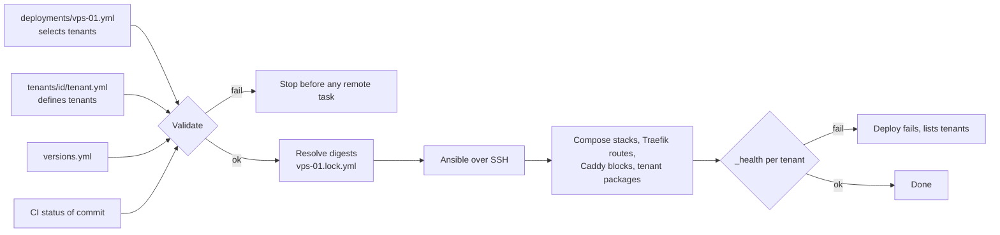

- The manifest **selects**; `tenants/<id>/tenant.yml` **defines** (domains, features and Gibbon branding).
- Deploys require `VPS=`; there is no default "deploy everything".
- Validation before any remote task: schema, unknown tenant IDs, duplicate placement across manifests, unsupported apps, missing tenant files, unencrypted secrets.
- `deployments/local.yml` selects **test tenants** from `tests/tenants/`.
- DNS/edge rules: `node_record` unique across manifests; exactly one `control_plane: true`; production needs `dns.provider: cloudflare` and `tls.mode: letsencrypt`; reserved tenant IDs (§3.3) rejected.
- Limits: ≤ 10 tenants per product per VPS; exactly one `canary` school per VPS when it hosts Gibbon.
- Every school states its `gibbon_version` explicitly (no default); the version must exist in `versions.yml`.

### 7.2 Tenant folder

| File | Purpose |
|---|---|
| `README.md` | From the tenant README template: who, which apps, domains, role-based contact (e.g. "school office"), mermaid overview. **No personal names, phone numbers or e-mail addresses** (public repo); those live in `vault.yml` or outside the repo |
| `tenant.yml` | Domains (+ paid `custom_domains`), enabled apps and Gibbon branding refs |
| `vault.yml` | Encrypted DB/OIDC credentials |
| `assets/` | Static files only: logo, header, CSS overrides |
| `migrations/` | Ordered, forward-only tenant data changes, including the initial bootstrap (`0001-bootstrap`) |

Never commit real personal data, production exports or uploads. The repo and its packages are **public**: tenant IDs, domains, logos and bootstrap migrations are visible to everyone, so tenants must agree to that in their terms.

#### Tenant migrations

Tenant migrations change **one tenant's data and settings** (school settings, year groups, roles, custom fields, ERP company defaults, print formats). Upstream schema changes are not tenant migrations: they come with the product upgrade (Gibbon's database updater, Frappe `bench migrate` patches, §5.5).

| Aspect | edu (Gibbon) | erp (ERPNext site) |
|---|---|---|
| Format | `migrations/NNNN-<summary>.sql` (MariaDB) | `migrations/NNNN-<summary>.json`: documents to insert/update |
| Applied by | Ansible `community.mysql.mysql_query`, connected as the **school's own DB user** (cannot touch other schools' databases) | Ansible `ansible.builtin.uri` → the site's Frappe REST API with a per-site API key from `vault.yml` |
| Tracking | Table `nigu_migrations` in the tenant database (id, checksum, applied_at) | DocType `Nigu Migration` in our platform Frappe app |
| Version guard | Header `-- requires: gibbon >= <version>`; validator checks it against the tenant's pinned version | `"requires": {"erpnext": ">= <version>"}` |

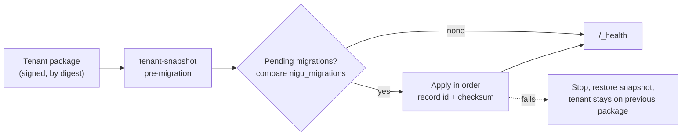

Rules: forward-only (no down scripts; rollback = restore the snapshot); a changed checksum of an applied migration fails validation (write a new migration instead); no secrets and no real personal data (synthetic or tenant-approved reference data only); `sqlfluff` (MariaDB dialect) in pre-commit; integration tests apply every migration of the test tenants on a fresh database and on one upgraded from the previous product version. During a product upgrade, the product's own DB update runs first, then pending tenant migrations that require the new version.

### 7.3 Makefile targets

| Target | Purpose |
|---|---|
| `setup` | `mise install`, galaxy deps, `pre-commit install` |
| `lint` | `pre-commit run --all-files` + Ansible syntax checks |
| `scan` | Trivy fs + config + secret; `scan-images` for built images |
| `test-unit` | Validators, template rendering |
| `local-up` / `local-down` / `local-reset` | Start/stop/wipe the local VPS simulator |
| `local-deploy` | Run real playbooks with `deployments/local.yml` |
| `test-integration` | pytest against local env + test tenants |
| `bench-tenants` | Generate the 10 + 10 benchmark tenants (§9.1); not committed |
| `bench SCENARIO=` | k6 run → `tests/benchmarks/results/` |
| `image-build PRODUCT= APP=` | Build image (+ Trivy scan) |
| `deploy VPS=` | Validate manifest, then deploy core + selected products |
| `tenant-new PRODUCT= ID=` | Scaffold tenant from template |
| `db-shell VPS= DB=` / `s3-ls VPS=` | CLI access to DB / object store (MinIO locally) |
| `s3-check VPS=` | Object-store compatibility smoke test against the configured provider (§4.5) |
| `backup-now VPS=` / `restore-test` | Backup / restore drill in local env |
| `vault-edit FILE=` | Edit secrets |
| `health VPS=` | `/_health` of every tenant in the manifest, as a table |
| `upgrade-test PRODUCT= APP= FROM= TO=` | Local upgrade + rollback rehearsal on test tenants |
| `tenant-snapshot VPS= ID=` / `tenant-restore VPS= ID= SNAPSHOT=` | Per-tenant snapshot / restore |
| `upgrade VPS= PRODUCT=` | Saturday upgrade of one VPS + product (§5.5) |
| `maintenance VPS= ID= STATE=on\|off` | Per-tenant maintenance page |
| `tenant-package PRODUCT= ID=` | Build the tenant package locally (same as CI) |
| `tenant-migrate VPS= ID= [CHECK=1]` | Snapshot, then apply pending tenant migrations (also part of `deploy`); `CHECK=1` lists pending ones only |
| `cert-status VPS=` | Certificate SANs and expiry served by Traefik on that VPS |
| `dns-sync VPS=` | Create/update the node `A` record and tenant `CNAME`s in Cloudflare; report orphans |
| `cdn-purge VPS= [ID=]` | Purge Cloudflare cache for the VPS's (or one tenant's) hostnames |
| `tenant-move ID= FROM= TO=` | Snapshot, restore on target, health check, repoint CNAME, purge (§3.4) |
| `access-check VPS=` | Probe the RBAC matrix (§13.1) with test accounts of each group |
| `ci-catalog` / `ci-plan BASE=` | Same module catalog and change plan the workflows use (§7.5) |
| `iac-scan [VPS=] [PRODUCT=] [ID=]` | Render config with dummy secrets and run the advisory IaC checks |
| `ci-module ID= TYPE=` | Build/scan one image, or dry-run one tenant package (one matrix leg) |
| `ci-quality` | `lint test-unit scan` + PR title/branch/commit rules |
| `ci-report DIR=` | Build the Markdown + HTML report from job results |

### 7.4 Build & publish (CI/CD)

| Artifact | Registry / format | Built by | Contents | Used by |
|---|---|---|---|---|
| Custom images: `erpnext`, `gibbon`, `local-vps` | OCI images in GHCR; tags `<upstream-version>-<build>` and `sha-<commit>` | `publish.yml` → `publish-images` when the plan marks an image changed | Pinned upstream release + our patches/config | Compose, pinned by digest |
| Tenant packages | OCI artifacts in GHCR via **ORAS** (`ghcr.io/<owner>/nigu-lite/tenants/<product>/<id>:<version>`) + `.tar.gz` on GitHub Releases | `publish.yml` → `publish-tenants` when the plan marks a tenant changed | `tenant.yml`, `README.md`, `assets/` (logo, header, CSS), `migrations/` (§7.2). **Never `vault.yml`.** | Ansible pulls by digest and unpacks on the VPS |
| SBOM + signatures | CycloneDX SBOM + **keyless cosign** signature on every image and package (GitHub Actions OIDC identity, Fulcio certificate, public Rekor log; no signing key to store or rotate) | Same workflows | — | Deploy verifies the signature against the expected workflow identity (`--certificate-identity` = `publish.yml` on `main` or a `v*` tag, issuer `token.actions.githubusercontent.com`) |
| Third-party images (Traefik, MariaDB, LLDAP, …) | Not rebuilt; pinned by digest in `versions.yml` | Renovate PRs | — | Compose |

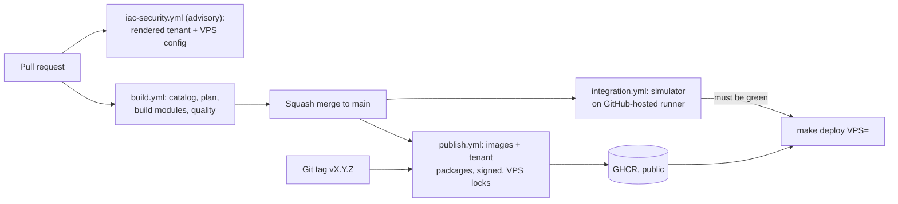

- **PR:** build and scan only, no push. **Merge to `main`:** push `sha-` tags, signed. **Git tag `vX.Y.Z`:** release with versioned tags, notes from PR titles, tenant tarballs. Workflow and job design: §7.5.
- `publish.yml` → `lock-vps` resolves the digests each VPS needs into `<vps>.lock.yml` (run artifact; attached to releases). `make deploy VPS=` uses that lock and commits it to `deployments/`. Redeploying an older lock is the rollback for images and tenant assets.
- GitHub Packages has no generic zip/tar package type, so tarballs live on Releases as a convenience copy; OCI is the deploy source.
- **Public repo:** images and tenant packages are public; VPSs pull anonymously (no registry token on servers). Publish sets each new GHCR package to public and links it to the repo. Secrets never enter packages; Vault files are AES-256 encrypted with a long random vault password (≥ 32 characters, never reused), because anyone can copy the ciphertext and attack it offline.
- **GitHub Free on a public repo:** standard GitHub-hosted runner minutes, public package storage/bandwidth, rulesets and code scanning are free (verify current terms in S1). A retention workflow still prunes old `sha-` versions to keep the registry tidy.
- **`main` ruleset**, enabled at the end of S1 once `build.yml` exists (S0 is the single initial commit, pushed directly):

| Rule | Effect |
|---|---|
| Require a pull request (0 approvals while solo) | No direct pushes to `main`, including the owner |
| Required status checks: `Build` report job | Merge only when Build is green |
| Allowed merge method: squash only; linear history | One commit per PR; PR title becomes the commit message |
| Block force pushes and deletion | History cannot be rewritten |
| `make deploy` refuses commits on `main` without green `build.yml`, `publish.yml` and `integration.yml` runs | Deploy gate on the operator's machine |

Raise required approvals to 1 when a second contributor joins.

### 7.5 GitHub Actions workflows

All three main workflows share one pattern: **catalog → plan → matrix of work → report**. The catalog and plan come from the same scripts as `make ci-catalog` / `make ci-plan`, so a developer can see locally what CI will do. Jobs call `make` targets, never inline tool commands.

| Workflow (`name:`) | File | Triggers | Blocking? | Purpose |
|---|---|---|---|---|
| **Build** | `build.yml` | PR; push to `main`; manual | Yes | Validate the repo, build changed modules without pushing, run quality checks |
| **Advisory IaC security** | `iac-security.yml` | PR (paths: `core/`, `erp/`, `edu/`, `deployments/`, `policy/`, `versions.yml`); nightly; manual | **No** (reports only) | Scan the config each tenant and each VPS would really get |
| **Publish** | `publish.yml` | Push to `main` after a green Build (`workflow_run`); tag `v*`; manual | Yes | Build, scan, sign and push changed images and tenant packages; resolve per-VPS locks; GitHub Release on tags |
| Integration | `integration.yml` | Push to `main`; manual | Yes (deploy gate) | §9 |
| Retention | `retention.yml` | Weekly; manual | — | Prune old `sha-` package versions and expired artifacts |

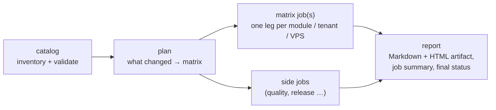

#### Catalog and plan (shared)

- **Catalog** (`scripts/ci/catalog.py` → `catalog.json`): every module with type, product, path, inputs and dependencies. Module types: `image` (`erp/images/erpnext`, `edu/images/gibbon`, `local`), `tenant` (`<product>/tenants/<id>`, `tests/tenants/...`), `vps` (`deployments/<vps>.yml`), `role` (Ansible roles per product).
- **Validate** in the same job: manifest schema, tenant files, unknown/duplicate tenants, capacity (≤ 10 + 10 per VPS), `versions.yml` pins and checksums, reserved tenant IDs, no unencrypted `vault.yml`.
- **Plan** (`scripts/ci/plan.py` → `plan.json` + matrices as job outputs): maps changed paths to modules, then follows dependencies. Examples: `versions.yml` Gibbon bump → `gibbon` image + every edu tenant on that version + every VPS hosting them; `edu/ansible/**` → all edu tenants + their VPSs; `core/**` → all VPSs; a tenant's `assets/` → only that tenant package. Manual runs accept `modules=all` or a list.
- An empty matrix skips the job (no wasted minutes); the report says why.

#### Build (`build.yml`)

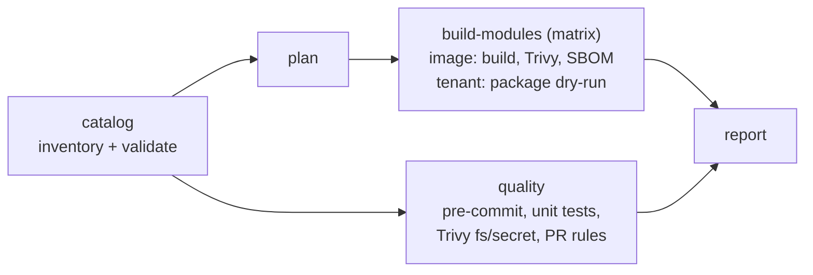

| Job | Needs | Does | Fails on |
|---|---|---|---|
| `catalog` | — | Inventory + validation above; uploads `catalog.json` | Any validation error |
| `plan` | `catalog` | Change plan, matrices | Unknown module mapping |
| `build-modules` (matrix) | `plan` | **image:** `make image-build` with layer cache, no push; Trivy image; size and layer count; SBOM. **tenant:** `make tenant-package` dry run (content allow-list, no secrets, size limit) | Build error; Trivy CRITICAL/HIGH with fix (outside `.trivyignore`); package rule violation |
| `quality` | `catalog` | `make lint test-unit scan` (pre-commit incl. actionlint/zizmor, unit tests with JUnit + coverage, Trivy fs/secret/config on Dockerfiles); PR title, branch and commit rules (§11.5) | Any failure |
| `report` | all (`if: always()`) | Merge job results into the report; set the workflow's final status | Any needed job failed |

#### Advisory IaC security (`iac-security.yml`)

Scans what the deploy would **render**, not just the templates. Rendering uses `tests/fixtures/dummy-secrets.yml` (fake values with the same shape as `vault.yml`); CI never has the Vault password.

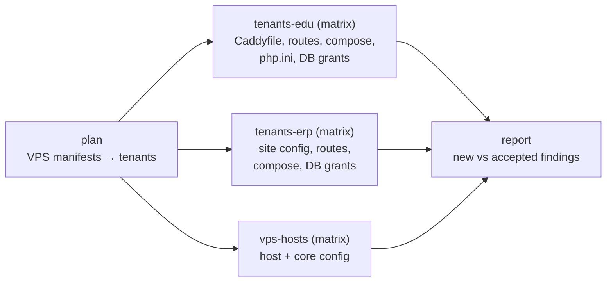

| Job | Matrix | Checks (KICS + conftest + Trivy config) |
|---|---|---|
| `plan` | — | On PR: affected tenants/VPSs only. Nightly/manual: everything in all VPS manifests + test tenants |
| `tenants-edu` | one leg per school | Caddy blocks `config.php`/`uploads` PHP/installer; `open_basedir` + `disable_functions` present; `/_health` internal only; DB user granted only its own DB; code mounted read-only; Traefik router has TLS + security headers; no ads on Gibbon |
| `tenants-erp` | one leg per company | Site-only DB grants; Traefik TLS + headers; AdSense only on allowed routes (§10.4); no tenant secrets in rendered non-secret files |
| `vps-hosts` | one leg per `deployments/<vps>.yml` | SSH/UFW/sysctl/Docker daemon settings; 443/80 only from Cloudflare ranges (`DOCKER-USER`), `51820/udp` open, SSH on `wg0` only; DB and admin UIs not public; `dbx`/`logs` routers have `vpn-only → authelia → dbx-trusted-auth` in that order and no published port; **no Authelia middleware on any tenant router**; Authelia `default_policy: deny`; `mem_limit`/`cpus`/healthcheck on every service; images pinned by digest; backup + `object_store` config valid; `tls.mode` + DNS settings valid |
| `report` | — | Findings by severity per tenant/VPS, mapped back to the source template; **new** vs **accepted** (`policy/iac/accepted.yml`, reason + expiry); expired acceptances listed |

- **Advisory:** findings never fail the workflow (only tool crashes do). A nightly run with new HIGH/CRITICAL findings opens or updates one GitHub issue (`iac-security` label).
- **Graduation:** a rule that has been clean for a month can move into `build.yml` as blocking (update `docs/lld/ci.md`; note it in the PR).
- **SARIF upload:** code scanning is free on public repos, so Trivy and KICS results are also uploaded as SARIF (`security-events: write` on the report job only) and appear in the Security tab; the report artifact stays the primary record. Advisory findings use the `note`/`warning` level so they do not block.

#### Publish (`publish.yml`)

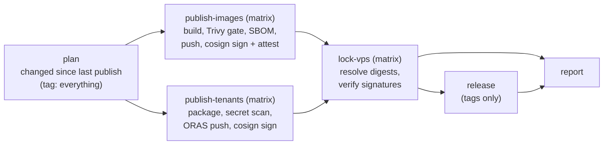

| Job | Matrix | Does |
|---|---|---|
| `plan` | — | Modules changed since the last successful publish (stored as the `published` git tag ref); everything on a version tag |
| `publish-images` | one leg per changed image | Rebuild with the layer cache from Build; Trivy gate; SBOM; push `sha-<commit>` (+ `<upstream>-<build>` / `vX.Y.Z` on tags); cosign sign + attach SBOM attestation. amd64 only (Contabo) |
| `publish-tenants` | one leg per changed tenant | Package (`tenant.yml`, `README.md`, `assets/`, `migrations/`), migration checksums + version guards checked, Trivy secret scan on the package, ORAS push, cosign sign; `.tar.gz` kept for the release |
| `lock-vps` | one leg per VPS manifest | Resolve every image/package digest that VPS needs into `<vps>.lock.yml`; verify each signature; diff against the committed lock |
| `release` | — | Tags only: GitHub Release with notes from PR titles, tenant tarballs, `<vps>.lock.yml` files, `digests.json` |
| `report` | — | What was published (name, tag, digest, size, signature, SBOM), lock diffs per VPS |

- Concurrency: one Publish at a time (`cancel-in-progress: false`) so tags and locks are never half-written.
- Permissions per job: only `publish-*` get `packages: write`; `release` gets `contents: write`; everything else read-only.

#### Reports (all workflows)

| Item | Rule |
|---|---|
| Per-job output | Each job writes `report/<job>[-<leg>].json` (machine-readable) and `.md` |
| `report` job | `make ci-report` merges them into `report.md` and a **self-contained `report.html`** (inline CSS, no external JS/fonts) |
| Artifact | `<workflow>-report-<run_number>` with `report.md`, `report.html`, JSON, Trivy/KICS raw output, SBOMs, JUnit, coverage; `retention-days: 14` |
| Job summary | `report.md` (truncated with a link to the artifact if over the 1 MiB summary limit) |
| Contents | Header (workflow, commit, PR title, trigger, duration, Actions minutes used), plan (what ran, what was skipped and why), per-leg results, findings by severity, links to raw files |

#### Reference skeleton (`build.yml`, copied into `nigu-lite` in S1)

Shows the wiring every workflow reuses: plan outputs → dynamic matrix → per-leg report fragments → one `report` job that always runs, uploads the Markdown + HTML report as a run artifact and sets the final status. `iac-security.yml` and `publish.yml` follow the same shape with their own matrix jobs. `<sha>` placeholders are replaced with pinned commit SHAs (Renovate keeps them current).

```yaml
name: Build
on:
  pull_request:
  push: {branches: [main]}
  workflow_dispatch:
    inputs:
      modules: {description: "all or comma-separated module ids", default: ""}
permissions: {contents: read}
concurrency:
  group: build-${{ github.ref }}
  cancel-in-progress: ${{ github.event_name == 'pull_request' }}

jobs:
  catalog:
    name: Catalog and validate
    runs-on: ubuntu-24.04
    timeout-minutes: 10
    steps:
      - uses: actions/checkout@<sha>  # v4
        with: {fetch-depth: 0}
      - run: make ci-catalog          # writes catalog.json + report/catalog.{json,md}
      - uses: actions/upload-artifact@<sha>  # v4
        if: always()
        with: {name: part-catalog, path: report/, retention-days: 1}

  plan:
    name: Plan
    needs: catalog
    runs-on: ubuntu-24.04
    timeout-minutes: 5
    outputs:
      modules: ${{ steps.plan.outputs.modules }}  # JSON list for the matrix
      any: ${{ steps.plan.outputs.any }}
    steps:
      - uses: actions/checkout@<sha>  # v4
        with: {fetch-depth: 0}
      - id: plan
        env: {MODULES: "${{ inputs.modules }}"}  # via env, not inline (script injection)
        run: make -s ci-plan MODULES="$MODULES" >> "$GITHUB_OUTPUT"

  build-modules:
    name: Build module · ${{ matrix.module.id }}
    needs: plan
    if: needs.plan.outputs.any == 'true'
    runs-on: ubuntu-24.04
    timeout-minutes: 45
    strategy:
      fail-fast: false
      matrix:
        module: ${{ fromJSON(needs.plan.outputs.modules) }}
    steps:
      - uses: actions/checkout@<sha>  # v4
      - env: {ID: "${{ matrix.module.id }}", TYPE: "${{ matrix.module.type }}"}
        run: make ci-module ID="$ID" TYPE="$TYPE"
      - uses: actions/upload-artifact@<sha>  # v4
        if: always()
        with: {name: "part-module-${{ matrix.module.id }}", path: report/, retention-days: 1}

  quality:
    name: Quality
    needs: catalog
    runs-on: ubuntu-24.04
    timeout-minutes: 20
    steps:
      - uses: actions/checkout@<sha>  # v4
        with: {fetch-depth: 0}
      - run: make ci-quality          # lint, test-unit, scan, PR title/branch/commit rules
      - uses: actions/upload-artifact@<sha>  # v4
        if: always()
        with: {name: part-quality, path: report/, retention-days: 1}

  report:
    name: Report
    needs: [catalog, plan, build-modules, quality]
    if: always()
    runs-on: ubuntu-24.04
    timeout-minutes: 5
    steps:
      - uses: actions/checkout@<sha>  # v4
      - uses: actions/download-artifact@<sha>  # v4
        with: {pattern: "part-*", path: report/parts, merge-multiple: true}
      - env: {NEEDS_JSON: "${{ toJSON(needs) }}"}
        run: make ci-report WORKFLOW=build NEEDS="$NEEDS_JSON"  # report.md + report.html
      - run: cat report/report.md >> "$GITHUB_STEP_SUMMARY"
      - uses: actions/upload-artifact@<sha>  # v4
        with:
          name: build-report-${{ github.run_number }}
          path: |
            report/report.md
            report/report.html
            report/parts/
          retention-days: 14
      - name: Final status
        if: contains(needs.*.result, 'failure') || contains(needs.*.result, 'cancelled')
        run: exit 1
```

- Short-lived `part-*` fragments (1 day) feed the `report` job; only the merged `<workflow>-report-<run_number>` artifact is kept for 14 days.
- A skipped matrix (`any == 'false'`) shows as `skipped`, not failed; the report lists it with the plan's reason.
- `iac-security.yml`: same `report` job without the final-status step (advisory), plus the nightly issue step. `publish.yml`: `publish-images` / `publish-tenants` / `lock-vps` / `release` jobs with per-job `packages: write` / `contents: write`.
- Expressions reach `run:` only through `env:` (zizmor rule); every CI step is a Make target (§7.3), so the same commands run locally.

#### Conventions

- **Run names:** pushes and PRs keep the default (commit message / PR title, §11.5). Scheduled and manual runs set `run-name`, e.g. `Nightly advisory IaC scan` or `Publish v1.2.0`.
- **Job names** are readable in the Actions UI: `Build module · gibbon`, `Edu tenant · school-a`, `VPS · vps-01`.
- Actions pinned by SHA; `permissions:` declared per job; `timeout-minutes` on every job; PR runs `cancel-in-progress: true`.
- **Runtime budget:** minutes are free on a public repo, but runs still cost time: path filters, plan-based skipping, ERPNext image built only when its inputs change, layer cache, nightly IaC scan renders config only (no image builds). The report shows the duration per run.
- **Fork pull requests (public repo):** workflows use `pull_request`, never `pull_request_target` with a checkout of PR code; fork runs get a read-only token and no secrets; repo setting "Require approval for all outside collaborators" for Actions runs; Publish and Integration never run on fork code.

---

## 8. Local Environment (VPS simulator)

| Aspect | Design |
|---|---|
| Model | `local/Dockerfile`: Ubuntu 24.04 + systemd + sshd + Docker Engine. Ansible connects over SSH exactly as to a real VPS. Docker-in-Docker. |
| Runtime | Default: `--privileged` container with its own `/var/lib/docker` volume. Preferred if available: **Sysbox** runtime (`--runtime=sysbox-runc`), which runs systemd + Docker without `--privileged`. |
| Fidelity gaps | UFW/iptables, swap, sysctl and kernel tuning do not fully apply inside a container. Tagged `host_kernel` and skipped locally. For full fidelity: `make local-vm` using **Multipass** or libvirt (reusing ideas from `infra-core`). |
| DNS | `*.localhost` (resolves to 127.0.0.1 in browsers) or `*.lvh.me`/`nip.io` for tools; hostnames come from test tenants. |
| TLS | `tls.mode: selfsigned` in `deployments/local.yml`. Optional **Pebble** (local ACME test server) to exercise the ACME path. |
| Cloudflare | `dns.provider: none`: Cloudflare role not run; its rendered API payloads are unit-tested; first real run in S6 |
| VPN + RBAC | wg-portal runs in the simulator (needs the host's WireGuard kernel module); integration tests use a WireGuard client container to check the VPN-only rules, and LLDAP test users in `admin`/`ops`/`support` |
| Object store | **MinIO** container in the simulator (same `object_store` config block, `endpoint: http://minio:9000`); bucket created by Ansible via the S3 API |
| Data | Test tenants with synthetic data only; `make local-reset` wipes everything. |
| Resources | Recommended developer machine: 16 GB RAM (simulator capped at ~8 GB like the VPS). |

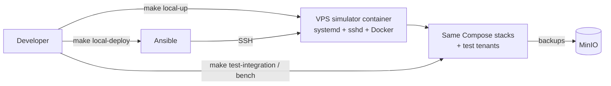

---

## 9. Testing Strategy

| Level | Location | What | When |
|---|---|---|---|
| Static | pre-commit | Lint, format, secrets, editorconfig | Every commit |
| Unit | `tests/unit/` | Manifest validation, Jinja2 rendering (Compose, Caddyfile, Traefik routes), scripts | `make test-unit`, `build.yml` → `quality` |
| Security | `make scan` | Trivy fs/config/secret/image | Local before PR; `build.yml` (blocking), `iac-security.yml` (advisory, PR + nightly), `publish.yml` (image gate) |
| Integration | `tests/integration/` | Deploy local env with test tenants; per-tenant `/_health` (one unhealthy test school must not affect the other), login (SSO + local), ERPNext site per tenant, GST report on synthetic data, Gibbon isolation tests (school A cannot read school B files/DB/sessions), backup → restore of one tenant | `make test-integration`; CI `integration.yml` on **GitHub-hosted runner** (privileged simulator; Sysbox is not available there), triggered **on merge to `main` and manually** (`workflow_dispatch`) |
| Upgrade | `tests/integration/upgrade/` | Old → new version on test tenants, DB update, health, isolation, rollback drill | `make upgrade-test` locally before the PR (report attached); CI on merge/manual like integration |
| Benchmarks | `tests/benchmarks/` | k6 scenarios per §9.1 (`edu-*`, `erp-*`, `capacity-10x10`, `stress-10x10`), resources via `docker stats` + Beszel snapshots | Before/after changes affecting runtime/resources; results committed |

**Access tests** (`tests/integration/access/`): the §13.1 matrix as table-driven cases — `support` gets 403 on `vpn`/`dbx`, `ops` passes only from the VPN subnet, a non-VPN source is refused on `dbx` even with a valid session, a client-supplied `X-DBX-Auth` is overwritten, DBX without the header is refused, and tenant hostnames never redirect to Authelia.

**Identity storage tests (S3):** verify LLDAP and Authelia persist state across container recreation using separate SQLite volumes, remain usable when MariaDB is stopped, and recover from consistent SQLite snapshots with the required secrets. Confirm staff login/MFA and wg-portal OIDC after restore; tenant admins continue to use native app login.

**School routing tests (S4):** on both test schools, verify each school hostname routes only to its selected Gibbon tenant at `/`, with no default-tenant fallback. Exercise native login/logout, CSS/JS, uploads/downloads and module links. Verify school-only-app selections, cross-school file/DB/session isolation, upgrade/rollback with the unchanged base URL, public denial of health paths, blocked `/config.php` and upload PHP, and no edge caching or ads on school hosts. Rendered unit tests verify Traefik host routing and Cloudflare bypass expressions; production cache checks run in S6.

Because integration tests do not run on PRs, the PR checklist requires the local `make test-integration` result, and a failed post-merge run blocks the next deploy (`make deploy` checks the latest `integration.yml` status for the commit).

**Test tenants:** `tests/tenants/erp/test-company-{a,b}`, `tests/tenants/edu/test-school-{a,b}`. They use the same schema as real tenants and synthetic data only. At least two per product, so tests can check isolation between tenants.

**Benchmark results:** `tests/benchmarks/results/<YYYY-MM-DD>-<scenario>.json` (raw k6 summary + resource snapshot) and `.md` (environment, commit, versions, key numbers, comparison to previous run, comparison to §9.1 targets, conclusion).

### 9.1 Benchmark targets — one VPS, 10 schools + 10 ERP companies

These are **initial targets** (estimates). The first S4/S5 runs calibrate them; after that, targets live in `docs/lld/capacity.md` and change through it (with benchmark evidence in the PR).

**Benchmark data set** (`make bench-tenants` generates `bench-school-01…10` and `bench-company-01…10` from the test tenant templates; synthetic, not committed):
- School: 500 students, 40 staff, one academic year of timetable and attendance.
- ERP company: GST-enabled, 300 customers, 500 items, 5,000 sales invoices per year (~420 per month), 2,000 purchase invoices.

**Load levels** (concurrent active users = k6 virtual users with 5–15 s think time; req/s counts dynamic requests only, static asset requests are excluded):

| Level | When (IST) | Gibbon (10 schools) | ERPNext (10 companies) |
|---|---|---|---|---|
| **Low** | Evenings, weekends | 20 users (2 per school), ~2 req/s | 10 users (1 per company), ~1 req/s |
| **Moderate** | School day 10:00–15:00; business hours | 100 users (10 per school), ~10 req/s: timetable, student profiles, markbook views | 40 users (4 per company), ~5 req/s: list views, create/submit invoices, stock entries |
| **High (peak)** | Gibbon: 08:00–09:30 attendance, results day. ERP: month-end, GSTR-1 (by 11th) and GSTR-3B (by 20th) filing days | 300 users (30 per school, one school at 100 for results day), ~30 req/s with attendance-submit bursts | 100 users (10 per company), ~12 req/s incl. 5 concurrent heavy reports (GSTR-1, Accounts Receivable, Stock Balance) and bulk invoice submit |

**Targets** (measured over the steady phase):

| Metric | Low | Moderate | High (peak) |
|---|---|---|---|
| Gibbon page p95 / p99 | ≤ 400 ms / ≤ 800 ms | ≤ 800 ms / ≤ 1.5 s | ≤ 2 s / ≤ 4 s |
| Gibbon attendance submit p95 | ≤ 500 ms | ≤ 1 s | ≤ 2 s |
| ERPNext desk API p95 / p99 | ≤ 400 ms / ≤ 800 ms | ≤ 800 ms / ≤ 1.5 s | ≤ 2 s / ≤ 4 s |
| ERPNext invoice submit p95 | ≤ 1 s | ≤ 1.5 s | ≤ 3 s |
| Heavy report p95 (GSTR-1 for one month, ~420 invoices) | ≤ 5 s | ≤ 8 s | ≤ 15 s |
| Background job queue lag (ERPNext) | ≤ 10 s | ≤ 30 s | ≤ 120 s |
| Error rate (5xx + timeouts) | < 0.1 % | < 0.5 % | < 1 % |
| CPU, average of 4 vCPU | ≤ 30 % | ≤ 60 % | ≤ 85 % |
| RAM used, of 8 GB | ≤ 5.5 GB | ≤ 6.0 GB | ≤ 6.8 GB, no OOM kill |
| Swap-in | None | None | No sustained swap-in |
| Disk I/O wait | ≤ 5 % | ≤ 10 % | ≤ 20 % |
| Fairness: one quiet school while the other nine are loaded | p95 ≤ 400 ms | p95 ≤ 800 ms | p95 ≤ 1 s |

**Scenarios** (`tests/benchmarks/scenarios/`):

| Scenario | Load | Pass rule |
|---|---|---|
| `edu-low`, `edu-moderate`, `edu-high` | Gibbon only, at that level | Matching column above |
| `erp-low`, `erp-moderate`, `erp-high` | ERPNext only, at that level | Matching column above |
| `capacity-10x10` | `edu-high` + `erp-moderate` at the same time (school morning on a normal business day) | **High** column. Gate before a VPS gets its 10th tenant of either product |
| `stress-10x10` | `edu-high` + `erp-high` at the same time (school morning on a GST filing day) | Survival: error rate < 2 %, no OOM kill, no container restart, back to Moderate targets within 5 min after load stops |

Rules:
- Each run: 5 min ramp-up, 15 min steady, 2 min ramp-down.
- **Acceptance runs** measure the origin, not Cloudflare: k6 connects over WireGuard to the VPS with the tenant `Host` header (the origin lockdown blocks direct public access). They use the real VPS (or identical hardware) with k6 on a separate machine, before onboarding real tenants (S6) and after each major upgrade. Local simulator runs are only for before/after comparison of a change, not acceptance.
- Missing a target: tune first (MariaDB buffer pool, FrankenPHP threads, Gunicorn workers, page cache); otherwise lower the per-VPS tenant limit (update `docs/lld/capacity.md` and the validator) or scale out (§3.2); changing the 10 + 10 model itself is an ADR.

---

## 10. Monetisation — ERP Advertising (Deferred)

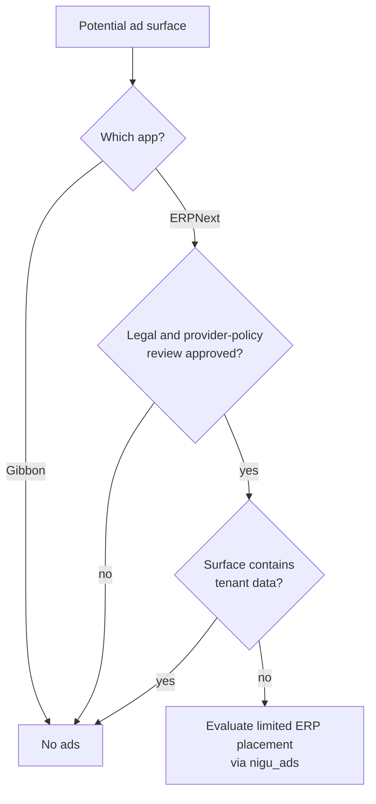

### 10.1 Options

| Option | Education-only? | Child-safe? | Effort | Verdict |
|---|---|---|---|---|
| Google AdSense on ERP | No reliable education-only allow-list | Not for school/student surfaces | Low | Consider only after policy/legal review and only on approved ERP surfaces |
| Google Ad Manager | Direct-sold can be narrow; programmatic is separate | Depends on configuration and policy | Medium | Not initially |
| Revive Adserver | Can restrict creatives, but adds tracking and operations risk | Depends on configuration | Medium | Defer; separate VPS only if demand justifies |
| Custom ad service | Policy control is possible | Risky to build and operate | High | No |

### 10.2 Model

| Aspect | Design |
|---|---|
| Inventory | No school public websites and no ads in Gibbon. ERP placements remain deferred pending policy/legal review (§10.4). |
| Advertisers | If later approved for ERP, review categories and creatives against applicable law and provider policies |
| Policy | Written prohibited-category rules and review of advertiser, creative and landing page before any ERP ad rollout |
| Targeting | No behavioural, age or role targeting; no tenant or student data sent to advertisers |
| Delivery | No ad delivery until an approved surface and implementation are selected |
| Unsold | No ad |
| Never | Fake/"ghost" student/teacher/parent accounts, falsified ages or roles to change ad treatment |

### 10.3 Guard-rails

| Topic | Action |
|---|---|
| Children's data & ads (DPDP Act and provider policies) | Legal review before any placement; keep all school-facing and authenticated education surfaces ad-free |
| Advertising standards (ASCI incl. education ads) | Review any future ERP ad policy and creative against applicable standards |
| Data processor role | Tenant ToS/DPA, privacy policy, breach runbook, deletion on exit |
| Licences / trademarks | Verify licences of pinned versions; own brand "… powered by ERPNext" |
| Diversification | Paid custom domains, optional paid onboarding, GST API credit pass-through, extra backup retention |

### 10.4 AdSense on ERP (funds India Compliance credits)

ERP users are businesses, not children, so the education-only restriction does not apply there. AdSense in ERPNext is **possible in principle but needs a policy check first** (S7):

| Concern | Plan |
|---|---|
| Ads behind login | AdSense allows it only if Google's crawler can log in; give it a **dedicated demo site with synthetic data**, never a tenant account |
| Pages with tenant data | Invoices, ledgers and GST returns contain customer names/GSTINs; Google's contextual crawler would read them. Show ads only on surfaces without tenant data: login page, ERP portal/help pages, a fixed desk-sidebar slot on workspace home |
| Desk is a single-page app | Ad refresh on in-app navigation may breach AdSense rules; refresh only on full page loads, never auto-refresh |
| Category control | Block gambling, dating, alcohol, crypto etc. in AdSense blocking controls |
| Privacy | Privacy policy + cookie notice for ERP; DPDP Act processing notice; tenants can opt out via a paid plan |
| Delivery | A small Frappe app `nigu_ads` (ours, linted, tested) injects the slot; site-level on/off in `tenant.yml` |
| Gibbon | No ads; this remains a product rule even if ERP advertising is later approved. |

Credits: platform buys India Compliance credits centrally if revenue allows; per-tenant monthly cap; above the cap the tenant brings its own key.

---

## 11. AI Instructions & Documentation System

### 11.1 Layout

`AGENTS.md` (root, ≤ 60 lines) contains:
1. **Always-on rules** (~10): Makefile is the only entry point; no secrets or real tenant data in git; Jinja2 templates, no shell in roles; update docs and tests in the same change; run `make lint test-unit` (+ `scan` for images); never edit upstream code, use patches; branch names, commit messages and PR titles per `git.instructions.md`, never add AI `Co-authored-by` trailers.
2. **Index table**: "When you are doing X → read `.github/instructions/Y`".

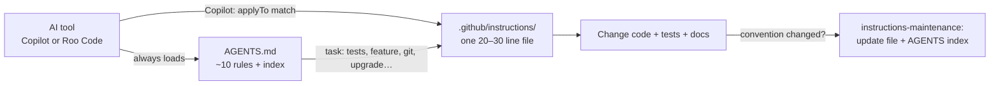

Each file in `.github/instructions/` is **20–30 lines**, named `*.instructions.md`, with `applyTo` front matter where a file pattern fits (Copilot auto-attaches; Roo Code follows the index). Nothing large goes in `.roo/rules/`; Roo loads that folder on every request.

| File | Read when | Key content |
|---|---|---|
| `ansible.instructions.md` | Editing roles/playbooks/group_vars | Var placement, no defaults, templates over shell, idempotency |
| `compose-traefik.instructions.md` | Compose templates, Traefik routes, Caddyfiles | File-provider routes, healthchecks, limits, internal-only ports |
| `frankenphp-gibbon.instructions.md` | Gibbon image/config | Isolation controls §5, never relax `open_basedir`/`disable_functions` without ADR |
| `feature-add.instructions.md` | Adding a feature/service/product | LLD first (new or existing, approved before code); README, tests, manifest schema, benchmark if resource-relevant; ADR only per §11.3 criteria and only when the owner asks |
| `feature-remove.instructions.md` | Removing a feature | Data/backup handling, remove config + tests, set LLD status `retired`; mark an ADR superseded only if one exists; update READMEs |
| `tenant.instructions.md` | Tenant or VPS manifest changes, tenant migrations | Templates, validation, assets rules, no real data; migrations: new numbered file, never edit an applied one, version guard, test on test tenants |
| `unit-tests.instructions.md` | Any code change | What to test, naming, location, update tests when behaviour changes |
| `integration-tests.instructions.md` | Changes to deployable behaviour | Use test tenants + local env; add isolation/regression cases |
| `benchmarks.instructions.md` | Resource/runtime changes | Run scenario, store `.md` + `.json`, compare with previous |
| `quality-scan.instructions.md` | Lint/pre-commit/Trivy/editorconfig | Fix, don't suppress; `.trivyignore` needs reason + expiry; exclude upstream code only |
| `docs.instructions.md` | Any change | Which doc type is required when (§11.3); **LLD by default; never create an ADR unprompted, propose it in the PR instead** |
| `adr-lld.instructions.md` | Writing/updating an LLD, or proposing an ADR | Use the §11.3 templates; Existing + Proposed mermaid diagrams; LLD before code; never create an ADR unprompted; update LLD changelog per PR |
| `edge-access.instructions.md` | Cloudflare records/settings, Traefik middlewares, Authelia rules, wg-portal, DBX exposure | §3.3/§3.4/§13.1: tenant routers never get Authelia; staff tools only on `nigu.in`; `dbx` chain order; WireGuard never proxied; tokens least-privilege; update `access-check` cases |
| `readme.instructions.md` | Creating/updating READMEs | Use template; one high-level mermaid diagram (≤ 10 nodes); keep in sync |
| `git.instructions.md` | Branch, commit, PR | Branch prefixes; plain-sentence commit messages/PR titles; no AI co-author trailers; PR template incl. mermaid |
| `upgrade.instructions.md` | Bumping Gibbon, ERPNext or image versions | §5.5: local rehearsal on test tenants, snapshot, canary, rollback drill, upgrade report in PR |
| `release-publish.instructions.md` | CI publish workflows, images, tenant packages | §7.4: no secrets in packages, digest pins, signing, lock files |
| `github-actions.instructions.md` | Editing `.github/workflows/*` or `scripts/ci/*` | §7.5: catalog → plan → matrix → report; jobs call `make`; SHA pins; per-job permissions; timeouts; report artifacts; advisory vs blocking |
| `security.instructions.md` | Secrets, ports, personal data, ads | Vault, exposure rules, ad guard-rails |
| `local-env.instructions.md` | Local simulator | `make local-*`, `host_kernel` tag, `tls.mode: selfsigned`, MinIO |
| `instructions-maintenance.instructions.md` | After any change that alters a convention | **Self-update rules** (below) |

### 11.2 Self-updating instructions

The AI must update instructions in the same PR when:
- a new tool, directory, Make target, product type or convention is introduced or removed;
- an instruction turned out wrong, missing or contradicted by the code;
- the same review comment appears twice.

Rules:
- Edit the smallest relevant file; keep each file ≤ 30 lines (split if larger).
- Update the `AGENTS.md` index when adding, renaming or removing a file.
- Never weaken a security rule without an ADR.
- List instruction changes in the PR under "Docs & instructions updated".

### 11.3 Documentation types

| Type | Location | Required when |
|---|---|---|
| README | Every product, tenant, `tests/`, `deployments/`, `local/` | Always; from `docs/templates/README.template.md` |
| LLD | `docs/lld/<area>.md` | **Before implementing** any feature or moderate change. One LLD usually covers several PRs and is updated in the PRs that change the design |
| ADR | `docs/adr/NNNN-title.md` | **Rare**: release- or sprint-level decisions only (criteria below) |
| SDD | `docs/sdd/` | System boundaries, products, trust zones change (usually alongside an ADR) |
| Developer docs | `docs/developer/` | Setup, workflows, runbooks, troubleshooting |

```mermaid
flowchart LR
  REL["Release / sprint<br/>decision"] -->|rare| ADR[ADR]
  ADR -.->|shapes| LLD
  FEAT["Feature or<br/>moderate change"] --> LLD["LLD<br/>(written first)"]
  LLD --> PR1[PR 1] & PR2[PR 2] & PR3[PR …]
  PR2 -.->|updates design| LLD
```

**LLD lifecycle**
- Written (or an existing one extended) **before** the first implementation PR, on a `docs/` branch or as the first commit of the feature branch. Status: `draft` → `approved` → `implemented` → `retired`.
- One LLD per area or feature (e.g. `gibbon.md`, `tenant-manifest.md`, `ci.md`, `capacity.md`), not per PR. Each PR links it and updates it if the design changed during implementation.
- Contents: context and scope, design (components, data, config keys, flows with a small mermaid diagram), alternatives considered (short), test plan, rollout/upgrade notes, open points, changelog of PRs.
- Moderate decisions (a library, a config layout, a new Make target, a CI job, a tenant field, a per-VPS limit) are recorded in the LLD's "Decisions" section, **not** as ADRs.

**ADR criteria — all of the following are rare:**

| ADR | Not an ADR (LLD or PR description instead) |
|---|---|
| Changes a baseline decision (D1–D27), e.g. Compose → anything else, FrankenPHP shared container → per-school (D7 fallback) | Adding/removing a service, role, Make target, workflow or job |
| New product type, new hosting/VPS model, new object-store backend type | New tenant fields, manifest keys, config templates |
| Weakens a security rule or isolation control | Version upgrades (upgrade report + LLD), tuning, benchmark target changes |
| Changes the revenue/ads or data-protection model | Tool swaps inside the same role (e.g. one linter for another) |
| Planned at release or sprint level | Anything decided inside a single feature |

- **AI rule:** never create an ADR on its own. If a change seems to meet the criteria, say so in the PR description ("ADR proposed: …"); the owner decides and writes or approves it.
- ADRs are short (context, decision, consequences, status) and link the LLDs they affect.

#### ADR template (`docs/templates/ADR.template.md`)

Based on **MADR 4** (Markdown Architectural Decision Records) with Michael Nygard's context/decision/consequences core. File name `docs/adr/NNNN-kebab-title.md`; numbers are never reused. An accepted ADR is immutable: to change it, write a new ADR and set the old one to `superseded by NNNN`.

````markdown
---
status: proposed            # proposed | accepted | rejected | deprecated | superseded by NNNN
date: YYYY-MM-DD
decision-makers: <owner>
consulted: <people/AI tools asked>
informed: <who is told>
release: <release or sprint, e.g. v1.2 / 2027-S03>
supersedes: <NNNN or none>
---

# NNNN — <Short decision title as a statement, e.g. "Run each school in its own Gibbon container">

## Context and problem statement
<!-- 2–5 sentences: the situation, the forces, why decide now. Link the evidence (benchmark, incident, LLD). -->

## Decision drivers
- <driver, e.g. RAM per tenant ≤ 50 MB>
- <driver, e.g. no cross-school file access>

## Existing solution
<!-- How it works today. Required unless greenfield; then write "None". -->
```mermaid
flowchart LR
  A[Today: component] --> B[(Dependency)]
```

## Considered options
1. <Option 1 — chosen>
2. <Option 2>
3. <Do nothing>

## Decision outcome
Chosen: **<option>**, because <one-sentence justification tied to the drivers>.

### Proposed solution
```mermaid
flowchart LR
  A[Today: component] --> N[New component]:::new --> B[(Dependency)]
  X[Old part]:::removed
  classDef new fill:#d9f7d9,stroke:#2e7d32
  classDef removed fill:#fde0e0,stroke:#c62828,stroke-dasharray:4 3
```

### Consequences
- Good: <…>
- Bad / accepted trade-off: <…>
- Follow-up: <LLDs to create/update, migration, tenants affected>

### Confirmation
<!-- How we will know it is implemented and working: tests, benchmark, review, metric. -->

## Pros and cons of the options
### <Option 2>
- Good: <…>
- Bad: <…>

## More information
<!-- Links: LLDs, PRs, upstream docs, related ADRs. -->
````

#### LLD template (`docs/templates/LLD.template.md`)

A living design document: written before the first implementation PR, updated by later PRs. File name `docs/lld/<area>.md`. Sections that do not apply say "N/A" with a reason instead of being deleted, so reviewers (and AI tools) see they were considered.

````markdown
---
title: <Area / feature>
status: draft               # draft | approved | implemented | retired
owner: <name>
reviewers: <names>
created: YYYY-MM-DD
updated: YYYY-MM-DD
related-adrs: [<NNNN>]      # usually empty or 0001
issues: [#<n>]
products: [core|erp|edu]
---

# <Area / feature> — Low-Level Design

## 1. Summary
<!-- 3–5 sentences: what, why, outcome for tenants/operators. -->

## 2. Scope
- In scope: <…>
- Out of scope / non-goals: <…>

## 3. Requirements
| ID | Requirement | Type (functional / non-functional) | Verified by |
|---|---|---|---|
| R1 | <…> | <…> | <test / benchmark> |

## 4. Existing solution
<!-- Current behaviour and its problem. "None (new)" if greenfield. -->
```mermaid
flowchart LR
  A[Existing] --> B[(Dependency)]
```

## 5. Proposed design
### 5.1 Overview
```mermaid
flowchart LR
  A[Existing] --> N[New component]:::new --> B[(Dependency)]
  X[Old part]:::removed
  classDef new fill:#d9f7d9,stroke:#2e7d32
  classDef removed fill:#fde0e0,stroke:#c62828,stroke-dasharray:4 3
```
### 5.2 Components and responsibilities
| Component | Change | Responsibility | Location (path) |
|---|---|---|---|

### 5.3 Flows
<!-- Sequence diagram for the main path and the main failure path. -->
```mermaid
sequenceDiagram
  participant U as User
  participant S as Service
  U->>S: request
  S-->>U: response
```

### 5.4 Data and configuration
<!-- Schemas, DB tables/grants, manifest and tenant.yml keys (no defaults), versions.yml pins, secrets in Vault. -->

### 5.5 Interfaces
<!-- Make targets, CLI, HTTP endpoints, CI jobs, Ansible role variables. -->

## 6. Decisions
| # | Decision | Alternatives | Reason | PR |
|---|---|---|---|---|
| L1 | <moderate decision recorded here, not as an ADR> | <…> | <…> | #<n> |

## 7. Security, isolation and privacy
<!-- Tenant isolation, exposed ports, secrets, personal data, ads rules. -->

## 8. Resources and performance
<!-- RAM/CPU/disk estimate, impact on §9.1 targets, benchmark scenario. -->

## 9. Test plan
| Level | Cases | Location |
|---|---|---|
| Unit | <…> | `tests/unit/…` |
| Integration | <…> (test tenants) | `tests/integration/…` |
| Benchmark | <scenario or N/A> | `tests/benchmarks/…` |

## 10. Rollout, upgrade and rollback
<!-- Order of VPSs/tenants, data migration, feature flags in tenant.yml, rollback steps. -->

## 11. Observability and operations
<!-- Health checks, metrics, alerts, logs, runbook links. -->

## 12. Risks and open points
| Risk / question | Impact | Mitigation / owner |
|---|---|---|

## 13. Implementation plan
| Step | PR | Status |
|---|---|---|
| 1 | <branch / PR> | planned |

## 14. Changelog
| Date | PR | Change to this design |
|---|---|---|
````

**Diagram rules (ADR and LLD):** "Existing" and "Proposed" diagrams use the same node names and layout for unchanged parts, so the difference is visible at a glance; mark new nodes with `:::new` (green) and removed ones with `:::removed` (red, dashed); the `classDef` lines come with the template. Max ~10 nodes each; detail goes into §5.3 flows.

### 11.4 README template (`docs/templates/README.template.md`)

````markdown
# <Name>
> One-line purpose. Owner: <name> · Status: <active|experimental|deprecated>

## Overview
<!-- One high-level mermaid diagram, ≤ 10 nodes: inputs, this component, dependencies, outputs -->
```mermaid
flowchart LR
  A[Caller] --> B[This component] --> C[(Dependency)]
```

## Quick start
<!-- Only `make` targets -->

## Structure
<!-- Key folders/files and their purpose -->

## Configuration
<!-- Variables/manifest keys, where they live, which are secret -->

## Operations
<!-- Deploy, backup/restore, common tasks, troubleshooting links -->

## Tests
<!-- Unit/integration/benchmark coverage and how to run -->

## Related
<!-- ADRs, LLDs, upstream docs -->
````

Tenant READMEs use a reduced variant (overview diagram, apps, domains, contacts, special notes).

### 11.5 Git conventions & PR template

```mermaid
flowchart LR
  B["Branch feature/, bugfix/,<br/>patch/, tenant/ …"] --> CM["Commit: plain sentence<br/>commit-msg hook"]
  CM --> PR["PR from template + mermaid<br/>title = Actions run name"]
  PR --> CI["build.yml checks<br/>+ advisory IaC report"]
  CI --> SQ["Squash merge (main ruleset)<br/>PR title becomes the commit"]
  SQ --> POST["Post-merge workflows (§7.4)"]
```

**Branches:** `<prefix>/<short-slug>`, optionally with the issue number (`feature/42-tenant-manifest`).

| Prefix | Use |
|---|---|
| `feature/` | New capability, product, Make target, workflow |
| `bugfix/` | Defect fixed through the normal flow |
| `hotfix/` | Urgent production fix; still needs CI + PR |
| `patch/` | Upstream version bumps and our patches to upstream code (Gibbon, ERPNext, images); Renovate uses this prefix |
| `tenant/` | Onboarding, changing or retiring a tenant |
| `docs/` | Documentation and instructions only |
| `chore/` | Tooling, CI, refactoring without behaviour change |

**Commit messages and PR titles:**
- Plain sentence, starts with a capital letter, ≤ 72 characters, no trailing period.
- No type prefixes or scopes (`feat:`, `(feat)`, `fix(edu):`).
- Optional stage prefix while executing §12: `Stage 1 - Added CI scanning manifests and unit tests structure`.
- **Small history:** one squash-merged PR per stage where practical (a large stage may use a few PRs, one per LLD). Stage 0 is the repo's single initial commit, `Stage 0 - Added repository foundation`, pushed directly before the `main` ruleset exists.
- Other examples: `Fixed issue related to file uploads folder access in caddy`, `Upgraded Gibbon on test schools and added rollback drill`.
- Optional body: why, and which tenants are affected.
- **Never add `Co-authored-by` trailers for AI tools** (Copilot, Roo Code, etc.). Human co-authors are fine.
- Why: GitHub Actions shows the commit message (push) or PR title (pull request) as the run name. Repo setting: squash merge only, using the PR title as the commit message.
- Enforced by the `commit-msg` hook and a CI check of PR title, branch name and commit messages.

- `.github/pull_request_template.md` sections:
  1. **Summary**: what and why
  2. **Change diagram** (required for architecture, deployment or data-flow changes; optional otherwise): small mermaid flowchart or sequence diagram, ≤ 10 nodes, showing what is being merged
  3. **Changes**: bullet list by product (`core`/`erp`/`edu`/…)
  4. **Tests**: commands run (`make lint test-unit scan test-integration`), new/updated tests, benchmark links
  5. **Docs & instructions updated**: LLD link (required for features), READMEs, `.github/instructions/*`; "ADR proposed" only if §11.3 criteria apply
  6. **Risk, rollback & data impact**: tenants affected, backup/restore notes
  7. **Checklist**: no secrets/real data, upstream code untouched, Trivy clean or justified

---

## 12. Staged Implementation Plan

A stage ends when its exit checks pass. S4 and S5 both depend only on S3 and can be done in either order.

```mermaid
flowchart LR
  S0["S0 Repo foundation"] --> S1["S1 CI + scanning"] --> S2["S2 Local env"] --> S3["S3 Core platform"]
  S3 --> S4["S4 Edu: Gibbon"]
  S3 --> S5["S5 ERP"]
  S4 & S5 --> S6["S6 First VPS"] --> S7["S7 Ads"] --> S8["S8 Scale-out"]
```

| Stage | Work items | Exit criteria |
|---|---|---|
| **S0 — Repo foundation** (single initial commit) | Create public repo (`main`, AGPL-3.0 `LICENSE`, `SECURITY.md`); `AGENTS.md` + `.github/instructions/*`; `.editorconfig`, `.gitattributes`, `.gitignore`, `.tool-versions`, `.pre-commit-config.yaml`; Makefile skeleton; `docs/templates/*` (README, ADR, SDD, LLD, tenant, VPS manifest); PR template with mermaid section; `commit-msg` hook + branch rules; `versions.yml`; baseline ADR `0001-platform-baseline.md` (D1–D27) and LLD template; root/product READMEs; repo settings (squash only, secret scanning + push protection, Dependabot alerts, private vulnerability reporting) | `make setup lint` passes on a clean clone; templates render; AGENTS index matches files |
| **S1 — CI, scanning, manifests, unit tests** | `scripts/ci/` catalog, plan and report (+ unit tests); `build.yml`, `iac-security.yml`, `publish.yml`, `retention.yml` (§7.5); pre-commit incl. actionlint/zizmor; Trivy fs/config/secret + SARIF upload; KICS + conftest evaluation; PR title/branch checks; publish with ORAS + keyless cosign, proven with the `local-vps` image and a test tenant package; Renovate (`patch/` branches); manifest schema + validator; Jinja2 render tests; test tenant skeletons in `tests/tenants/`; enable the `main` ruleset (§7.4) | CI green; invalid manifests fail before remote tasks; deploy without `VPS=` fails; each workflow uploads `report.md` + `report.html`; a docs-only PR builds no modules; a direct push to `main` is rejected |
| **S2 — Local environment** | `local/` simulator (systemd + sshd + Docker, privileged or Sysbox); `deployments/local.yml`; `tls.mode` (self-signed); MinIO; `make local-up/down/reset/deploy` | Fresh clone → `make local-up local-deploy` gives a running edge with a test route |
| **S3 — Core platform** | Host baseline roles (`host_kernel` tagged), Traefik (file provider, `selfsigned`, ACME DNS-01 resolver), MariaDB, LLDAP (groups `admin`/`ops`/`support`), Authelia (access rules + OIDC policies), wg-portal (OIDC), Beszel, Dozzle, DBX with the protection chain + LDAP Studio, backups (restic → S3), `db-shell`, `s3-ls`; Cloudflare role (render + check mode only) | Integration tests: health, per-tenant DB provisioning, backup → restore, **access matrix §13.1**, Traefik sees `10.10.0.x` client IPs in the local env |
| **S4 — Edu: Gibbon spike then pilot** | Spike: FrankenPHP image + pinned Gibbon + `tenant-guard.php`; isolation tests (cross-tenant file/DB/session access must fail); verify Gibbon root-path compatibility; benchmark vs per-school containers. Pilot: per-school Traefik host routers + Caddy blocks from manifest; tenant assets + SQL migrations from signed packages; per-school `/_health` + Traefik health checks; side-by-side versions + `make upgrade-test` | Isolation suite passes, or fallback (D7) is decided by ADR; benchmark results committed; two test schools pass integration and host-routing tests (§9); an unhealthy test school does not affect the other; upgrade + rollback drill passes; `edu-*` benchmarks recorded against §9.1 |
| **S5 — ERP pilot** | ERPNext + India Compliance image (Trivy-scanned, SBOM); multi-site bench; site lifecycle (create/restore/retire) from manifest; tenant JSON migrations via REST API + `Nigu Migration` DocType; assets; SMTP | Two test companies; GSTR report on synthetic data; per-site restore; `erp-*` benchmarks recorded against §9.1 |
| **S6 — First VPS** | `deployments/vps-01.yml`; production secrets in Vault; Cloudflare zones, tokens, zone settings, cache rules; Let's Encrypt staging → production; `make dns-sync`; origin lockdown; external uptime checks; runbooks; `make s3-check` against the production object store; go-live checklist §12.1 | Deploy from clean VPS succeeds; checklist §12.1 complete; `s3-check` and `access-check` pass; `capacity-10x10` and `stress-10x10` pass on the VPS before real tenants; restore drill passes; Trivy has no unaddressed CRITICAL/HIGH |
| **S7 — Advertising review (optional)** | Legal/provider-policy review of ERP-facing advertising (§10.4); do not build `nigu_ads` or enable ads until the review approves a specific non-sensitive surface | Written approval and documented boundaries before implementation; otherwise no advertising feature ships |
| **S8 — Scale-out & monitoring** | Split to `core-01`/`erp-01`/`edu-01` by manifests; `mon-01` with Grafana + object store; reassess ad server | Moves tested in local env first; measured downtime |

### 12.1 Deployment checklist (each new VPS, S6 and later)

| # | Check | How |
|---|---|---|
| 1 | Manifest valid: `public_ip`, `node_record`, `tls.mode: letsencrypt`, `dns.provider: cloudflare`, one control plane | `make deploy VPS=` validation (CI green) |
| 2 | Cloudflare tokens in Vault, least privilege (`cf_dns_token`, `cf_zone_token`, `cf_acme_token`) | `make vault-edit`, token list reviewed |
| 3 | Let's Encrypt wildcard issued (staging first, then production); expiry alert configured | `make cert-status VPS=`; `curl --resolve` over WireGuard shows the LE chain |
| 4 | Zone settings: Full (strict), Always HTTPS, min TLS 1.2; cache rules allow-list + bypasses | Cloudflare role; confirm all school-host traffic and ERPNext `/private/*` are never cached; origin returns `Cache-Control: private, no-store` for Gibbon |
| 5 | DNS: node `A` DNS-only; tenant `CNAME`s proxied; `dbx`/`logs` DNS-only → `10.10.0.1` | `make dns-sync VPS=` (no orphans reported) |
| 6 | Firewall: 443/80 from Cloudflare only (`DOCKER-USER`), `51820/udp` open, SSH on `wg0` only | Direct request to the public IP times out; via Cloudflare works |
| 7 | WireGuard: `admin`/`ops` can download configs; `support` cannot log in to `vpn.nigu.in` | `make access-check VPS=` |
| 8 | RBAC matrix §13.1 holds; DBX refuses non-VPN sources and requests without the trusted header | `make access-check VPS=` |
| 9 | Tenants: every `/_health` green; tenant hosts show native login, no Authelia redirect | `make health VPS=` |
| 10 | Backups to S3 and one restore | `make s3-check VPS=`, restore drill |
| 11 | Benchmarks `capacity-10x10`, `stress-10x10` on this VPS (over WireGuard, origin) | `make bench` results committed |
| 12 | Monitoring: Beszel agent reporting; UptimeRobot checks per tenant hostname | Beszel dashboard, alert test |

### Ongoing change workflow

1. Branch per `git.instructions.md`.
2. Features: write or extend the LLD first (§11.3); later PRs of the same feature reuse it.
3. Change code, then **in the same change**: update tests (unit/integration), READMEs/docs, instructions (self-update rules).
4. `make lint test-unit scan` (+ `test-integration`/`bench` when deployable behaviour or resources change).
5. Commit with a plain-sentence message (§11.5); PR from the template with a mermaid change diagram where required.

---

## 13. Security Baseline

| Control | Implementation |
|---|---|
| SSH | Key-only, no root, user `ops`; reachable only on `wg0` (WireGuard) after S6 |
| Repo | Public `nigu-lite` (AGPL-3.0) on GitHub Free; `main` ruleset from S1 (PR + green Build, squash only, no force push/deletion); secret scanning with push protection; fork PRs without secrets (§7.5); Vault files with a long random password; keyless cosign; anonymous public package pulls |
| Exposure | Public 443/80 only from Cloudflare ranges (`DOCKER-USER`), `51820/udp` for WireGuard; DB ports never published; `dbx`/`logs` VPN-only + Authelia; `beszel` Authelia only |
| Edge | Cloudflare proxy (DDoS, TLS Full strict); real client IP from trusted Cloudflare ranges only; optional Authenticated Origin Pulls |
| Secrets | Ansible Vault; per-tenant `vault.yml`; Trivy secret scan in pre-commit + CI |
| Tenant isolation | DB + user per tenant; Frappe site isolation; Gibbon controls §5.2 |
| Supply chain | Pinned images/actions (SHA/digest), Trivy image/SBOM, cosign signatures verified at deploy, Renovate, upstream code via pinned release + checksum |
| Updates | `unattended-upgrades`; Renovate PRs tested in local env first; app upgrades per §5.5 |
| Backups | restic encrypted off-site; restore drill each release/monthly |
| Privacy | Cloudflare terminates TLS and processes tenant traffic: named as sub-processor in tenant terms; all Gibbon traffic on school hostnames and ERPNext private files are never edge-cached (§3.4) |

### 13.1 Access control matrix (platform staff)

| Endpoint | `admin` | `ops` | `support` | Tenant users | Gates |
|---|---|---|---|---|---|
| `vpn.nigu.in` (wg-portal) | ✅ admin role | ✅ own peers | ❌ (OIDC policy deny) | ❌ | Authelia OIDC `vpn_admin_ops` |
| `dbx.nigu.in` | ✅ | ✅ | ❌ | ❌ | VPN subnet + forwardAuth + `X-DBX-Auth` |
| `logs.nigu.in` (Dozzle) | ✅ | ✅ | ❌ | ❌ | VPN subnet + forwardAuth |
| `beszel.nigu.in` (+ future Grafana) | ✅ | ✅ | ✅ read-only | ❌ | forwardAuth (no VPN) |
| Other `*.nigu.in` staff tools | ✅ | ❌ unless listed | ❌ | ❌ | forwardAuth |
| SSH, tenant `/_health` | ✅ | ✅ | ❌ | ❌ | WireGuard + SSH key |
| `<company>.erpos.in`, `<school>.schooledu.in` | Native app account only | Native app account only | Native app account only | ✅ native login | No Authelia (tenant isolation) |

`admin` "full access" applies to platform tools; inside tenant apps, staff have no implicit rights. MFA (`two_factor`) for every staff rule. Changing this matrix updates `tests/integration/access/` in the same PR.

---

## 14. Decisions from Open Questions

| # | Question | Decision |
|---|---|---|
| 1 | Domains | ERP `erpos.in`; edu `schooledu.in` (Gibbon only); control plane and platform home `nigu.in`. Custom school domains later, paid (§5.1) |
| 2 | TLS | Let's Encrypt only in production (DNS-01 wildcard per VPS, Cloudflare Full strict); `selfsigned` locally (D9, §5.1) |
| 3 | India Compliance credits | Platform-funded only if a compliant ERP revenue source is approved; otherwise tenant brings own |
| 4 | School sponsor revenue share | Not applicable: public school websites and school sponsorship inventory are out of scope |
| 5 | Capacity | ≤ 10 schools + ≤ 10 ERP companies per VPS (4 vCPU / 8 GB / 300 GB); shared object store |
| 6 | CI integration tests | GitHub-hosted runner, on merge to `main` + manual |
| 7 | Repo | `nigu-lite`, public, AGPL-3.0 (D23) |
| 8 | DBX | Web workbench only; no Kafka/Trino agents or JRE |
| 9 | Upgrades | Saturdays, one VPS + product at a time; rollback until Sunday 18:00 IST (confirmed) |
| 10 | GitHub plan | Free, public; `main` ruleset enabled at the end of S1 (§7.4); one squash-merged PR per stage where practical |
| 11 | Edge & DNS | Cloudflare free, two-tier records, Ansible API automation (D24, §3.4) |
| 12 | VPN | wg-portal at `vpn.nigu.in`, OIDC via Authelia (D25) |
| 13 | Access | LLDAP groups `admin`/`ops`/`support`; tenant users native only (D26, §13.1) |

### Remaining questions

1. WireGuard staff subnet `10.10.0.0/24` and VPS peer subnet `10.10.1.0/24`: OK, or do they clash with networks your devices use?
2. What does `nigu.in` (apex) show: a product landing page for both offerings, or a redirect?

---

## Appendix — Prior art (reference only)

`infra` (Swarm-based playbooks: Traefik, Keycloak, OpenLDAP, NetBird, ERPNext) and `infra-core` (libvirt VM creation) are references for ideas only, such as ERPNext site init, Traefik middleware and VM provisioning for `make local-vm`. Nothing is migrated. A Docker Hub token is committed in `infra`; revoke it independently of this plan.
