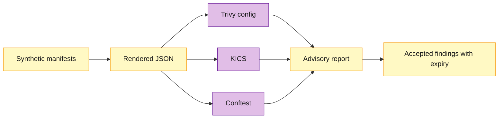

# Policy

> Advisory policy checks for rendered infrastructure configuration. Owner: varunpathania86 · Status: active

## Overview

## Quick start

- `make act-iac MODE=worktree`

## Structure

| Path | Purpose |
|---|---|
| `iac/manifests.rego` | Conftest rules for rendered manifests |
| `iac/accepted.yml` | Time-bounded advisory finding acceptance |

## Configuration

Inputs are synthetic tenant and VPS renderings. Dummy secret values have the expected shape only.
The renderer never loads a Vault password or production configuration.

## Operations

Trivy config, KICS and conftest run in advisory mode during Stage 1. New findings remain visible in
reports. Expired accepted findings are listed for correction; tool execution failures still block.

## Tests

`make act-iac MODE=worktree` validates rendered inputs and policy output. Validator and rendering unit
tests cover malformed and insecure inputs.

## Related

[CI LLD](../docs/lld/ci.md) · [Manifest LLD](../docs/lld/tenant-manifest.md) · master-plan.md §7.5
