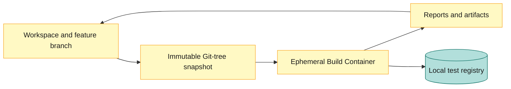

# Act orchestration

> Local Git snapshots and Build Container lifecycle for unpushed work. Owner: varunpathania86 · Status: active

## Overview

## Quick start

- `make act-build MODE=commit`
- `make act-build MODE=staged`
- `make act-build MODE=worktree`
- `make act-iac MODE=worktree`
- `make registry-up`
- `make registry-status`
- `make registry-down`

## Structure

| Path | Purpose |
|---|---|
| `act.sh` | Runs the selected workflow through Act |
| `run-build-container.sh` | Transfers a snapshot and manages the disposable Build Container |
| `python.sh` | Selects the pinned Workspace Python or fallback interpreter |
| `registry.sh` | Starts and stops the persistent local OCI registry |

## Configuration

`MODE` accepts `commit`, `staged`, `worktree` or `all`. `BASE` selects the comparison branch and
defaults to `origin/main`. The real Git index is never changed. Local publication always uses test tags.

## Operations

The source archive is mounted read-only. A disposable Build Container receives a writable `/output`
directory, returns reports and artifacts, and is destroyed. Act does not require a push. Staged and
worktree snapshots cannot produce production locks or publish to GHCR.

## Tests

`make act-build MODE=worktree` exercises the GitHub workflow locally. Snapshot unit tests prove that
staged and worktree modes leave the repository index and object database unchanged.

## Related

[CI scripts](../ci/README.md) · [CI LLD](../../docs/lld/ci.md) · [Getting started](../../docs/developer/getting-started.md)
