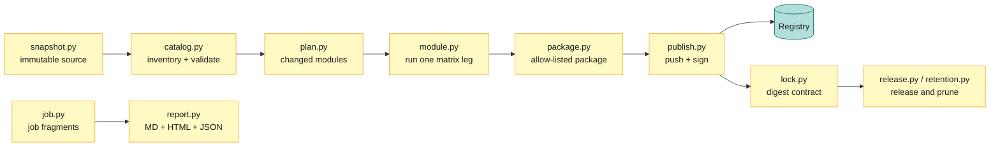

# CI scripts

> CI catalog, planning, packaging, reporting and publishing contracts. Owner: varunpathania86 · Status: active

## Overview

`render.py` feeds the advisory IaC policy path, while `github_output.py` only exports planner
results to GitHub Actions step outputs.

## Quick start

- `make container-catalog MODE=worktree`
- `make container-quality MODE=worktree`
- `make container-report WORKFLOW=build`
- `make act-build MODE=worktree`

## Structure

| Path | Purpose |
|---|---|
| `snapshot.py` / `github_output.py` | Source snapshots and workflow output |
| `catalog.py` / `plan.py` | Inventory, validation and change planning |
| `render.py` / `module.py` / `job.py` | IaC inputs and one job or matrix leg |
| `package.py` / `publish.py` | Package allow-list, registry push and signing |
| `report.py` | Markdown, HTML and JSON report aggregation |
| `lock.py` / `release.py` / `retention.py` | Digest locks, releases and pruning |

## Configuration

Inputs come from `deployments/`, `tests/tenants/`, `versions.yml` and the selected source snapshot.
Output is written only under `/output` inside the Build Container. Secrets, `vault.yml` and runtime
configuration are never package inputs.

## Operations

GitHub Actions and Act call these scripts through Make targets. The source tree is read-only. Failed,
skipped and successful jobs remain represented in report fragments. Tenant packages are allow-listed;
publication signs immutable registry digests.

## Tests

`make test-unit` covers catalog, planner, snapshot, package, lock, report and retention behaviour.
`make act-build` verifies the workflow-level contract with unpushed source.

## Related

[CI LLD](../../docs/lld/ci.md) · [Act orchestration](../act/README.md) · master-plan.md §7.5
