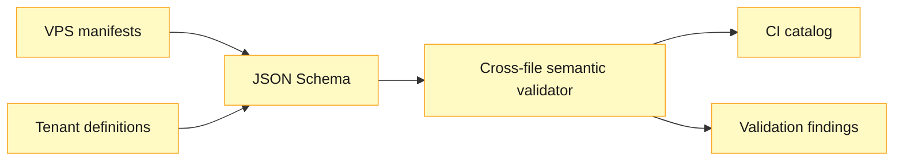

# Manifest scripts

> Schema and semantic validation for deployment and tenant configuration. Owner: varunpathania86 · Status: active

## Overview

## Quick start

- `make manifest-validate`
- `make container-catalog`
- `make test-unit`

## Structure

| Path | Purpose |
|---|---|
| `validator.py` | YAML loading, JSON Schema checks and repository relationship validation |
| `__init__.py` | Python package marker |

## Configuration

Schemas live in `deployments/schema.json` and `deployments/tenant.schema.json`. Every required key is
explicit. The validator rejects duplicate placement, capacity errors, invalid production TLS/DNS
combinations and plaintext `vault.yml`.

## Operations

Validation is offline and runs before catalog planning or future remote tasks. Errors contain stable
codes, file paths and JSON paths; Vault contents are never printed.

## Tests

`make test-unit` covers valid documents, each rejection class and capacity/version boundaries using
synthetic fixtures under `tests/unit/manifests/`.

## Related

[Manifest LLD](../../docs/lld/tenant-manifest.md) · [Deployments](../../deployments/README.md)
