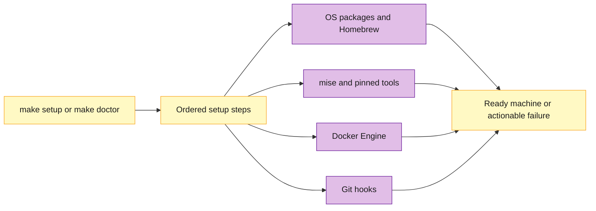

# Developer setup

> Idempotent installation and machine-readiness checks. Owner: varunpathania86 · Status: active

## Overview

## Quick start

- `make setup`
- `make doctor`

## Structure

| Path | Purpose |
|---|---|
| `setup.sh` | Runs numbered steps in order |
| `lib.sh` | Shared OS, package, version and privilege helpers |
| `steps/` | Idempotent `step_describe`, `step_check` and `step_install` functions |

## Configuration

CLI versions live in `.tool-versions`. Docker is installed by `45-docker.sh` because it cannot be
managed as an ordinary mise tool. No secrets or login tokens are installed by setup.

## Operations

`make setup` installs only missing requirements. `make doctor` uses the same checks without changing
the machine. Steps are numbered in dependency order and stop at the first failed installation.

## Tests

`make test-unit` covers the setup runner with synthetic step directories and check/install behavior.
Machine setup is verified with `make doctor`, `make setup`, then `make doctor`.

## Related

[Getting started](../../docs/developer/getting-started.md) ·
[Developer setup instructions](../../.github/instructions/dev-setup.instructions.md)
