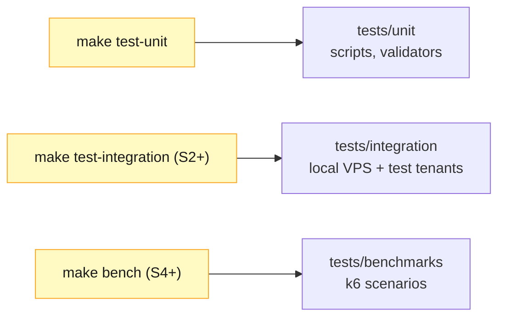

# tests

> Automated tests for the platform. Owner: varunpathania86 · Status: active (unit tests only)

## Overview

## Quick start

`make test-unit`

## Structure

| Path | Purpose |
|---|---|
| `unit/` | Python `unittest` tests for `scripts/` (git rules, docs checks); later validators and template rendering |

`integration/`, `tenants/` and `benchmarks/` are added in the stages that need them (master-plan.md §9, §12).

## Configuration

None.

## Operations

Run in CI from Stage 1 (`build.yml` → `quality`).

## Tests

Each code change adds or updates focused tests here (`.github/instructions/unit-tests.instructions.md`).

## Related

master-plan.md §9 (testing strategy and benchmarks).
