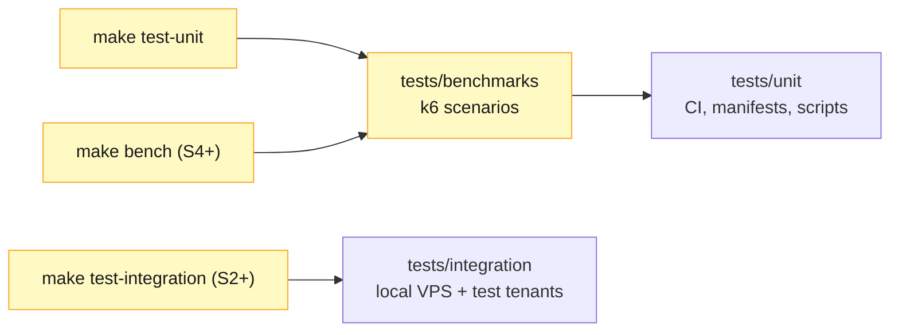

# tests

> Automated tests for the platform. Owner: varunpathania86 · Status: active (S1 CI and unit tests)

## Overview

## Quick start

`make test-unit`

## Structure

| Path | Purpose |
|---|---|
| `unit/` | Offline `unittest` coverage for CI, manifests, packages and scripts |
| `tenants/` | Two synthetic ERP and edu tenants used by catalog and package tests |
| `fixtures/` | Dummy secrets and service-free OCI build fixtures |
| `act/` | Future Act event fixtures; local runs currently use the committed branch or isolated snapshot |

`integration/` and `benchmarks/` are added by later stages.

## Configuration

Unit tests are offline and use no secrets, Docker, SSH or real tenant data. `tests/fixtures/dummy-secrets.yml`
uses schematic values for rendering.

## Operations

Run in `build.yml` → `quality`. Local `make act-build MODE=...` creates a snapshot from an unpushed
feature branch, index or isolated worktree and runs it through Act and Build Containers.

## Tests

Each code change adds or updates focused tests here (`.github/instructions/unit-tests.instructions.md`).
Build snapshot, package determinism and manifest rejection paths are covered by `tests/unit/ci/` and
`tests/unit/manifests/`.

## Related

master-plan.md §9 (testing strategy and benchmarks).
