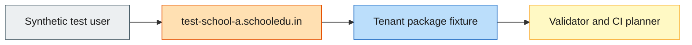

# Test School A (`test-school-a`)

> Product: edu · Apps: gibbon · Status: test-only

## Overview

## Domains

| Hostname | App | Notes |
|---|---|---|
| `test-school-a.schooledu.in` | Gibbon | Synthetic package fixture only |

## Contacts

| Role | Channel |
|---|---|
| Platform test team | Repository issue tracker |

## Placement and versions

Not selected by a production or local runtime manifest. The fixture uses the same schema as a real
school and is used only by CI package and planner tests.

## Assets and migrations

`assets/` contains synthetic branding. `migrations/0001-bootstrap.sql` creates one empty fixture table.

## Special notes

Synthetic data only. No children, staff or real school data is present.
