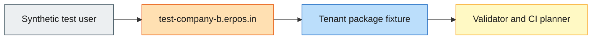

# Test Company B (`test-company-b`)

> Product: erp · Apps: erpnext · Status: test-only

## Overview

## Domains

| Hostname | App | Notes |
|---|---|---|
| `test-company-b.erpos.in` | ERPNext | Synthetic package fixture only |

## Contacts

| Role | Channel |
|---|---|
| Platform test team | Repository issue tracker |

## Placement and versions

Not selected by a production or local runtime manifest. This second ERP tenant supports path-planning
and duplicate-placement test cases.

## Assets and migrations

`assets/` contains synthetic branding. `migrations/0001-bootstrap.json` contains no customer data.

## Special notes

Synthetic data only. This tenant is never deployed to a runtime.
